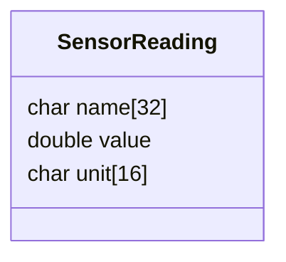
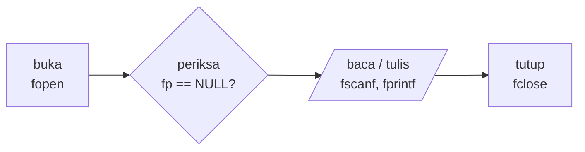
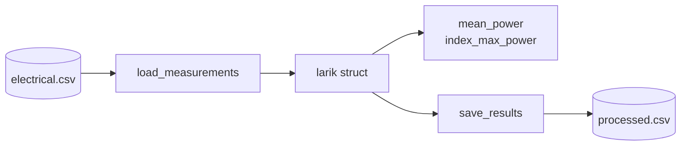

# Kuliah 7: Data Terstruktur dan Pengolahan Berkas

Larik, fungsi, *pointer*, dan *string* memungkinkan kita menyimpan banyak nilai bertipe sama dan membagi program menjadi bagian-bagian yang jelas. Namun, data teknik jarang terdiri atas satu besaran saja. Satu titik pengukuran dapat memuat waktu, temperatur, tegangan, nama sensor, dan status yang semuanya membentuk satu kesatuan. Jika setiap besaran disimpan dalam larik terpisah, program masih dapat bekerja, tetapi hubungan bahwa nilai-nilai tersebut berasal dari satu pengukuran menjadi tidak terlihat.

Selain itu, data di memori hilang ketika program selesai. Data eksperimen biasanya berasal dari berkas dan hasil analisis perlu disimpan ke berkas. Kuliah ini membahas dua hal tersebut: **data terstruktur** dengan `struct` dan **pengolahan berkas** teks, khususnya format CSV.

## Data terstruktur dengan `struct`

`struct` mengelompokkan beberapa variabel, yang boleh berbeda tipe, menjadi satu tipe baru. Setiap bagiannya disebut **anggota** (*member*). Tipe untuk satu pengukuran temperatur dapat didefinisikan sebagai

```c
struct Measurement
{
    double time;          /* s */
    double temperature;   /* C */
};
```

Definisi ini belum membuat variabel; ia hanya mendefinisikan *bentuk* data. Variabelnya dibuat dengan `struct Measurement m;`, dan anggotanya diakses dengan operator titik: `m.time = 2.5;` serta `m.temperature = 31.2;`.

Penulisan `struct Measurement` dapat disingkat dengan `typedef`, sehingga variabel cukup dideklarasikan sebagai `Measurement m;`. Bentuk `typedef struct` ini akan kita gunakan seterusnya.

```c
typedef struct
{
    double time;
    double temperature;
} Measurement;

Measurement a = {2.5, 31.2};                          /* urut sesuai anggota */
Measurement b = {.time = 3.0, .temperature = 31.9};   /* designated initializer */
```

Inisialisasi pertama mengikuti urutan anggota, sedangkan bentuk kedua (*designated initializer*) menyebutkan nama anggota secara eksplisit sehingga lebih mudah dibaca dan tidak bergantung pada urutan.

Anggota `struct` tidak harus bertipe sama. Satu rekaman pembacaan sensor dapat memuat bilangan dan teks sekaligus:



Contoh satu rekaman: `"pressure_1"`, `101.3`, `"kPa"`.

```c
typedef struct
{
    char name[32];
    double value;
    char unit[16];
} SensorReading;

SensorReading reading = {.name = "pressure_1", .value = 101.3, .unit = "kPa"};
```

Karena `name` adalah larik karakter, isinya tidak dapat diganti dengan *assignment* biasa: `reading.name = "sensor_A";` tidak valid. Gunakan `strcpy(reading.name, "sensor_A");` dari `string.h`, setelah memastikan kapasitas tujuan mencukupi.

Data terstruktur membuat hubungan antarbesaran terlihat langsung di dalam program: ketika kita melihat `m.time` dan `m.temperature`, kita tahu keduanya berasal dari pengukuran yang sama. Satu `struct` dapat dipandang sebagai satu **rekaman**, dan—seperti akan kita lihat—satu baris dalam berkas CSV.

## Larik `struct` dan fungsi

Banyak rekaman dengan bentuk yang sama disimpan dalam larik `struct`. Larik mengatur banyak rekaman, sedangkan `struct` mengatur isi setiap rekaman: `data[0].time` adalah waktu rekaman pertama dan `data[0].temperature` temperaturnya.

```c
#include <stdio.h>

typedef struct
{
    double time;
    double temperature;
} Measurement;

int main(void)
{
    Measurement data[] =
    {
        {0.0, 25.1},
        {1.0, 25.8},
        {2.0, 26.7},
        {3.0, 27.4}
    };
    int n = sizeof(data) / sizeof(data[0]);

    for (int i = 0; i < n; i++)
    {
        printf("t = %.1f s, T = %.2f C\n", data[i].time, data[i].temperature);
    }

    return 0;
}
```

```text
t = 0.0 s, T = 25.10 C
t = 1.0 s, T = 25.80 C
t = 2.0 s, T = 26.70 C
t = 3.0 s, T = 27.40 C
```

### Mengirim `struct` ke fungsi

`struct` dapat dikirim ke fungsi seperti tipe lain. Untuk `struct` kecil, pengiriman berdasarkan nilai sudah memadai. Untuk `struct` yang lebih besar, atau jika fungsi perlu mengubahnya, kita mengirim alamatnya dan mengakses anggota dengan operator panah `->`; bentuk `m->time` setara dengan `(*m).time`. Model fisika dapat dipetakan langsung ke fungsi seperti ini. Untuk data listrik dengan daya sesaat $P_i=V_iI_i$:

```c
typedef struct
{
    double time;      /* s */
    double voltage;   /* V */
    double current;   /* A */
} ElectricalMeasurement;

double power(const ElectricalMeasurement *m)
{
    return m->voltage * m->current;
}
```

Setiap rekaman menyimpan semua data yang dibutuhkan untuk satu evaluasi model.

Fungsi juga dapat *mengembalikan* `struct`. Ini berguna ketika beberapa besaran secara logis merupakan satu hasil, misalnya rentang data. Bandingkan dengan fungsi `min_max` pada Kuliah 6 yang menggunakan dua parameter *pointer*; keduanya sah, tetapi `struct` sering membuat hasil yang saling berkaitan lebih mudah dipahami.

```c
typedef struct
{
    double minimum;
    double maximum;
} Range;

Range find_range(const double data[], int n)
{
    Range result = {.minimum = data[0], .maximum = data[0]};

    for (int i = 1; i < n; i++)
    {
        if (data[i] < result.minimum) result.minimum = data[i];
        if (data[i] > result.maximum) result.maximum = data[i];
    }
    return result;
}
```

## Berkas teks: membuka, menulis, dan menutup

Larik dan `struct` hanya hidup selama program berjalan. Agar data dapat digunakan kembali, dianalisis program lain, atau diperiksa manusia, data perlu disimpan ke **berkas** (*file*). Kita berfokus pada berkas teks karena formatnya transparan, mudah diperiksa, dan cocok untuk data pengukuran.

Pustaka `stdio.h` menyediakan tipe `FILE`; program bekerja dengan *pointer* `FILE *fp` yang menyimpan informasi untuk mengelola aliran data ke atau dari berkas (bukan isi berkas itu sendiri). Setiap operasi berkas mengikuti pola empat langkah yang sama.



Fungsi `fopen(nama, mode)` membuka berkas dan mengembalikan `NULL` jika gagal. Mode dasar yang penting adalah sebagai berikut.

| Mode | Kegunaan |
|---|---|
| `"r"` | membaca berkas yang sudah ada |
| `"w"` | menulis dari awal; isi lama *dihapus* |
| `"a"` | menambahkan data pada akhir berkas; isi lama dipertahankan |

Mode `"w"` harus digunakan dengan hati-hati karena dapat menghapus data mentah yang berharga.

### Memeriksa keberhasilan `fopen`

`fopen` dapat gagal karena nama berkas salah, direktori tidak ada, atau izin akses tidak mencukupi. *Pointer* hasil `fopen` tidak boleh digunakan sebelum diperiksa. Fungsi `perror` menampilkan pesan yang menjelaskan penyebab kegagalan dari sistem operasi, sehingga lebih informatif daripada pesan umum.

```c
#include <stdio.h>

int main(void)
{
    FILE *fp = fopen("data_missing.csv", "r");

    if (fp == NULL)
    {
        perror("data_missing.csv");
        return 1;
    }

    /* baca data di sini */

    fclose(fp);
    return 0;
}
```

```text
data_missing.csv: No such file or directory
```

Setelah selesai, berkas harus ditutup dengan `fclose(fp)` agar data yang masih tertahan di *buffer* benar-benar ditulis dan sumber daya dilepaskan. Untuk berkas keluaran yang penting, nilai kembalian `fclose` (nol jika berhasil) juga dapat diperiksa.

### Menulis dengan `fprintf`

`fprintf` bekerja seperti `printf`, tetapi argumen pertamanya adalah berkas tujuan. Program berikut menulis tabel temperatur yang naik linear, $T(t)=25.0+0.8t$.

```c
#include <stdio.h>

int main(void)
{
    FILE *fp = fopen("temperature.txt", "w");
    if (fp == NULL)
    {
        perror("temperature.txt");
        return 1;
    }

    for (int i = 0; i <= 5; i++)
    {
        double time = i * 1.0;
        double temperature = 25.0 + 0.8 * time;
        fprintf(fp, "%.2f %.2f\n", time, temperature);
    }

    fclose(fp);
    printf("Data written to temperature.txt\n");

    return 0;
}
```

```text
Data written to temperature.txt
```

Isi berkas `temperature.txt` yang dihasilkan:

```text
0.00 25.00
1.00 25.80
2.00 26.60
3.00 27.40
4.00 28.20
5.00 29.00
```

Format teks sederhana ini mudah dibaca manusia dan mudah diproses kembali oleh program.

## Membaca berkas teks

`fscanf` bekerja seperti `scanf`, tetapi membaca dari berkas. Nilai kembaliannya adalah banyaknya item yang berhasil dibaca, sehingga pola pembacaan yang benar adalah mengulang *selama pembacaan berhasil*:

```c
#include <stdio.h>

int main(void)
{
    FILE *fp = fopen("temperature.txt", "r");
    if (fp == NULL)
    {
        perror("temperature.txt");
        return 1;
    }

    double time, temperature;
    double sum = 0.0;
    int n = 0;

    while (fscanf(fp, "%lf %lf", &time, &temperature) == 2)
    {
        sum += temperature;
        n++;
    }
    fclose(fp);

    if (n > 0)
    {
        printf("Records read     = %d\n", n);
        printf("Mean temperature = %.3f C\n", sum / n);
    }

    return 0;
}
```

```text
Records read     = 6
Mean temperature = 27.000 C
```

Pengulangan berhenti ketika `fscanf` tidak lagi berhasil membaca dua nilai, baik karena akhir berkas tercapai maupun karena format tidak sesuai.

Pola yang sering ditemui pemula, `while (!feof(fp))`, sebaiknya dihindari. Fungsi `feof` baru bernilai benar *setelah* suatu operasi baca mencoba melewati akhir berkas. Akibatnya, pengulangan berjalan satu kali terlalu banyak: pembacaan terakhir gagal, tetapi data lama di variabel tetap diproses sebagai rekaman tambahan. Selalu periksa hasil operasi baca itu sendiri.

Untuk membaca teks per baris, gunakan `fgets(line, sizeof(line), fp)`, yang mengembalikan `NULL` jika tidak ada lagi baris yang dapat dibaca. Pola `fgets` inilah dasar pembacaan CSV yang andal.

## Format CSV

**CSV** (*comma-separated values*) menyimpan data tabel dalam berkas teks: setiap baris adalah satu rekaman dan kolomnya dipisahkan koma. Baris pertama biasanya berisi nama kolom (*header*). Format ini dapat dibuka oleh perangkat lunak lembar kerja dan dibaca dengan mudah oleh Python (Kuliah 9). Contoh berkas data listrik `electrical.csv`:

```text
time,voltage,current
0.0,5.02,0.21
0.5,5.01,0.22
1.0,4.98,0.24
1.5,4.95,0.25
2.0,4.93,0.26
2.5,4.90,0.27
```

Sebelum menulis atau membaca CSV, tetapkan **skema** berkasnya: urutan kolom, nama kolom, dan satuannya. Nama kolom yang memuat satuan, misalnya `time_s` atau `voltage_V`, mencegah salah tafsir di kemudian hari.

### Membaca CSV dengan `fgets` dan `sscanf`

Pendekatan yang andal adalah membaca satu baris penuh dengan `fgets`, lalu menguraikannya (*parsing*) dengan `sscanf`, yang bekerja seperti `scanf` tetapi membaca dari *string*. Dengan cara ini, setiap baris diperiksa terpisah; baris yang rusak dapat ditolak tanpa mengacaukan pembacaan baris berikutnya. *Header* dilewati dengan satu `fgets` di awal. Setiap baris yang valid dipetakan ke satu `struct`, sehingga representasi data di berkas konsisten dengan representasi di memori.

Misalkan sebuah berkas data memuat beberapa baris rusak:

```text
time,voltage,current
0.0,5.02,0.21
0.5,5.01
1.0,4.98,0.24
error,sensor,timeout
1.5,4.95,0.25
```

```c
#include <stdio.h>

#define MAX_DATA 1000

typedef struct
{
    double time;
    double voltage;
    double current;
} ElectricalMeasurement;

int main(void)
{
    FILE *fp = fopen("sensor_raw.csv", "r");
    if (fp == NULL)
    {
        perror("sensor_raw.csv");
        return 1;
    }

    ElectricalMeasurement data[MAX_DATA];
    int n = 0;
    int rejected = 0;
    char line[256];

    if (fgets(line, sizeof(line), fp) == NULL)     /* lewati header */
    {
        printf("File is empty.\n");
        fclose(fp);
        return 1;
    }

    while (fgets(line, sizeof(line), fp) != NULL)
    {
        ElectricalMeasurement m;
        int matched = sscanf(line, "%lf,%lf,%lf", &m.time, &m.voltage, &m.current);

        if (matched != 3)
        {
            printf("Skipping invalid line: %s", line);
            rejected++;
            continue;
        }
        if (n >= MAX_DATA)
        {
            printf("Data capacity exceeded.\n");
            break;
        }
        data[n] = m;
        n++;
    }
    fclose(fp);

    printf("Valid records = %d, rejected = %d\n", n, rejected);
    for (int i = 0; i < n; i++)
    {
        printf("%4.1f s  %5.2f V  %5.2f A\n", data[i].time, data[i].voltage, data[i].current);
    }

    return 0;
}
```

```text
Skipping invalid line: 0.5,5.01
Skipping invalid line: error,sensor,timeout
Valid records = 3, rejected = 2
 0.0 s   5.02 V   0.21 A
 1.0 s   4.98 V   0.24 A
 1.5 s   4.95 V   0.25 A
```

Program ini menerapkan beberapa pemeriksaan sekaligus: hasil `fopen`, keberadaan *header*, banyaknya kolom yang berhasil diurai, dan kapasitas larik.

Perlu dicatat bahwa **data yang berhasil diurai belum tentu valid**. Baris `1.0,-500.0,0.2` lolos dari `sscanf`, tetapi tegangan $-500$ V mungkin mustahil untuk rangkaian $5$ V. Setelah parsing, data perlu divalidasi terhadap rentang fisis, misalnya tegangan dan arus tidak negatif serta waktu yang selalu bertambah.

## Memisahkan masukan-keluaran dan analisis

Kode yang membuka berkas, mengurai baris, dan menghitung hasil di satu tempat sulit dibaca dan diuji. Prinsip modularisasi dari Kuliah 6 diterapkan dengan memisahkan **lapisan masukan-keluaran** (I/O) dari **lapisan perhitungan**: fungsi pemuatan mengubah teks menjadi larik `struct`, fungsi analisis bekerja pada larik tanpa mengetahui asal datanya, dan fungsi penyimpanan menulis hasil.



Fungsi pemuatan berikut mengelola seluruh siklus buka–periksa–baca–tutup dan mengembalikan banyaknya rekaman valid, atau $-1$ jika berkas tidak dapat dibuka. Dengan antarmuka ini, jelas pula siapa yang bertanggung jawab menutup berkas.

```c
int load_measurements(const char filename[], ElectricalMeasurement data[], int max_data)
{
    FILE *fp = fopen(filename, "r");
    if (fp == NULL)
    {
        perror(filename);
        return -1;
    }

    char line[256];
    if (fgets(line, sizeof(line), fp) == NULL)     /* header */
    {
        fclose(fp);
        return 0;
    }

    int n = 0;
    while (n < max_data && fgets(line, sizeof(line), fp) != NULL)
    {
        ElectricalMeasurement m;
        if (sscanf(line, "%lf,%lf,%lf", &m.time, &m.voltage, &m.current) != 3)
        {
            printf("Skipping invalid line: %s", line);
            continue;
        }
        data[n] = m;
        n++;
    }

    fclose(fp);
    return n;
}
```

Pemisahan ini juga memudahkan pengujian: fungsi analisis dapat diuji dengan larik yang dibuat langsung di dalam program, tanpa perlu menyiapkan berkas.

## Studi kasus: pengolahan data listrik

Sekarang kita gabungkan `struct`, larik `struct`, pembacaan CSV, fungsi analisis, dan penulisan hasil. Dari berkas `electrical.csv` kita ingin menghitung daya setiap pengukuran, daya rata-rata, dan daya maksimum beserta waktunya, lalu menulis berkas hasil `processed.csv` dengan kolom tambahan `power`. Berkas data mentah tidak ditimpa; hasil pengolahan selalu ditulis ke berkas baru agar proses dapat diulang dan dibandingkan.

```c
#include <stdio.h>

#define MAX_DATA 1000

typedef struct
{
    double time;      /* s */
    double voltage;   /* V */
    double current;   /* A */
} ElectricalMeasurement;

int load_measurements(const char filename[], ElectricalMeasurement data[], int max_data);
double power(const ElectricalMeasurement *m);
double mean_power(const ElectricalMeasurement data[], int n);
int index_max_power(const ElectricalMeasurement data[], int n);
int save_results(const char filename[], const ElectricalMeasurement data[], int n);

int main(void)
{
    ElectricalMeasurement data[MAX_DATA];

    int n = load_measurements("electrical.csv", data, MAX_DATA);
    if (n <= 0)
    {
        printf("No valid data.\n");
        return 1;
    }

    int k = index_max_power(data, n);

    printf("Records       = %d\n", n);
    printf("Mean power    = %.4f W\n", mean_power(data, n));
    printf("Maximum power = %.4f W at t = %.1f s\n", power(&data[k]), data[k].time);

    if (save_results("processed.csv", data, n) != 0)
    {
        return 1;
    }
    printf("Results written to processed.csv\n");

    return 0;
}

int load_measurements(const char filename[], ElectricalMeasurement data[], int max_data)
{
    FILE *fp = fopen(filename, "r");
    if (fp == NULL)
    {
        perror(filename);
        return -1;
    }

    char line[256];
    if (fgets(line, sizeof(line), fp) == NULL)
    {
        fclose(fp);
        return 0;
    }

    int n = 0;
    while (n < max_data && fgets(line, sizeof(line), fp) != NULL)
    {
        ElectricalMeasurement m;
        if (sscanf(line, "%lf,%lf,%lf", &m.time, &m.voltage, &m.current) != 3)
        {
            printf("Skipping invalid line: %s", line);
            continue;
        }
        data[n] = m;
        n++;
    }

    fclose(fp);
    return n;
}

double power(const ElectricalMeasurement *m)
{
    return m->voltage * m->current;
}

double mean_power(const ElectricalMeasurement data[], int n)
{
    double sum = 0.0;
    for (int i = 0; i < n; i++)
    {
        sum += power(&data[i]);
    }
    return sum / n;
}

int index_max_power(const ElectricalMeasurement data[], int n)
{
    int index = 0;
    for (int i = 1; i < n; i++)
    {
        if (power(&data[i]) > power(&data[index]))
        {
            index = i;
        }
    }
    return index;
}

int save_results(const char filename[], const ElectricalMeasurement data[], int n)
{
    FILE *fp = fopen(filename, "w");
    if (fp == NULL)
    {
        perror(filename);
        return -1;
    }

    fprintf(fp, "time,voltage,current,power\n");
    for (int i = 0; i < n; i++)
    {
        fprintf(fp, "%.2f,%.3f,%.3f,%.5f\n",
                data[i].time, data[i].voltage, data[i].current, power(&data[i]));
    }

    if (fclose(fp) != 0)
    {
        perror(filename);
        return -1;
    }
    return 0;
}
```

```text
Records       = 6
Mean power    = 1.1990 W
Maximum power = 1.3230 W at t = 2.5 s
Results written to processed.csv
```

Isi berkas hasil:

```text
time,voltage,current,power
0.00,5.020,0.210,1.05420
0.50,5.010,0.220,1.10220
1.00,4.980,0.240,1.19520
1.50,4.950,0.250,1.23750
2.00,4.930,0.260,1.28180
2.50,4.900,0.270,1.32300
```

Fungsi `index_max_power` sengaja mengembalikan *indeks*, bukan nilai daya. Dengan indeks, kita memperoleh waktu, tegangan, arus, dan daya dari rekaman yang sama. Fungsi `power` juga digunakan ulang oleh tiga fungsi lain.

Hasilnya perlu diperiksa kewajarannya. Daya sekitar $1$–$1.3$ W wajar untuk beban kecil pada catu $5$ V. Tegangan yang sedikit menurun ketika arus naik konsisten dengan adanya hambatan dalam sumber. Format numerik `%.5f` pada kolom daya dipilih agar presisi hasil sebanding dengan presisi data masukan (tiga angka penting); menulis lebih banyak digit tidak menambah informasi.

### Mode tambah untuk catatan pengukuran

Mode `"a"` menambahkan data di akhir berkas tanpa menghapus isi lama, sehingga cocok untuk catatan (*log*) pengukuran yang terus bertambah. Program berikut menambahkan satu baris setiap kali dijalankan.

```c
#include <stdio.h>
#include <string.h>

int main(void)
{
    char experiment[64];
    double value;

    printf("Experiment name: ");
    fgets(experiment, sizeof(experiment), stdin);
    experiment[strcspn(experiment, "\n")] = '\0';
    printf("Measured value: ");
    scanf("%lf", &value);

    FILE *fp = fopen("experiment.log", "a");
    if (fp == NULL)
    {
        perror("experiment.log");
        return 1;
    }
    fprintf(fp, "%s,%.4f\n", experiment, value);
    fclose(fp);

    return 0;
}
```

Program dijalankan dua kali:

```text
Experiment name: kalibrasi-1
Measured value: 1.0012
```

```text
Experiment name: kalibrasi-2
Measured value: 0.9987
```

Isi `experiment.log` setelah kedua eksekusi menunjukkan bahwa data lama tidak terhapus:

```text
kalibrasi-1,1.0012
kalibrasi-2,0.9987
```

## Kesalahan umum dan kebiasaan yang baik

- **Salah anggota atau tidak menginisialisasi anggota.** Gunakan *designated initializer* agar setiap anggota jelas nilainya.
- **Menyalin *string* dengan `=`.** Gunakan `strcpy` dan periksa kapasitas.
- **Tidak memeriksa `fopen`.** Menggunakan `NULL` sebagai `FILE *` menyebabkan program berhenti tiba-tiba.
- **Mode yang salah.** Membuka berkas data mentah dengan `"w"` menghapus isinya.
- **Lupa menutup berkas.** Data dapat tertahan di *buffer* dan tidak tertulis.
- **Mengabaikan hasil pembacaan** atau menggunakan `while (!feof(fp))`. Periksa nilai kembalian `fscanf`, `fgets`, dan `sscanf`.
- **Tidak memeriksa kapasitas larik** saat memuat data dari berkas yang ukurannya tidak diketahui.
- **Menganggap data valid karena berhasil diurai.** Validasi rentang fisis tetap diperlukan.

Kebiasaan yang dianjurkan: rancang skema berkas (kolom, urutan, satuan) sebelum menulis kode; jangan menimpa data mentah; pisahkan fungsi I/O dari fungsi analisis; laporkan baris yang ditolak; gunakan presisi keluaran yang sesuai dengan presisi data; dan periksa isi berkas hasil secara manual setidaknya sekali.

## Cek pemahaman

- Apa keuntungan `struct` dibandingkan beberapa larik terpisah?
- Apa perbedaan operator `.` dan `->`?
- Apa fungsi `typedef` dan *designated initializer*?
- Mengapa anggota *string* tidak dapat diisi dengan `=`?
- Apa empat langkah pola operasi berkas? Apa perbedaan mode `"r"`, `"w"`, dan `"a"`?
- Mengapa hasil `fopen` harus diperiksa, dan apa kegunaan `perror`?
- Mengapa `while (!feof(fp))` bukan pola pembacaan yang baik?
- Mengapa membaca CSV dengan `fgets` lalu `sscanf` lebih andal daripada `fscanf` langsung?
- Mengapa data yang berhasil diurai masih perlu divalidasi?
- Apa keuntungan memisahkan fungsi I/O dari fungsi analisis?

## Latihan

1. **`struct` gerak lurus.** Buat `struct MotionSample` dengan anggota waktu, posisi, dan kecepatan. Buat larik berisi sekurang-kurangnya lima sampel, tampilkan sebagai tabel, dan tambahkan fungsi yang menghitung energi kinetik satu sampel jika massa diberikan sebagai parameter.
1. **Eksperimen kalor.** Buat tipe `ThermalSample` (waktu, temperatur). Baca $N$ data ke larik `struct`, lalu cari temperatur minimum, maksimum, dan waktu terjadinya maksimum dengan fungsi terpisah. Tolak $N\le0$ dan $N$ yang melebihi kapasitas.
1. **Data pegas ke berkas.** Baca konstanta $k$, hitung $F=-kx$ untuk beberapa nilai $x$, dan tulis hasilnya ke `spring.csv` dengan kolom `x_m,force_N`. Periksa hasil `fopen` dan `fclose`, lalu buka berkas secara manual untuk memeriksa formatnya.
1. **Posisi dari CSV.** Baca `motion.csv` (kolom `time_s,position_m`) ke larik `MotionSample`, hitung kecepatan rata-rata setiap interval, dan tulis `velocity.csv` dengan kolom `time_start,time_end,velocity`. Tolak baris rusak dan selang waktu yang tidak positif.
1. **Energi listrik.** Dari `electrical.csv`, hitung energi $E\approx\sum_iP_i\Delta t_i$ dengan $\Delta t_i$ diambil dari data, bukan diasumsikan tetap. Periksa terlebih dahulu bahwa waktu bertambah monoton.
1. **Intensitas relatif.** Baca berkas `time,intensity`, cari intensitas maksimum beserta waktunya, lalu tulis berkas baru dengan kolom tambahan `relative_intensity` $=I_i/I_{\max}$. Tangani kasus ketika maksimum tidak positif.
1. **Parser dengan baris rusak.** Siapkan berkas berisi baris valid dan tidak valid. Hitung banyaknya baris valid dan tidak valid secara terpisah, dan hanya simpan baris valid ke larik `struct`. Tambahkan validasi rentang fisis setelah parsing.
1. **Catatan eksperimen.** Kembangkan program mode tambah pada kuliah ini sehingga setiap baris juga memuat nomor urut pengukuran. Jalankan beberapa kali dan verifikasi bahwa data lama tidak terhapus. Apa yang terjadi jika mode diganti menjadi `"w"`?
1. **Metadata dan data.** Tulis `info.txt` (nama eksperimen, operator, satuan) dan `data.csv` (data numerik), lalu baca kembali `info.txt` untuk menampilkan metadata. Diskusikan keuntungan dan kelemahan memisahkan metadata dari data numerik.
1. **Proyek mini: *pipeline* data ayunan.** Rancang format CSV `time_s,angle_deg` untuk data pendulum. Buat program dengan sekurang-kurangnya tiga fungsi selain `main` yang membaca dan memvalidasi data, mencari sudut maksimum absolut, menghitung rata-rata sudut dan banyaknya data dengan $|\theta|>10^\circ$, lalu menulis ringkasan ke `summary.txt`. Jelaskan alasan pembagian fungsinya.

## Rangkuman

- `struct` mengelompokkan data yang berkaitan menjadi satu rekaman; anggotanya diakses dengan `.` atau, melalui *pointer*, dengan `->`. `typedef` menyederhanakan nama tipe.
- Larik `struct` menyimpan banyak rekaman; fungsi dapat menerima `struct` (sebaiknya melalui *pointer* `const`) maupun mengembalikannya.
- Operasi berkas mengikuti pola buka–periksa–baca/tulis–tutup. Mode `"r"` membaca, `"w"` menulis ulang, dan `"a"` menambahkan.
- Hasil `fopen` harus diperiksa; `perror` menjelaskan penyebab kegagalan. Pembacaan diulang selama fungsi baca berhasil, bukan dengan `while (!feof(fp))`.
- CSV dibaca baris demi baris dengan `fgets`, diurai dengan `sscanf`, dan setiap baris valid dipetakan ke satu `struct`. Data yang berhasil diurai tetap perlu divalidasi.
- Memisahkan fungsi I/O dari fungsi analisis membuat program lebih mudah dibaca, diuji, dan digunakan kembali. Data mentah tidak ditimpa; hasil ditulis ke berkas baru.
- Kuliah berikutnya mengintegrasikan semua konsep C yang telah dipelajari dalam satu program utuh untuk kasus Teknik Fisika, lengkap dengan pengujian dan pemeriksaan hasil.
