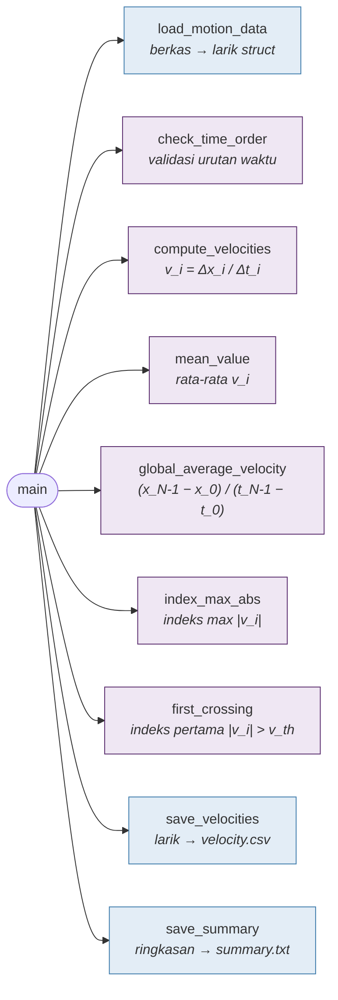

# Kuliah 8: Integrasi Pemrograman C untuk Kasus Teknik Fisika

Kuliah-kuliah sebelumnya memperkenalkan konsep C satu per satu: variabel dan ekspresi, percabangan dan pengulangan, pola iteratif, larik dan fungsi, `struct`, serta pengolahan berkas. Dalam praktik, konsep-konsep tersebut tidak muncul sendiri-sendiri. Program analisis data eksperimen harus membaca berkas, memvalidasi data, menyimpan rekaman, menghitung besaran fisis, mencari kondisi tertentu, menulis hasil, *dan* meyakinkan kita bahwa hasilnya benar.

Kuliah ini membangun *satu* program utuh untuk satu persoalan, dari perumusan masalah sampai pengujian. Tujuannya bukan memperkenalkan sintaks baru, melainkan melatih cara menyusun program yang dapat dipercaya. Alurnya mengikuti kerangka yang sudah kita kenal sejak Kuliah 1, kini dalam bentuk yang lebih lengkap:

```math
\begin{aligned}
&\text{masalah}\rightarrow\text{model}\rightarrow\text{rancangan}\rightarrow{}\\
&\qquad\text{implementasi bertahap}\rightarrow\text{pengujian}\rightarrow\text{pemeriksaan fisis}
\end{aligned}
```

## Persoalan: eksperimen gerak satu dimensi

Sebuah sensor posisi merekam gerak benda di sepanjang lintasan lurus. Hasilnya adalah berkas `Data/motion.csv` dengan dua kolom, waktu (s) dan posisi (m):

```text
time_s,position_m
0.00,0.400000
0.50,1.087500
1.00,1.950000
1.50,2.987500
2.00,4.200000
2.50,5.587500
3.00,7.150000
3.50,8.887500
4.00,10.800000
4.50,12.887500
5.00,15.150000
```

Dari data tersebut kita ingin mengetahui bagaimana kecepatan benda berubah, berapa kecepatan rata-ratanya, kapan kecepatan terbesar terjadi, dan kapan kecepatan pertama kali melampaui suatu ambang, misalnya $3.0$ m/s.

### Model dan spesifikasi

Data terdiri atas pasangan $(t_i,x_i)$ dengan $i=0,1,\ldots,N-1$. Kecepatan rata-rata pada interval antara dua sampel berurutan adalah

```math
v_i=\frac{x_{i+1}-x_i}{t_{i+1}-t_i},\qquad i=0,1,\ldots,N-2.
```

Dari $N$ sampel diperoleh $N-1$ interval; hubungan ini langsung menentukan ukuran larik kecepatan dan batas pengulangan. Rumus tersebut hanya bermakna jika $t_{i+1}>t_i$, sehingga **waktu harus naik secara ketat**; dua waktu yang sama akan menghasilkan pembagian dengan nol, dan waktu yang mundur tidak bermakna fisis.

Spesifikasi program adalah sebagai berikut.

| Aspek | Uraian |
|---|---|
| **Masukan** | berkas CSV `time_s,position_m`; ambang kecepatan $v_{\text{th}}$ |
| **Prakondisi** | minimal dua sampel valid; waktu naik secara ketat |
| **Keluaran** | banyaknya sampel; kecepatan setiap interval; rata-rata kecepatan interval; kecepatan rata-rata global; kecepatan maksimum absolut beserta intervalnya; interval pertama dengan $\|v_i\|>v_{\text{th}}$ |
| **Berkas hasil** | `velocity.csv` (kecepatan per interval) dan `summary.txt` (ringkasan) |

## Rancangan program

### Dekomposisi dan tanggung jawab fungsi

Persoalan dipecah menjadi fungsi-fungsi dengan satu tanggung jawab masing-masing. Fungsi `main` hanya mengatur alur: memanggil fungsi, memeriksa hasilnya, dan menghentikan program jika ada kesalahan.



Fungsi berwarna biru muda bekerja dengan berkas (lapisan I/O); fungsi berwarna ungu muda hanya bekerja pada data di memori (lapisan analisis). Dengan pemisahan ini, jika kecepatan yang dihitung salah, kita cukup memeriksa `compute_velocities` tanpa menelusuri kode pembacaan berkas.

### Struktur data, kapasitas, dan prakondisi

Satu baris CSV dipetakan ke satu rekaman:

```c
#include <stdio.h>
#include <math.h>

#define MAX_SAMPLES 1000

typedef struct
{
    double time;       /* s */
    double position;   /* m */
} MotionSample;
```

Kapasitas `MAX_SAMPLES` ditetapkan sebagai konstanta dan diperiksa setiap kali data ditambahkan, sehingga berkas yang lebih panjang dari dugaan tidak menyebabkan akses di luar batas larik.

Setiap fungsi mempunyai **prakondisi** (apa yang harus benar sebelum dipanggil) dan **pascakondisi** (apa yang dijamin setelahnya), seperti dibahas pada Kuliah 2. Misalnya, `compute_velocities` mensyaratkan $n\ge2$ dan waktu yang naik secara ketat, dan menjamin larik kecepatan berisi tepat $n-1$ nilai. Prakondisi dituliskan sebagai komentar di atas fungsi, dan `main` bertanggung jawab memastikan prakondisi terpenuhi sebelum memanggilnya. Parameter larik yang hanya dibaca diberi `const`, sehingga aliran data terlihat dari prototipe: data masuk melalui parameter `const`, hasil keluar melalui nilai kembalian atau larik tanpa `const`.

## Implementasi bertahap: membaca dan memvalidasi data

Program sebesar ini sebaiknya tidak ditulis sekaligus lalu dikompilasi di akhir. Cara yang jauh lebih aman adalah membangunnya **bertahap**: tulis satu fungsi, kompilasi, uji dengan data kecil, baru lanjut ke fungsi berikutnya. Jika muncul kesalahan, penyebabnya hampir pasti berada pada bagian yang baru ditambahkan.

Tahap pertama adalah membaca data. Fungsi berikut mengikuti pola Kuliah 7, dengan satu tambahan penting: **pesan kesalahan yang informatif**. Pesan "Invalid line" saja menyulitkan pengguna mencari kesalahan dalam berkas berisi ribuan baris; menyebutkan nama berkas dan nomor baris membuat data bermasalah dapat dilacak.

```c
/* Membaca CSV time_s,position_m ke larik data.
   Mengembalikan banyaknya sampel valid, atau -1 jika berkas gagal dibuka. */
int load_motion_data(const char filename[], MotionSample data[], int max_samples)
{
    FILE *fp = fopen(filename, "r");
    if (fp == NULL)
    {
        perror(filename);
        return -1;
    }

    char line[256];
    int line_number = 1;
    int n = 0;

    if (fgets(line, sizeof(line), fp) == NULL)          /* header */
    {
        fclose(fp);
        return 0;
    }

    while (fgets(line, sizeof(line), fp) != NULL)
    {
        line_number++;
        MotionSample s;

        if (sscanf(line, "%lf,%lf", &s.time, &s.position) != 2)
        {
            printf("%s:%d: invalid line ignored\n", filename, line_number);
            continue;
        }
        if (n >= max_samples)
        {
            printf("%s:%d: capacity of %d samples exceeded\n",
                   filename, line_number, max_samples);
            break;
        }
        data[n] = s;
        n++;
    }

    fclose(fp);
    return n;
}
```

Tahap kedua memeriksa prakondisi fisis: waktu harus naik secara ketat. Fungsi ini sengaja *hanya memeriksa*, tidak mengubah data. Memisahkan validasi dari manipulasi data membuat program lebih mudah dipahami; jika validasi sekaligus "memperbaiki" data secara diam-diam, kita kehilangan jejak tentang apa yang sebenarnya diukur.

```c
/* Mengembalikan -1 jika waktu naik secara ketat,
   atau indeks i pertama dengan t[i+1] <= t[i]. */
int check_time_order(const MotionSample data[], int n)
{
    for (int i = 0; i < n - 1; i++)
    {
        if (data[i + 1].time <= data[i].time)
        {
            return i;
        }
    }
    return -1;
}
```

Fungsi mengembalikan *indeks* masalah pertama, bukan sekadar "benar/salah", sehingga pesan kesalahan dapat menunjukkan lokasinya. Pada tahap ini kita sudah dapat menulis `main` sementara yang hanya memuat data, menampilkan banyaknya sampel, dan memeriksa urutan waktu—lalu mengujinya sebelum melanjutkan.

## Implementasi bertahap: analisis

### Kecepatan setiap interval

```c
/* Prakondisi: n >= 2 dan waktu naik secara ketat.
   Pascakondisi: velocity[0..n-2] berisi kecepatan setiap interval. */
void compute_velocities(const MotionSample data[], int n, double velocity[])
{
    for (int i = 0; i < n - 1; i++)
    {
        double dx = data[i + 1].position - data[i].position;
        double dt = data[i + 1].time - data[i].time;
        velocity[i] = dx / dt;
    }
}
```

### Dua jenis kecepatan rata-rata

Ada dua besaran yang sama-sama dapat disebut "kecepatan rata-rata", dan keduanya tidak selalu sama. **Rata-rata aritmetika** kecepatan interval memberi bobot yang sama pada setiap interval,

```math
\overline{v}=\frac{1}{M}\sum_{i=0}^{M-1}v_i,\qquad M=N-1,
```

sedangkan **kecepatan rata-rata global** menghubungkan perpindahan total dengan waktu total,

```math
v_{\text{global}}=\frac{x_{N-1}-x_0}{t_{N-1}-t_0}.
```

Kecepatan rata-rata global adalah besaran yang dimaksud dalam fisika: ia setara dengan rata-rata $v_i$ yang dibobot oleh lamanya interval, $\sum v_i\Delta t_i/\sum\Delta t_i$. Jika semua $\Delta t_i$ sama, keduanya identik; jika selang waktu tidak seragam, keduanya dapat berbeda. Kita menghitung keduanya karena perbandingannya juga berguna sebagai pemeriksaan konsistensi.

```c
/* Prakondisi: m > 0. */
double mean_value(const double values[], int m)
{
    double sum = 0.0;
    for (int i = 0; i < m; i++)
    {
        sum += values[i];
    }
    return sum / m;
}

/* Prakondisi: n >= 2 dan waktu naik secara ketat. */
double global_average_velocity(const MotionSample data[], int n)
{
    double dx = data[n - 1].position - data[0].position;
    double dt = data[n - 1].time - data[0].time;
    return dx / dt;
}
```

### Pencarian nilai ekstrem dan kondisi

Fungsi pencarian mengembalikan *indeks*, bukan nilai. Dengan indeks, kita dapat memperoleh waktu awal, waktu akhir, posisi, dan kecepatan dari interval yang sama. Nilai $-1$ digunakan sebagai penanda "tidak ditemukan", karena tidak ada indeks larik yang bernilai negatif.

```c
/* Prakondisi: m > 0. Indeks elemen dengan nilai absolut terbesar. */
int index_max_abs(const double values[], int m)
{
    int index = 0;
    for (int i = 1; i < m; i++)
    {
        if (fabs(values[i]) > fabs(values[index]))
        {
            index = i;
        }
    }
    return index;
}

/* Indeks pertama dengan |values[i]| > threshold, atau -1 jika tidak ada. */
int first_crossing(const double values[], int m, double threshold)
{
    for (int i = 0; i < m; i++)
    {
        if (fabs(values[i]) > threshold)
        {
            return i;
        }
    }
    return -1;
}
```

Fungsi `first_crossing` berhenti segera setelah kondisi ditemukan; tidak perlu memeriksa sisa data.

## Program utuh

### Menulis hasil

Hasil ditulis ke dua berkas baru. Data mentah tidak pernah ditimpa, dan berkas hasil diberi *header* yang menyertakan satuan.

```c
int save_velocities(const char filename[], const MotionSample data[],
                    const double velocity[], int n)
{
    FILE *fp = fopen(filename, "w");
    if (fp == NULL)
    {
        perror(filename);
        return -1;
    }

    fprintf(fp, "time_start_s,time_end_s,velocity_m_per_s\n");
    for (int i = 0; i < n - 1; i++)
    {
        fprintf(fp, "%.2f,%.2f,%.4f\n", data[i].time, data[i + 1].time, velocity[i]);
    }

    return (fclose(fp) == 0) ? 0 : -1;
}

int save_summary(const char filename[], const char source[], int n,
                 double v_mean, double v_global, double v_max, double t_max)
{
    FILE *fp = fopen(filename, "w");
    if (fp == NULL)
    {
        perror(filename);
        return -1;
    }

    fprintf(fp, "source file             : %s\n", source);
    fprintf(fp, "samples                 : %d\n", n);
    fprintf(fp, "mean interval velocity  : %.4f m/s\n", v_mean);
    fprintf(fp, "global average velocity : %.4f m/s\n", v_global);
    fprintf(fp, "maximum |v|             : %.4f m/s (interval starting at %.2f s)\n",
            v_max, t_max);

    return (fclose(fp) == 0) ? 0 : -1;
}
```

Ringkasan menyertakan nama berkas sumber. Kebiasaan kecil ini menjaga **keterlacakan** (*traceability*): setiap hasil dapat ditelusuri kembali ke data asalnya.

### Fungsi `main` sebagai pengatur alur

Fungsi `main` menyusun semua fungsi di atas. Perhatikan bahwa setiap tahap diperiksa hasilnya, dan program berhenti dengan pesan yang jelas segera setelah prakondisi tahap berikutnya tidak terpenuhi—menghitung kecepatan dari data dengan waktu yang mundur hanya akan menghasilkan angka yang menyesatkan.

```c
int main(void)
{
    const char *input_file = "Data/motion.csv";
    const double threshold = 3.0;              /* m/s */

    MotionSample data[MAX_SAMPLES];
    double velocity[MAX_SAMPLES];

    int n = load_motion_data(input_file, data, MAX_SAMPLES);
    if (n < 2)
    {
        printf("Need at least two valid samples (found %d).\n", n);
        return 1;
    }

    int bad = check_time_order(data, n);
    if (bad >= 0)
    {
        printf("Time does not increase between samples %d and %d.\n", bad, bad + 1);
        return 1;
    }

    compute_velocities(data, n, velocity);
    int m = n - 1;

    double v_mean = mean_value(velocity, m);
    double v_global = global_average_velocity(data, n);
    int k_max = index_max_abs(velocity, m);
    int k_cross = first_crossing(velocity, m, threshold);

    printf("Samples                 : %d (%d intervals)\n", n, m);
    printf("Mean interval velocity  : %.4f m/s\n", v_mean);
    printf("Global average velocity : %.4f m/s\n", v_global);
    printf("Maximum |v|             : %.4f m/s in [%.2f, %.2f] s\n",
           fabs(velocity[k_max]), data[k_max].time, data[k_max + 1].time);
    if (k_cross >= 0)
    {
        printf("|v| > %.1f m/s first in  : [%.2f, %.2f] s\n",
               threshold, data[k_cross].time, data[k_cross + 1].time);
    }
    else
    {
        printf("|v| never exceeds %.1f m/s\n", threshold);
    }

    if (save_velocities("velocity.csv", data, velocity, n) != 0 ||
        save_summary("summary.txt", input_file, n, v_mean, v_global,
                     fabs(velocity[k_max]), data[k_max].time) != 0)
    {
        return 1;
    }

    return 0;
}
```

Program lengkap terdiri atas definisi tipe dan semua fungsi pada subbab-subbab sebelumnya, diikuti `main` ini. Setelah dikompilasi dan dijalankan:

```text
Samples                 : 11 (10 intervals)
Mean interval velocity  : 2.9500 m/s
Global average velocity : 2.9500 m/s
Maximum |v|             : 4.5250 m/s in [4.50, 5.00] s
|v| > 3.0 m/s first in  : [2.50, 3.00] s
```

Isi `velocity.csv`:

```text
time_start_s,time_end_s,velocity_m_per_s
0.00,0.50,1.3750
0.50,1.00,1.7250
1.00,1.50,2.0750
1.50,2.00,2.4250
2.00,2.50,2.7750
2.50,3.00,3.1250
3.00,3.50,3.4750
3.50,4.00,3.8250
4.00,4.50,4.1750
4.50,5.00,4.5250
```

Isi `summary.txt`:

```text
source file             : Data/motion.csv
samples                 : 11
mean interval velocity  : 2.9500 m/s
global average velocity : 2.9500 m/s
maximum |v|             : 4.5250 m/s (interval starting at 4.50 s)
```

## Pengujian program

Keluaran di atas tampak masuk akal, tetapi bagaimana kita *tahu* bahwa program benar? Mencoba satu berkas data nyata tidak cukup, karena kita tidak mengetahui jawaban yang tepat untuk data tersebut. Strategi yang andal adalah menguji setiap fungsi dengan **data sintetis** yang jawabannya dapat diturunkan secara analitik, termasuk **kasus batas**.

| Kasus uji | Hasil yang diharapkan |
|---|---|
| posisi konstan, $x_i=2$ | semua $v_i=0$ |
| kecepatan konstan, $x_i=1+3t_i$ | semua $v_i=3$; $\overline v=v_{\text{global}}=3$ |
| percepatan konstan, $x=\frac12at^2$ | $v_i=a\,\bar t_i$ dengan $\bar t_i$ titik tengah interval |
| gerak mundur, $x_i=-2t_i$ | $v_i=-2$; maksimum absolut $2$, bukan $-2$ |
| waktu tidak naik | `check_time_order` menunjuk interval yang salah |
| $\Delta t$ tidak seragam | $\overline v\neq v_{\text{global}}$ secara umum |
| ambang tidak pernah terlampaui | `first_crossing` mengembalikan $-1$ |

Kasus percepatan konstan sangat informatif. Untuk $x(t)=\frac12at^2$,

```math
v_i=\frac{\frac12a(t_{i+1}^2-t_i^2)}{t_{i+1}-t_i}=\frac12a(t_{i+1}+t_i)=a\,\bar t_i,
```

sehingga kecepatan interval *tepat* sama dengan kecepatan sesaat di titik tengah interval. Ini memberikan jawaban eksak yang dapat dibandingkan dengan hasil program.

Pengujian dapat diotomatiskan dengan program uji kecil. Fungsi `check` berikut mencetak `PASS` atau `FAIL`; hasil *floating-point* dibandingkan dengan toleransi, bukan kesamaan eksak.

```c
int failures = 0;

void check(const char *name, int condition)
{
    printf("[%s] %s\n", condition ? "PASS" : "FAIL", name);
    if (!condition)
    {
        failures++;
    }
}

int close_to(double a, double b)
{
    return fabs(a - b) < 1e-9;
}

int main(void)
{
    double v[10];

    MotionSample still[] = {{0.0, 2.0}, {1.0, 2.0}, {2.0, 2.0}};
    compute_velocities(still, 3, v);
    check("constant position gives v = 0", close_to(v[0], 0.0) && close_to(v[1], 0.0));

    MotionSample uniform[] = {{0.0, 1.0}, {0.5, 2.5}, {1.5, 5.5}, {2.0, 7.0}};
    compute_velocities(uniform, 4, v);
    check("constant velocity gives v = 3",
          close_to(v[0], 3.0) && close_to(v[1], 3.0) && close_to(v[2], 3.0));
    check("global velocity = 3", close_to(global_average_velocity(uniform, 4), 3.0));

    MotionSample accel[] = {{0.0, 0.0}, {1.0, 1.0}, {2.0, 4.0}, {3.0, 9.0}};  /* a = 2 */
    compute_velocities(accel, 4, v);
    check("constant acceleration: v = a * t_mid",
          close_to(v[0], 1.0) && close_to(v[1], 3.0) && close_to(v[2], 5.0));

    MotionSample backward[] = {{0.0, 0.0}, {1.0, -2.0}, {2.0, -4.0}};
    compute_velocities(backward, 3, v);
    check("maximum |v| keeps sign information", close_to(fabs(v[index_max_abs(v, 2)]), 2.0));

    MotionSample bad_time[] = {{0.0, 0.0}, {1.0, 1.0}, {1.0, 2.0}, {2.0, 3.0}};
    check("repeated time is detected at interval 1", check_time_order(bad_time, 4) == 1);

    MotionSample uneven[] = {{0.0, 0.0}, {1.0, 1.0}, {4.0, 10.0}};
    compute_velocities(uneven, 3, v);
    check("uneven dt: mean != global",
          !close_to(mean_value(v, 2), global_average_velocity(uneven, 3)));

    check("threshold never crossed returns -1", first_crossing(v, 2, 100.0) == -1);

    printf("%d test(s) failed\n", failures);
    return failures == 0 ? 0 : 1;
}
```

```text
[PASS] constant position gives v = 0
[PASS] constant velocity gives v = 3
[PASS] global velocity = 3
[PASS] constant acceleration: v = a * t_mid
[PASS] maximum |v| keeps sign information
[PASS] repeated time is detected at interval 1
[PASS] uneven dt: mean != global
[PASS] threshold never crossed returns -1
0 test(s) failed
```

Semua uji lolos. Kasus $\Delta t$ tidak seragam memperlihatkan perbedaan dua jenis kecepatan rata-rata: interval pertama ($v_0=1$ m/s, $\Delta t=1$ s) dan kedua ($v_1=3$ m/s, $\Delta t=3$ s) memberi $\overline v=2$ m/s, sedangkan $v_{\text{global}}=10/4=2.5$ m/s.

Selain fungsi analisis, fungsi I/O juga perlu diuji dengan berkas kecil buatan sendiri: berkas yang tidak ada, berkas kosong, berkas hanya berisi *header*, berkas dengan baris rusak, dan berkas dengan satu sampel saja. Untuk setiap kasus, tentukan dahulu perilaku yang diharapkan, lalu periksa apakah program berperilaku demikian. Misalnya, berkas dengan satu sampel harus menghasilkan pesan yang jelas, bukan pembagian dengan nol.

## Memeriksa hasil secara fisis

Lolos uji belum menjamin hasil bermakna untuk data nyata. Pemeriksaan fisis merupakan lapisan pertahanan terakhir.

- **Dimensi.** $[v]=[\Delta x]/[\Delta t]=\text{m}/\text{s}$. Jika kolom waktu ternyata dalam milidetik, semua kecepatan menjadi seribu kali terlalu kecil.
- **Orde besaran.** Kecepatan beberapa meter per sekon wajar untuk troli di lintasan laboratorium; nilai ribuan meter per sekon pasti menandakan kesalahan.
- **Tanda.** Kecepatan negatif berarti benda bergerak ke arah $x$ negatif. Itulah sebabnya pencarian maksimum menggunakan nilai absolut.
- **Konsistensi internal.** Jumlah perpindahan setiap interval harus sama dengan perpindahan total, $\sum v_i\Delta t_i=x_{N-1}-x_0$. Untuk data kita, $15.15-0.40=14.75$ m.
- **Kesesuaian dengan model.** Kecepatan pada `velocity.csv` naik sebesar $0.35$ m/s setiap $0.5$ s, sehingga percepatannya konstan, $a=0.35/0.5=0.7$ m/s$^2$. Dengan hasil pengujian di atas, $v_i=v_0+a\bar t_i$; interval pertama ($\bar t=0.25$ s, $v=1.375$ m/s) memberikan $v_0=1.375-0.7(0.25)=1.2$ m/s. Data sesuai dengan model $x(t)=0.4+1.2t+0.35t^2$.

Data eksperimen nyata selalu mengandung **derau** (*noise*). Karena kecepatan dihitung dari *selisih* posisi, derau posisi diperbesar: galat posisi $\delta x$ menghasilkan galat kecepatan sekitar $\delta x/\Delta t$. Dengan $\delta x=1$ mm dan $\Delta t=0.5$ s, galat kecepatan hanya $2$ mm/s; tetapi dengan $\Delta t=1$ ms galatnya menjadi $1$ m/s. Data `motion.csv` di atas dibangkitkan dari model tanpa derau, sehingga pola kecepatannya sangat teratur; pada data nyata, kecepatan akan berfluktuasi di sekitar garis lurus.

Ketika hasil tampak janggal, pisahkan dua kemungkinan penyebab: **kesalahan data** (sensor bermasalah, satuan salah, baris rusak) atau **kesalahan program**. Program yang telah lolos uji dengan data sintetis memperkecil kemungkinan kedua, sehingga perhatian dapat dipusatkan pada data. Untuk itu, hasil juga perlu **dapat direproduksi**: catat berkas masukan, parameter (seperti ambang kecepatan), dan versi program, sehingga orang lain—atau kita sendiri beberapa bulan kemudian—memperoleh hasil yang sama dari data yang sama.

## Pola umum dan kesalahan umum

### Pola yang dapat digunakan kembali

Struktur program studi kasus ini berlaku untuk banyak persoalan Teknik Fisika lain; yang berubah hanyalah `struct`, model, dan fungsi analisisnya.

| Kasus | Rekaman | Analisis khas |
|---|---|---|
| gerak lurus | $(t,x)$ | $v_i=\Delta x/\Delta t$, maksimum, ambang |
| rangkaian listrik | $(t,V,I)$ | $P=VI$, energi $\sum P\Delta t$ |
| pendinginan benda | $(t,T)$ | laju $\Delta T/\Delta t$, waktu mencapai ambang |
| intensitas cahaya | $(x,I)$ | puncak, lebar pada setengah maksimum |
| osilasi | $(t,y)$ | amplitudo, RMS, perpotongan nol |

Dari sisi efisiensi, setiap fungsi analisis menelusuri data satu kali, sehingga keseluruhan program berkompleksitas waktu $O(N)$ dengan memori $O(N)$ untuk larik. Beberapa pengulangan sebenarnya dapat digabung menjadi satu, atau data dapat diproses secara *streaming* seperti Kuliah 5 dengan memori $O(1)$. Namun, untuk data berukuran ribuan sampel, perbedaan kinerjanya tidak berarti, sedangkan fungsi-fungsi kecil yang terpisah jauh lebih mudah dipahami dan diuji. Penggabungan baru layak dipertimbangkan jika data sangat besar dan pengukuran menunjukkan bahwa program memang terlalu lambat.

### Kesalahan umum pada program terintegrasi

- **Menulis seluruh program sekaligus**, lalu menghadapi puluhan pesan galat tanpa tahu dari mana harus mulai.
- **Mencampur I/O dan perhitungan di semua tempat**, sehingga fungsi analisis tidak dapat diuji tanpa berkas.
- **Mengabaikan prakondisi**, misalnya memanggil `compute_velocities` sebelum memeriksa urutan waktu.
- **Menganggap data valid karena berhasil dibaca.** Parsing yang berhasil hanya menjamin format, bukan makna fisis.
- **Menggunakan indeks tanpa memeriksa batas**, misalnya memakai hasil `first_crossing` tanpa memeriksa nilai $-1$.
- **Menimpa data mentah** dengan hasil pengolahan.
- **Tidak memeriksa hasil secara fisis**, sehingga kesalahan satuan atau tanda lolos ke laporan.

## Cek pemahaman

- Mengapa $N$ sampel posisi hanya menghasilkan $N-1$ kecepatan interval?
- Mengapa waktu harus naik secara ketat sebelum kecepatan dihitung?
- Apa keuntungan memisahkan lapisan I/O dari lapisan analisis?
- Apa peran prakondisi dan pascakondisi dalam merancang fungsi?
- Mengapa fungsi pencarian lebih baik mengembalikan indeks daripada nilai?
- Kapan rata-rata aritmetika kecepatan interval berbeda dari kecepatan rata-rata global? Mana yang bermakna fisis?
- Mengapa program sebaiknya dibangun dan diuji secara bertahap?
- Mengapa data sintetis berguna untuk pengujian? Berikan tiga contoh kasus uji beserta hasil yang diharapkan.
- Bagaimana derau posisi memengaruhi kecepatan yang dihitung dari selisih?
- Apa yang dimaksud dengan keterlacakan dan reprodusibilitas hasil?

## Latihan

1. **Program gerak lengkap.** Ketik ulang dan kompilasi program studi kasus kuliah ini. Tambahkan kolom percepatan antarinterval $a_i=(v_{i+1}-v_i)/(\bar t_{i+1}-\bar t_i)$ ke berkas hasil dan periksa bahwa hasilnya mendekati $0.7$ m/s$^2$ untuk `Data/motion.csv`.
1. **Energi rangkaian listrik.** Baca `electrical.csv` (`time_s,voltage_V,current_A`), hitung $P_i=V_iI_i$, lalu perkirakan energi dengan aturan trapesium $E\approx\sum_i\frac12(P_i+P_{i+1})\Delta t_i$. Periksa urutan waktu, cari daya maksimum, dan bandingkan orde energi dengan perkalian daya rata-rata dan lama eksperimen.
1. **Pendinginan benda.** Baca `Data/cooling.csv` (`time_min,temperature_C`). Hitung laju perubahan temperatur setiap interval dan cari saat pertama temperatur turun di bawah ambang yang dimasukkan pengguna. Periksa bahwa tanda laju sesuai dengan proses pendinginan.
1. **Intensitas cahaya.** Baca data posisi dan intensitas, cari intensitas maksimum dan posisinya, lalu cari titik pertama di kanan puncak tempat intensitas turun di bawah 50% maksimum. Gunakan fungsi pencarian yang mengembalikan indeks dan tulis berkas hasil dengan kolom `relative_intensity`.
1. **Osilasi pegas.** Untuk data `time_s,displacement_m`, hitung simpangan maksimum absolut $A$, RMS simpangan, banyaknya sampel dengan $|x|>0.8A$, dan banyaknya perubahan tanda berurutan sebagai indikasi penyeberangan titik setimbang.
1. **Kualitas data sensor.** Baca berkas `time_s,value` dan tandai baris yang waktunya tidak naik, nilainya di luar rentang yang ditentukan pengguna, atau lonjakannya terhadap sampel sebelumnya melebihi ambang. Tulis data valid ke `clean.csv` dan catatan masalah (dengan nomor baris) ke `rejected.txt`. Jelaskan pemisahan antara validasi format, urutan waktu, dan validasi fisis.
1. **Jatuh bebas.** Dari data waktu dan posisi vertikal, hitung kecepatan interval dan percepatan antarinterval. Bandingkan orde percepatannya dengan $g\approx9.8$ m/s$^2$ sebagai pemeriksaan kewajaran, tanpa melakukan *fitting* kurva.
1. **Gelombang sintetis.** Tulis program yang membangkitkan $y(t)=A\sin(2\pi ft)$ ke `wave.csv`, membacanya kembali, dan menghitung minimum, maksimum, rata-rata, serta RMS. Bandingkan RMS dengan $A/\sqrt2$. Gunakan fungsi terpisah untuk pembangkitan, pembacaan, dan analisis.
1. **Program uji.** Tambahkan sekurang-kurangnya tiga kasus uji baru ke program pengujian kuliah ini, termasuk satu kasus yang menguji fungsi `mean_value` dengan larik satu elemen dan satu kasus gerak dengan kecepatan negatif yang berubah tanda. Pastikan setiap uji gagal jika fungsi yang diuji sengaja dirusak.
1. **Proyek mini integrasi C.** Pilih satu kasus dari mekanika, listrik, termal, optika, atau gelombang. Rancang program dengan alur masalah $\rightarrow$ model $\rightarrow$ struktur data $\rightarrow$ pembacaan CSV $\rightarrow$ validasi $\rightarrow$ analisis $\rightarrow$ pencarian kondisi $\rightarrow$ penulisan hasil $\rightarrow$ pemeriksaan fisis. Gunakan sekurang-kurangnya satu `struct`, lima fungsi selain `main`, dan satu program uji dengan data sintetis.

## Rangkuman

- Program yang dapat dipercaya dibangun mengikuti alur masalah, model, rancangan, implementasi bertahap, pengujian, dan pemeriksaan fisis.
- Spesifikasi yang jelas—masukan, prakondisi, keluaran, dan berkas hasil—ditulis sebelum kode.
- Dekomposisi menghasilkan fungsi dengan satu tanggung jawab. Lapisan I/O dipisahkan dari lapisan analisis, dan `main` hanya mengatur alur serta memeriksa hasil setiap tahap.
- Validasi dilakukan sebelum perhitungan dan dipisahkan dari manipulasi data. Pesan kesalahan menyebutkan lokasi masalah.
- Fungsi pencarian mengembalikan indeks, dengan $-1$ sebagai penanda "tidak ditemukan".
- Rata-rata aritmetika kecepatan interval dan kecepatan rata-rata global hanya sama jika selang waktunya seragam; definisi statistik harus sesuai dengan makna fisis.
- Pengujian dengan data sintetis dan kasus batas memberikan jawaban eksak untuk dibandingkan. Pemeriksaan dimensi, orde besaran, tanda, dan konsistensi internal menjadi lapisan pertahanan terakhir.
- Hasil yang baik dapat dilacak ke data asalnya dan dapat direproduksi.
- Kuliah berikutnya memperkenalkan Python, yang memungkinkan analisis dan visualisasi data yang sama dengan kode yang jauh lebih ringkas.
