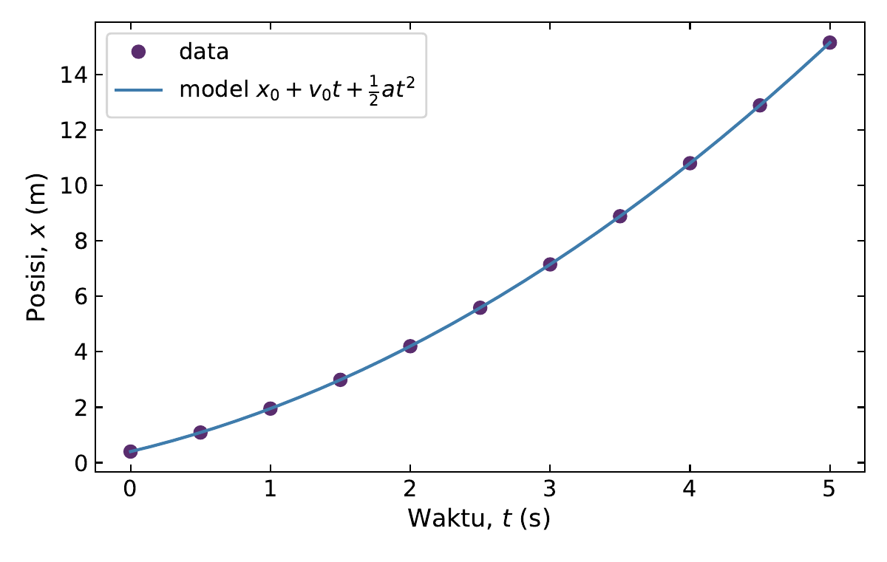
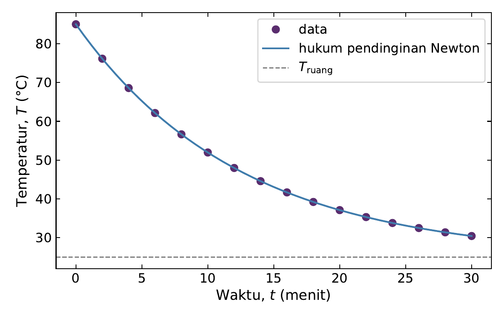
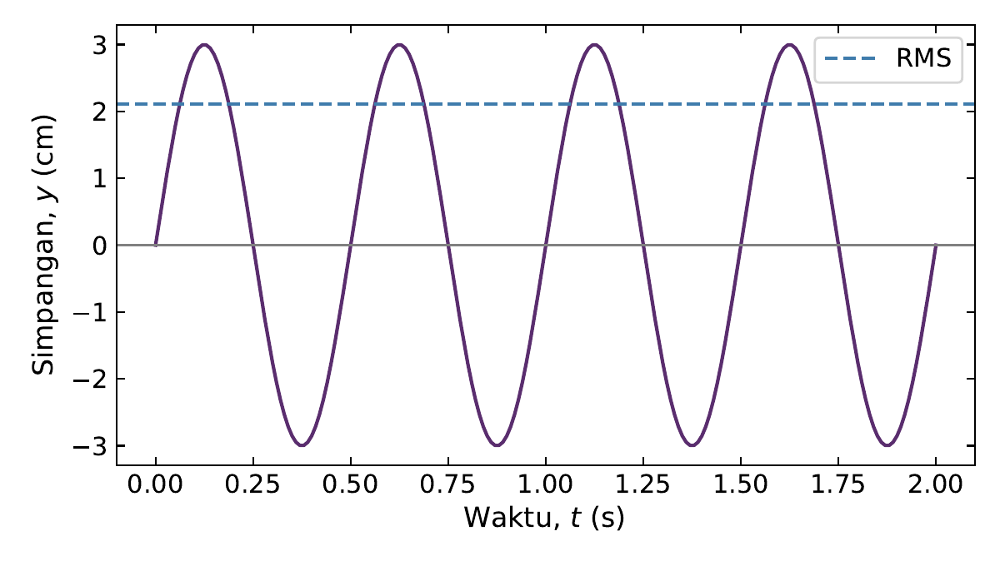
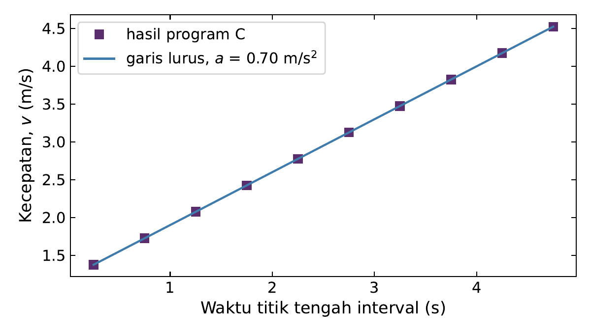

# Kuliah 9: Python untuk Komputasi Ilmiah

## Mengapa Python?

Delapan kuliah sebelumnya menggunakan C. Melalui C kita belajar bagaimana algoritma diterjemahkan menjadi instruksi yang dekat dengan mesin: tipe data harus dideklarasikan, ukuran larik harus dikelola sendiri, berkas dibuka dan ditutup secara eksplisit, dan setiap pengulangan ditulis lengkap. Pemahaman tersebut tetap berharga. Akan tetapi, untuk analisis data eksperimen dan visualisasi, menulis semuanya dalam C memakan waktu yang tidak sedikit.

**Python** adalah bahasa tingkat tinggi yang banyak digunakan dalam sains dan rekayasa. Program Python tidak perlu dikompilasi terlebih dahulu; programnya dijalankan oleh *interpreter*. Kekuatan utamanya untuk komputasi ilmiah terletak pada ekosistem pustakanya:

- **NumPy** untuk larik numerik dan operasi vektor yang cepat;
- **Matplotlib** untuk grafik ilmiah;
- SciPy, pandas, dan banyak pustaka lain untuk metode numerik, statistik, dan pengolahan data tabel.

Pergantian bahasa tidak berarti pergantian cara berpikir. Masalah, model, algoritma, validasi, dan pemeriksaan fisis tetap sama; yang berubah hanyalah cara mengekspresikannya. Kuliah ini memperkenalkan Python melalui perbandingan langsung dengan C, lalu menggunakannya untuk menganalisis dan memvisualisasikan data eksperimen.

### Menyiapkan lingkungan

Pada Linux atau WSL, Python biasanya sudah tersedia. Pustaka NumPy dan Matplotlib sebaiknya dipasang dalam **lingkungan virtual** (*virtual environment*) agar tidak bercampur dengan pustaka sistem:

```bash
python3 -m venv ~/venv-ilmiah
source ~/venv-ilmiah/bin/activate
pip install numpy matplotlib
```

Pengguna Windows dapat memasang Python dari <https://www.python.org> lalu menjalankan perintah `pip` yang sama; langkah lengkapnya ada di Lampiran A. Program Python disimpan sebagai berkas `.py` dan dijalankan dengan `python3 nama_berkas.py`. Contoh dalam kuliah ini diuji dengan Python 3.11, NumPy 2.4, dan Matplotlib 3.10.

Program Python pertama hanya satu baris:

```python
print("Hello, Teknik Fisika!")
```

```text
Hello, Teknik Fisika!
```

Tidak ada `#include`, fungsi `main`, titik koma, maupun langkah kompilasi.

## Sintaks dasar: perbandingan dengan C

| Konsep | C | Python |
|---|---|---|
| deklarasi | `double m = 2.0;` | `m = 2.0` |
| blok | kurung kurawal `{ }` | indentasi dan titik dua `:` |
| akhir pernyataan | titik koma `;` | akhir baris |
| pangkat | `pow(x, y)` | `x ** y` |
| pembagian | `7 / 2` bernilai `3` | `7 / 2` bernilai `3.5`; `7 // 2` bernilai `3` |
| logika | `&&`, `\|\|`, `!` | `and`, `or`, `not` |
| keluaran | `printf("%.2f\n", x);` | `print(f"{x:.2f}")` |
| masukan | `scanf("%lf", &x);` | `x = float(input())` |

### Variabel dan tipe dinamis

Variabel Python tidak dideklarasikan; tipenya ditentukan oleh nilai yang disimpan pada saat itu (**tipe dinamis**). Fungsi `type` menunjukkan tipe suatu nilai.

```python
mass = 2.0          # float (setara double di C)
count = 5           # int
name = "sensor-A"   # str
active = True       # bool

print(type(mass), type(count), type(name), type(active))
print(7 / 2, 7 // 2, 7 % 2, 2 ** 10)
print(2 ** 100)
print(0.1 + 0.2)
```

```text
<class 'float'> <class 'int'> <class 'str'> <class 'bool'>
3.5 3 1 1024
1267650600228229401496703205376
0.30000000000000004
```

Tiga hal patut dicatat. Pertama, operator `/` selalu menghasilkan bilangan real, sehingga jebakan pembagian bilangan bulat dari Kuliah 3 tidak muncul; pembagian bilangan bulat ditulis eksplisit dengan `//`. Kedua, bilangan bulat Python tidak mempunyai batas ukuran tetap, sehingga $2^{100}$ dihitung secara eksak tanpa *overflow*. Ketiga, bilangan real Python adalah *floating-point* IEEE 754 presisi ganda—persis `double` di C—sehingga $0.1+0.2$ tetap tidak tepat sama dengan $0.3$. Konsep representasi dari Kuliah 1 tetap berlaku.

### Masukan, keluaran, dan percabangan

Fungsi `input` membaca satu baris teks dari pengguna; teks tersebut diubah menjadi bilangan dengan `float` atau `int`. Keluaran diformat dengan *f-string*: ekspresi di dalam `{}` diganti nilainya, dan `:.3f` berarti tiga digit di belakang titik desimal, sama seperti `%.3f` pada `printf`. Percabangan menggunakan `if`, `elif`, dan `else`; blok ditentukan oleh **indentasi**, bukan kurung kurawal. Python juga mengizinkan perbandingan berantai seperti `20 <= T <= 30`, yang di C harus dipecah dengan `&&`.

```python
temperature = float(input("Temperature (C): "))

if temperature < 20:
    status = "DINGIN"
elif temperature <= 30:
    status = "NORMAL"
else:
    status = "PANAS"

print(f"T = {temperature:.1f} C -> {status}")
```

```text
Temperature (C): 27.4
T = 27.4 C -> NORMAL
```

Bandingkan dengan program C yang sama pada Kuliah 4: algoritmanya identik, tetapi kodenya jauh lebih ringkas.

### Pengulangan

Pengulangan `for` Python menelusuri anggota suatu barisan. Fungsi `range(a, b, langkah)` menghasilkan bilangan bulat dari `a` sampai *sebelum* `b`, sehingga `range(0, n)` setara dengan `for (int i = 0; i < n; i++)`. Batas atas yang tidak termasuk ini konsisten dengan indeks larik yang dimulai dari nol. Pengulangan `while` bekerja seperti di C.

```python
x0, v0, a = 2.0, 5.0, 3.0      # m, m/s, m/s^2

print(" t(s)    x(m)")
for t in range(0, 6):
    x = x0 + v0 * t + 0.5 * a * t**2
    print(f"{t:4d} {x:8.2f}")

# metode Babilonia dengan while
s, x, tol = 2.0, 1.0, 1e-12
iterations = 0
while True:
    x_new = 0.5 * (x + s / x)
    iterations += 1
    if abs(x_new - x) < tol or iterations >= 100:
        break
    x = x_new
print(f"sqrt(2) ~= {x_new:.15f} after {iterations} iterations")
```

```text
 t(s)    x(m)
   0     2.00
   1     8.50
   2    18.00
   3    30.50
   4    46.00
   5    64.50
sqrt(2) ~= 1.414213562373095 after 6 iterations
```

Hasilnya sama dengan program C pada Kuliah 4 dan 5. Python tidak mempunyai `do-while`; pola "jalankan minimal sekali" ditulis dengan `while True` dan `break`.

## Fungsi, *list*, dan berkas

Fungsi didefinisikan dengan `def`. Tipe parameter dan nilai kembalian tidak perlu dideklarasikan, dan tidak diperlukan prototipe. Teks di antara tanda kutip tiga di awal fungsi adalah *docstring* yang menjelaskan kegunaan fungsi. Seperti di C, variabel di dalam fungsi bersifat lokal.

```python
def kinetic_energy(mass, velocity):
    """Energi kinetik (J) dari massa (kg) dan kecepatan (m/s)."""
    return 0.5 * mass * velocity**2

def momentum(mass, velocity):
    return mass * velocity

print(f"E = {kinetic_energy(2.0, 3.0):.3f} J")
print(f"p = {momentum(2.0, 3.0):.3f} kg m/s")
```

```text
E = 9.000 J
p = 6.000 kg m/s
```

### *List*

***List*** adalah wadah serbaguna Python. Berbeda dengan larik C, *list* mengetahui panjangnya sendiri (`len`), dapat bertambah dengan `append`, dan dapat berisi data berbagai tipe. Indeks dimulai dari nol, dan indeks negatif menghitung dari belakang: `data[-1]` adalah elemen terakhir. Fungsi bawaan `sum`, `min`, dan `max` langsung menghasilkan statistik dasar.

```python
voltage = [2.4, 3.1, 2.8, 4.0]
voltage.append(3.5)

print("n     =", len(voltage))
print("first =", voltage[0], " last =", voltage[-1])
print(f"mean  = {sum(voltage) / len(voltage):.3f} V")
print("min   =", min(voltage), " max =", max(voltage))

for i, v in enumerate(voltage):
    print(f"V[{i}] = {v:.1f}")
```

```text
n     = 5
first = 2.4  last = 3.5
mean  = 3.160 V
min   = 2.4  max = 4.0
V[0] = 2.4
V[1] = 3.1
V[2] = 2.8
V[3] = 4.0
V[4] = 3.5
```

Fungsi `enumerate` memberikan indeks dan nilai sekaligus. Bandingkan dengan program statistik pada Kuliah 6 yang memerlukan tiga fungsi dan parameter ukuran larik.

### Membaca berkas teks

Pola buka–baca–tutup dari Kuliah 7 tetap berlaku. Konstruksi `with` menutup berkas secara otomatis ketika bloknya selesai, bahkan jika terjadi galat. Berkas `Data/voltage.dat` memuat dua kolom yang dipisahkan spasi, dengan baris komentar yang diawali `#`.

```python
time, voltage = [], []

with open("Data/voltage.dat", "r", encoding="utf-8") as f:
    for line in f:
        if line.startswith("#"):
            continue
        parts = line.split()
        time.append(float(parts[0]))
        voltage.append(float(parts[1]))

print("samples:", len(time))
print(f"V(0) = {voltage[0]:.3f} V, V(end) = {voltage[-1]:.3f} V")
print(f"drop = {100 * (1 - voltage[-1] / voltage[0]):.1f} %")
```

```text
samples: 11
V(0) = 5.000 V, V(end) = 2.483 V
drop = 50.3 %
```

Metode `split` memecah baris berdasarkan spasi, dan `float` mengubah teks menjadi bilangan. Pendekatan manual ini cukup untuk data kecil; untuk data numerik, NumPy menyediakan cara yang jauh lebih praktis.

## NumPy: larik numerik

NumPy menyediakan `ndarray`, larik numerik yang mirip larik C: semua elemennya bertipe sama (biasanya `float64`, yaitu `double`) dan tersimpan berurutan di memori. Keunggulannya adalah **operasi elemen demi elemen**: ekspresi matematika diterapkan ke seluruh larik sekaligus tanpa pengulangan eksplisit. NumPy diimpor dengan nama singkat `np`.

```python
import numpy as np

mass = np.array([1.0, 2.0, 3.0, 4.0])        # kg
velocity = np.array([2.0, 3.0, 1.5, 0.5])    # m/s

energy = 0.5 * mass * velocity**2             # tanpa loop
print("E       =", energy)
print("E_total =", energy.sum(), "J")

# perbandingan: list biasa memerlukan loop
energy_list = [0.5 * m * v**2 for m, v in zip([1.0, 2.0, 3.0, 4.0], [2.0, 3.0, 1.5, 0.5])]
print("list    =", energy_list)
```

```text
E       = [2.    9.    3.375 0.5  ]
E_total = 14.875 J
list    = [2.0, 9.0, 3.375, 0.5]
```

Ekspresi `0.5 * mass * velocity**2` terlihat sama seperti rumus fisikanya, tetapi dihitung untuk keempat partikel. Di balik layar, NumPy menjalankan pengulangan dalam kode C yang telah dikompilasi, sehingga jauh lebih cepat daripada pengulangan Python. Perhatikan perbedaan dengan *list*: `[1, 2] * 2` menghasilkan `[1, 2, 1, 2]`, bukan `[2, 4]`. *List* adalah wadah umum; larik NumPy adalah objek matematis.

### Membuat larik dan mengevaluasi model

Fungsi `np.linspace(a, b, n)` membuat $n$ titik berjarak sama dari $a$ sampai $b$ (termasuk $b$), sedangkan `np.arange(a, b, langkah)` bekerja seperti `range` untuk bilangan real. Untuk langkah real, `linspace` lebih aman karena banyaknya titik ditentukan secara eksplisit—masalah akumulasi pembulatan pada Kuliah 5 tidak muncul. Model fisika dapat langsung dievaluasi pada seluruh titik:

```python
import numpy as np

t = np.linspace(0.0, 2.0, 21)            # 21 titik, langkah 0.1 s
x = 2.0 + 5.0 * t + 0.5 * 3.0 * t**2     # x(t) = x0 + v0 t + a t^2 / 2

print("number of points:", t.size)
print("t[:4] =", t[:4])
print("x[-1] =", x[-1], "m")
print(f"mean = {x.mean():.3f}, std = {x.std():.3f}, max = {x.max():.3f}")
```

```text
number of points: 21
t[:4] = [0.  0.1 0.2 0.3]
x[-1] = 18.0 m
mean = 9.050, std = 4.869, max = 18.000
```

Notasi `t[:4]` (*slicing*) mengambil empat elemen pertama. Metode `mean`, `std`, `min`, `max`, dan `sum` menghasilkan statistik dasar.

### Penyaringan dengan kondisi Boolean

Perbandingan terhadap larik menghasilkan larik Boolean, yang dapat digunakan sebagai ***mask*** untuk memilih elemen. Pola pencacah dan penyaringan dari Kuliah 5 menjadi satu baris.

```python
import numpy as np

T = np.array([29.5, 30.2, 28.9, 31.1, 30.0, 19.4, 33.0])

high = T > 30.0
print("mask       :", high)
print("above 30 C :", T[high])
print("count      :", np.count_nonzero(high))
print(f"percentage : {100 * np.mean(high):.1f} %")

outside = (T < 20.0) | (T > 30.0)
print("outside 20-30 C:", T[outside])
```

```text
mask       : [False  True False  True False False  True]
above 30 C : [30.2 31.1 33. ]
count      : 3
percentage : 42.9 %
outside 20-30 C: [30.2 31.1 19.4 33. ]
```

Untuk larik, operator logika ditulis `&` (AND), `|` (OR), dan `~` (NOT), dan setiap kondisi harus diberi tanda kurung. `np.mean` dari larik Boolean adalah fraksi elemen yang bernilai benar.

## Membaca data dan menghitung selisih

Fungsi `np.loadtxt` membaca berkas numerik sederhana dan otomatis melewati baris komentar `#`. Untuk CSV dengan *header*, `np.genfromtxt` dengan `names=True` memungkinkan kolom diakses dengan namanya, sehingga makna setiap kolom tetap terjaga. Atribut `shape` dan `size` perlu diperiksa untuk memastikan data terbaca sesuai harapan.

```python
import numpy as np

volt = np.loadtxt("Data/voltage.dat")
print("voltage.dat shape:", volt.shape)

data = np.genfromtxt("Data/motion.csv", delimiter=",", names=True)
print("columns:", data.dtype.names)
t = data["time_s"]
x = data["position_m"]
print("samples:", t.size)
```

```text
voltage.dat shape: (11, 2)
columns: ('time_s', 'position_m')
samples: 11
```

Larik `volt` berbentuk $11\times2$: kolom `volt[:, 0]` berisi waktu dan `volt[:, 1]` berisi tegangan.

Fungsi `np.diff` menghitung selisih elemen berurutan, $\Delta x_i=x_{i+1}-x_i$, dan menghasilkan larik dengan satu elemen lebih sedikit—persis $N-1$ interval seperti pada Kuliah 8. Dengan `np.diff`, validasi urutan waktu dan perhitungan kecepatan interval masing-masing hanya membutuhkan satu baris:

```python
import numpy as np

data = np.genfromtxt("Data/motion.csv", delimiter=",", names=True)
t, x = data["time_s"], data["position_m"]

dt = np.diff(t)
if not np.all(dt > 0):
    raise ValueError("time must increase strictly")

v = np.diff(x) / dt
k = np.argmax(np.abs(v))
first = np.argmax(np.abs(v) > 3.0)

print("v =", np.round(v, 4))
print(f"mean interval velocity  = {v.mean():.4f} m/s")
print(f"global average velocity = {(x[-1] - x[0]) / (t[-1] - t[0]):.4f} m/s")
print(f"max |v| = {abs(v[k]):.4f} m/s in [{t[k]:.2f}, {t[k+1]:.2f}] s")
print(f"|v| > 3 m/s first in [{t[first]:.2f}, {t[first+1]:.2f}] s")
```

```text
v = [1.375 1.725 2.075 2.425 2.775 3.125 3.475 3.825 4.175 4.525]
mean interval velocity  = 2.9500 m/s
global average velocity = 2.9500 m/s
max |v| = 4.5250 m/s in [4.50, 5.00] s
|v| > 3 m/s first in [2.50, 3.00] s
```

Hasilnya identik dengan program C pada Kuliah 8, yang membutuhkan sekitar 150 baris. Fungsi `np.argmax` mengembalikan indeks elemen terbesar; pada larik Boolean, ia mengembalikan indeks `True` pertama. (Jika tidak ada elemen yang memenuhi, `argmax` mengembalikan $0$, sehingga dalam program yang lebih hati-hati kita perlu memeriksa `np.any(...)` terlebih dahulu.) Pernyataan `raise ValueError(...)` menghentikan program dengan pesan kesalahan, setara dengan mencetak pesan lalu `return 1` di C.

## Matplotlib: grafik ilmiah

Grafik adalah alat analisis, bukan sekadar hiasan laporan. Tren, anomali, dan kesesuaian dengan model sering langsung terlihat dari grafik, bahkan sebelum statistik dihitung. Matplotlib menggunakan dua objek utama: `figure` (seluruh gambar) dan `axes` (satu sistem sumbu tempat data digambar). Keduanya dibuat dengan `plt.subplots`.

```python
import numpy as np
import matplotlib.pyplot as plt

data = np.genfromtxt("Data/motion.csv", delimiter=",", names=True)
t, x = data["time_s"], data["position_m"]

t_model = np.linspace(0.0, 5.0, 200)
x_model = 0.4 + 1.2 * t_model + 0.5 * 0.7 * t_model**2

fig, ax = plt.subplots(figsize=(6.0, 3.8))
ax.plot(t, x, "o", color="#5A2D6E", label="data")
ax.plot(t_model, x_model, "-", color="#3F7CAC",
        label=r"model $x_0 + v_0 t + \frac{1}{2} a t^2$")
ax.set_xlabel("Waktu, $t$ (s)", fontsize=12)
ax.set_ylabel("Posisi, $x$ (m)", fontsize=12)
ax.tick_params(direction="in", top=True, right=True, labelsize=11)
ax.legend(fontsize=11)
fig.tight_layout()
fig.savefig("gerak-posisi.pdf")
print("saved gerak-posisi.pdf")
```

```text
saved gerak-posisi.pdf
```



Beberapa kebiasaan untuk grafik ilmiah yang layak:

- **Label sumbu selalu memuat besaran dan satuannya**, misalnya "Waktu, $t$ (s)". Matplotlib menerima notasi matematika di antara tanda `$`.
- **Data diskret digambar sebagai titik**, sedangkan model kontinu sebagai garis. Dengan begitu pembaca dapat membedakan apa yang diukur dan apa yang dihitung.
- **Legenda** diperlukan jika ada lebih dari satu kurva.
- **Ukuran huruf** harus tetap terbaca setelah gambar diperkecil di dalam laporan.
- **Tanda skala** (*tick*) yang menghadap ke dalam pada keempat sisi adalah gaya yang lazim dalam publikasi fisika.

Fungsi `savefig` menyimpan grafik. Format PDF atau SVG menghasilkan gambar vektor yang tetap tajam pada perbesaran apa pun dan cocok untuk dokumen LaTeX; format PNG dengan `dpi=300` cocok untuk dokumen pengolah kata dan presentasi. Saat bekerja interaktif, `plt.show()` menampilkan grafik di layar.

Grafik di atas menggabungkan data dan model. Model $x(t)=0.4+1.2t+0.35t^2$ menggunakan parameter yang diperoleh dari analisis kecepatan pada Kuliah 8 ($x_0=0.4$ m, $v_0=1.2$ m/s, $a=0.7$ m/s$^2$), dan kurvanya melewati semua titik data. Kesesuaian visual seperti ini adalah pemeriksaan fisis yang sangat kuat.

## Studi kasus: data pendinginan dan gelombang

### Pendinginan benda

Berkas `Data/cooling.csv` memuat temperatur sebuah benda (°C) terhadap waktu (menit). Menurut hukum pendinginan Newton,

```math
T(t)=T_{\text{ruang}}+\left(T_0-T_{\text{ruang}}\right)e^{-kt},
```

sehingga temperatur seharusnya turun makin lambat menuju temperatur ruang. Laju perubahan temperatur setiap interval dihitung dengan `np.diff`; nilainya negatif karena temperatur menurun, sehingga interval dengan pendinginan tercepat dicari dengan `np.argmin`.

```python
import numpy as np
import matplotlib.pyplot as plt

data = np.genfromtxt("Data/cooling.csv", delimiter=",", names=True)
t, T = data["time_min"], data["temperature_C"]

rate = np.diff(T) / np.diff(t)          # C/min
i = np.argmin(rate)

print(f"samples          : {T.size}")
print(f"initial / final  : {T[0]:.2f} C / {T[-1]:.2f} C")
print(f"all rates < 0    : {np.all(rate < 0)}")
print(f"fastest cooling  : {rate[i]:.3f} C/min in [{t[i]:.0f}, {t[i+1]:.0f}] min")
print(f"slowest cooling  : {rate[-1]:.3f} C/min in [{t[-2]:.0f}, {t[-1]:.0f}] min")

T_room, k = 25.0, 0.08                  # parameter model
t_model = np.linspace(0, 30, 200)
T_model = T_room + (T[0] - T_room) * np.exp(-k * t_model)

fig, ax = plt.subplots(figsize=(6.0, 3.8))
ax.plot(t, T, "o", color="#5A2D6E", label="data")
ax.plot(t_model, T_model, "-", color="#3F7CAC", label="hukum pendinginan Newton")
ax.axhline(T_room, color="gray", linestyle="--", linewidth=1, label=r"$T_{\mathrm{ruang}}$")
ax.set_xlabel("Waktu, $t$ (menit)", fontsize=12)
ax.set_ylabel("Temperatur, $T$ (°C)", fontsize=12)
ax.tick_params(direction="in", top=True, right=True, labelsize=11)
ax.legend(fontsize=11)
fig.tight_layout()
fig.savefig("pendinginan.pdf")
```

```text
samples          : 16
initial / final  : 85.00 C / 30.44 C
all rates < 0    : True
fastest cooling  : -4.436 C/min in [0, 2] min
slowest cooling  : -0.472 C/min in [28, 30] min
```



Semua laju bernilai negatif dan besarnya makin kecil seiring waktu, sesuai dengan perilaku eksponensial. Kurva model dengan $T_{\text{ruang}}=25\,^\circ$C dan $k=0.08$ min$^{-1}$ melewati semua titik data. (Data ini memang dibangkitkan dari model tersebut; menentukan parameter $T_{\text{ruang}}$ dan $k$ secara otomatis dari data nyata disebut *fitting* dan dibahas dalam mata kuliah metode numerik.)

### Gelombang sinus

Berkas `Data/wave.csv` merepresentasikan simpangan gelombang $y(t)=A\sin(2\pi ft)$ dengan amplitudo $A=0.03$ m dan frekuensi $f=2$ Hz. Untuk sinus ideal, nilai RMS-nya adalah $A/\sqrt2$. Banyaknya perubahan tanda berurutan menunjukkan berapa kali gelombang melewati titik setimbang.

```python
import numpy as np
import matplotlib.pyplot as plt

data = np.genfromtxt("Data/wave.csv", delimiter=",", names=True)
t, y = data["time_s"], data["displacement_m"]

amplitude = np.max(np.abs(y))
rms = np.sqrt(np.mean(y**2))
signs = np.sign(y)
signs = signs[signs != 0]               # abaikan sampel yang tepat nol
crossings = np.count_nonzero(signs[:-1] * signs[1:] < 0)

print(f"samples   = {y.size}, duration = {t[-1] - t[0]:.2f} s")
print(f"amplitude = {amplitude:.6f} m")
print(f"RMS       = {rms:.6f} m")
print(f"A/sqrt(2) = {amplitude / np.sqrt(2):.6f} m")
print(f"sign changes = {crossings}")

fig, ax = plt.subplots(figsize=(6.0, 3.4))
ax.plot(t, 100 * y, "-", color="#5A2D6E", linewidth=1.5)
ax.axhline(0, color="gray", linewidth=0.8)
ax.axhline(100 * rms, color="#3F7CAC", linestyle="--", label="RMS")
ax.set_xlabel("Waktu, $t$ (s)", fontsize=12)
ax.set_ylabel("Simpangan, $y$ (cm)", fontsize=12)
ax.tick_params(direction="in", top=True, right=True, labelsize=11)
ax.legend(fontsize=11, loc="upper right")
fig.tight_layout()
fig.savefig("gelombang.pdf")
```

```text
samples   = 201, duration = 2.00 s
amplitude = 0.029941 m
RMS       = 0.021160 m
A/sqrt(2) = 0.021171 m
sign changes = 7
```



RMS numerik berbeda dari $A/\sqrt2$ hanya sekitar $0.05\%$. Amplitudo terukur $0.029941$ m sedikit lebih kecil dari $0.03$ m karena tidak ada titik sampel yang jatuh tepat di puncak gelombang. Selama $2$ s, gelombang $2$ Hz menempuh empat periode dan melewati titik setimbang dua kali setiap periode. Perpotongan di dalam selang terbuka $(0,2)$ s berjumlah $2\times4-1=7$, karena perpotongan pada $t=0$ dan $t=2$ s tepat berada di ujung data. Perhatikan pula baris `signs[signs != 0]`: dengan langkah $0.01$ s, setiap perpotongan nol jatuh *tepat* pada titik sampel bernilai nol, sehingga tanpa baris tersebut tidak ada satu pun perubahan tanda yang terdeteksi. Detail semacam ini mengingatkan bahwa definisi besaran diskret harus selalu diperiksa terhadap teorinya. Simpangan digambar dalam sentimeter agar angka pada sumbu mudah dibaca—satuan pada label sumbu harus mengikuti perubahan ini.

## C dan Python dalam satu alur kerja

C dan Python tidak harus dipilih salah satu. Dalam praktik riset dan industri, keduanya sering dipadukan. Program C yang cepat dan dekat dengan perangkat keras—misalnya pada sistem akuisisi data atau simulasi berat—menulis hasilnya ke berkas CSV, lalu Python membaca berkas tersebut untuk analisis lanjutan dan visualisasi. Berkas teks dengan skema yang jelas menjadi "antarmuka" di antara keduanya.


Program Python berikut membaca `velocity.csv` yang dihasilkan program C pada Kuliah 8 dan menggambarkan kecepatan setiap interval pada titik tengahnya. Dari kemiringan garisnya, percepatan diperkirakan dengan `np.polyfit`, yang mencocokkan polinomial derajat satu terhadap data.

```python
import numpy as np
import matplotlib.pyplot as plt

data = np.genfromtxt("velocity.csv", delimiter=",", names=True)
t_mid = 0.5 * (data["time_start_s"] + data["time_end_s"])
v = data["velocity_m_per_s"]

slope, intercept = np.polyfit(t_mid, v, 1)
print(f"a  = {slope:.4f} m/s^2")
print(f"v0 = {intercept:.4f} m/s")

fig, ax = plt.subplots(figsize=(6.0, 3.4))
ax.plot(t_mid, v, "s", color="#5A2D6E", label="hasil program C")
ax.plot(t_mid, slope * t_mid + intercept, "-", color="#3F7CAC",
        label=f"garis lurus, $a$ = {slope:.2f} m/s$^2$")
ax.set_xlabel("Waktu titik tengah interval (s)", fontsize=12)
ax.set_ylabel("Kecepatan, $v$ (m/s)", fontsize=12)
ax.tick_params(direction="in", top=True, right=True, labelsize=11)
ax.legend(fontsize=11)
fig.tight_layout()
fig.savefig("kecepatan.pdf")
```

```text
a  = 0.7000 m/s^2
v0 = 1.2000 m/s
```



Percepatan $0.7$ m/s$^2$ dan kecepatan awal $1.2$ m/s sesuai dengan analisis manual pada Kuliah 8. Kedua bahasa bekerja sama: C menangani pembacaan, validasi, dan perhitungan inti dengan kendali penuh; Python menangani eksplorasi, statistik lanjutan, dan grafik dengan kode yang ringkas.

### Kesalahan umum saat beralih ke Python

- **Menulis titik koma dan kurung kurawal.** Blok Python ditentukan oleh indentasi; indentasi yang tidak konsisten menyebabkan `IndentationError`.
- **Lupa titik dua** di akhir baris `if`, `for`, `while`, dan `def`.
- **Salah memahami `range`.** `range(1, 10)` berhenti di $9$, bukan $10$.
- **Menganggap *list* sama dengan larik NumPy.** Operasi aritmetika pada *list* tidak bekerja elemen demi elemen.
- **Mengabaikan bentuk larik.** Periksa `shape` dan `size` setelah membaca data; kolom yang tertukar atau baris yang hilang tidak selalu menimbulkan galat.
- **Mengabaikan validasi data.** Kemudahan Python tidak menghapus kebutuhan memeriksa urutan waktu, rentang fisis, satuan, dan orde besaran.

## Cek pemahaman

- Apa perbedaan utama cara menjalankan program C dan program Python?
- Apa yang dimaksud dengan tipe dinamis? Apakah $0.1+0.2$ tepat sama dengan $0.3$ di Python? Mengapa?
- Apa perbedaan `/` dan `//` di Python?
- Bagaimana blok kode ditentukan dalam Python?
- Mengapa `range(0, n)` setara dengan `for (int i = 0; i < n; i++)`?
- Apa perbedaan *list* dan larik NumPy? Apa hasil `[1, 2] * 2` dan `np.array([1, 2]) * 2`?
- Apa keuntungan konstruksi `with` saat membuka berkas?
- Kapan `np.loadtxt` dan `np.genfromtxt` digunakan? Mengapa ukuran hasil `np.diff` satu elemen lebih kecil?
- Bagaimana *Boolean mask* digunakan untuk menyaring data?
- Apa saja unsur grafik ilmiah yang layak? Kapan format vektor lebih baik daripada PNG?

## Latihan

1. **Transisi C ke Python.** Tulis ulang program energi kinetik atau klasifikasi temperatur dari Kuliah 3 atau 4 dalam Python, lengkap dengan masukan pengguna dan satu pemeriksaan masukan. Jelaskan bagian yang berubah secara sintaks dan bagian yang tetap sama secara algoritmik.
1. **Gerak dengan NumPy.** Baca `Data/motion.csv`, hitung kecepatan interval dengan `np.diff`, lalu hitung minimum, maksimum, rata-rata aritmetika, dan kecepatan rata-rata global. Hapus satu baris data di tengah berkas (sehingga $\Delta t$ tidak seragam) dan jelaskan mengapa kedua jenis rata-rata kini berbeda.
1. **Analisis pendinginan.** Dari `Data/cooling.csv`, hitung temperatur awal, akhir, minimum, maksimum, dan rata-rata, serta interval dengan penurunan temperatur terbesar. Gambarkan $\ln(T-T_{\text{ruang}})$ terhadap $t$ dengan $T_{\text{ruang}}=25\,^\circ$C. Mengapa grafiknya berupa garis lurus, dan berapa kemiringannya?
1. **Gelombang dan RMS.** Dari `Data/wave.csv`, hitung amplitudo dan RMS, bandingkan dengan $A/\sqrt2$, dan hitung frekuensi gelombang dari banyaknya perpotongan nol. Simpan grafiknya dalam format PNG 300 dpi.
1. **Peluruhan tegangan.** Baca `Data/voltage.dat` dengan `np.loadtxt`. Hitung persentase penurunan tegangan, gambarkan $V(t)$ pada skala biasa dan skala logaritmik (`ax.set_yscale("log")`), lalu periksa apakah trennya konsisten dengan peluruhan eksponensial $V=V_0e^{-t/\tau}$. Perkirakan $\tau$.
1. ***Mask* data sensor.** Buat larik 50 temperatur sintetis dengan generator acak NumPy, yaitu `rng = np.random.default_rng(1)` lalu `T = rng.normal(25, 4, 50)`. Gunakan *Boolean mask* untuk mengambil data di luar rentang aman $20$–$30\,^\circ$C, hitung banyak dan persentasenya, lalu gambarkan data terhadap indeks sampel dengan titik di luar rentang diberi warna berbeda.
1. **Model dan data berderau.** Bangkitkan data gerak $x(t)=x_0+v_0t+\frac12at^2$ dengan parameter pilihan Anda, lalu tambahkan derau acak kecil. Gambarkan data dan model dalam satu grafik dengan legenda, hitung galat RMS antara data dan model, dan jelaskan maknanya.
1. **Daya listrik.** Baca `electrical.csv` dari Kuliah 7 dengan NumPy, hitung $P=VI$, daya maksimum, daya rata-rata, dan energi dengan aturan trapesium (`np.trapezoid`). Gambarkan daya terhadap waktu dan simpan hasilnya ke CSV baru dengan `np.savetxt`.
1. **Optika sederhana.** Buat data intensitas sintetis $I(x)=I_0\exp\!\left[-(x-x_0)^2/(2\sigma^2)\right]$. Cari posisi puncak, intensitas relatif, serta lebar penuh pada setengah maksimum (FWHM) secara numerik, lalu bandingkan dengan nilai teoritis $2\sqrt{2\ln2}\,\sigma$.
1. **Proyek mini Python ilmiah.** Pilih satu persoalan dari mekanika, listrik, termal, optika, atau gelombang. Bangun alur kerja data $\rightarrow$ NumPy $\rightarrow$ analisis $\rightarrow$ grafik $\rightarrow$ berkas hasil dengan sekurang-kurangnya tiga operasi analisis, satu grafik ilmiah yang layak, dan pemeriksaan kewajaran berdasarkan satuan, tanda, rentang, atau nilai referensi.

## Rangkuman

- Python adalah bahasa tingkat tinggi yang dijalankan oleh *interpreter*. Ekosistem NumPy dan Matplotlib menjadikannya alat utama untuk analisis dan visualisasi data ilmiah.
- Konsep algoritmik tetap sama dengan C; yang berubah adalah sintaks: tipe dinamis, blok dengan indentasi, `/` yang selalu menghasilkan bilangan real, `**` untuk pangkat, dan *f-string* untuk keluaran.
- Bilangan real Python adalah `double` IEEE 754, sehingga sifat *floating-point* dari Kuliah 1 tetap berlaku.
- Fungsi didefinisikan dengan `def`; *list* adalah wadah serbaguna yang mengetahui panjangnya sendiri; `with open(...)` menutup berkas secara otomatis.
- Larik NumPy mendukung operasi elemen demi elemen, statistik bawaan, dan *Boolean mask*, sehingga banyak pola iteratif dari Kuliah 5 cukup ditulis dalam satu baris.
- `np.loadtxt` dan `np.genfromtxt` membaca data; `np.diff` menghitung selisih berurutan dengan $N-1$ elemen.
- Grafik ilmiah yang layak mempunyai label sumbu dengan satuan, membedakan data dan model, memiliki legenda, dan disimpan dalam format yang sesuai.
- C dan Python saling melengkapi; berkas CSV dengan skema yang jelas menjadi penghubung keduanya. Validasi data dan pemeriksaan fisis tetap menjadi tanggung jawab pemrogram, apa pun bahasanya.
