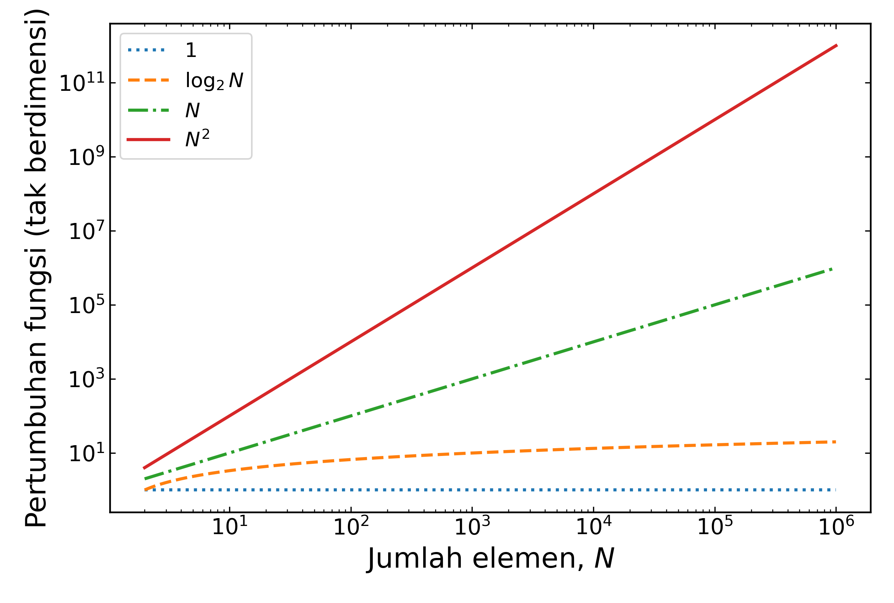
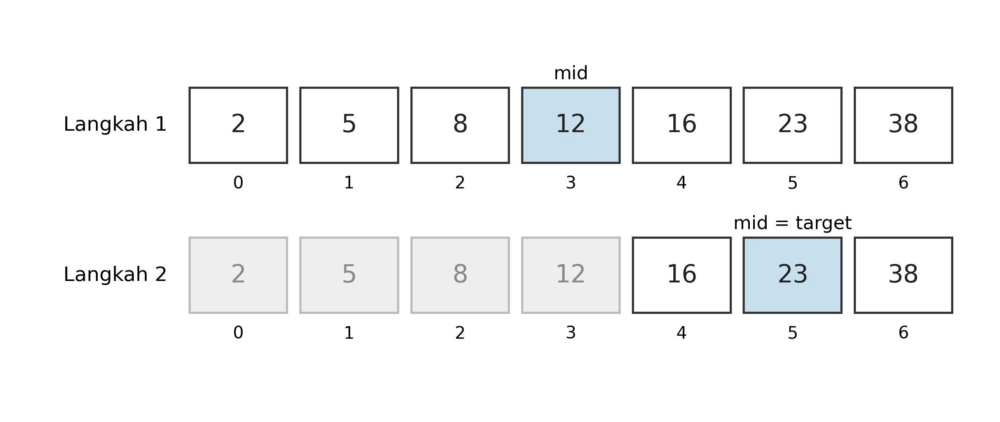
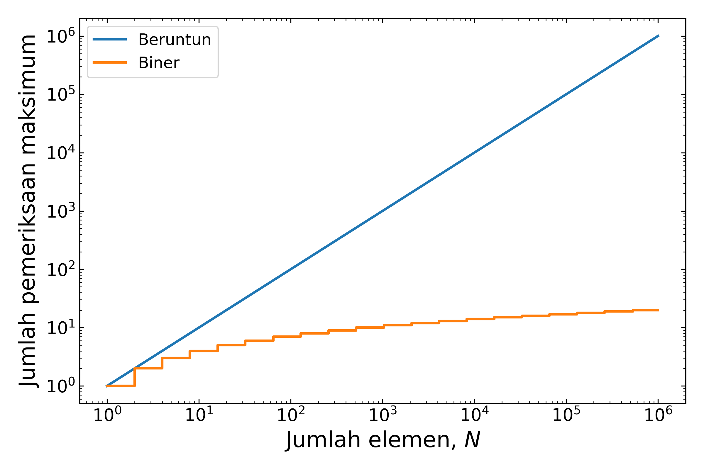

# Kuliah 10: Algoritma Pencarian

## Pendahuluan dan motivasi

Pada kuliah sebelumnya kita telah mengolah data numerik menggunakan C dan Python. Sekarang kita akan mempelajari bagaimana komputer menemukan suatu informasi di dalam kumpulan data tanpa melakukan pekerjaan yang tidak diperlukan.

Misalkan ada sebuah spektrometer menghasilkan sejuta rekaman intensitas cahaya pada berbagai panjang gelombang. Kita mungkin ingin menemukan rekaman dengan panjang gelombang tertentu, mencari identitas sensor yang bermasalah, atau menentukan apakah sebuah nomor atom terdapat dalam tabel sifat material.

Ketiga persoalan tersebut melibatkan pencarian, tetapi kondisi pencariannya tidak selalu sama. Di sini kita akan membahas dua algoritma dasar, yaitu pencarian beruntun (*sequential search* atau *linear search*) dan pencarian biner (*binary search*), serta menentukan kapan masing-masing layak digunakan.

## Merumuskan persoalan pencarian

Tinjau suatu larik $A$ dengan $N$ elemen dan sebuah nilai target $x$. Tujuan pencarian eksak adalah menemukan indeks $i$ yang memenuhi persamaan berikut.

```math
A[i]=x,\qquad 0\leq i<N.
```

Jika tidak ada elemen yang memenuhi kondisi tersebut, fungsi akan memberikan/mengembalikan `-1`. Konvensi ini perlu diperhatikan khususnya dalam Python karena `A[-1]` merupakan akses yang sah ke elemen terakhir, bukan penanda kesalahan.

Sebagai contoh, gunakan data berikut. Kita ingin mencari target $30$ dan mengetahui letaknya di dalam larik.

| Indeks | 0 | 1 | 2 | 3 | 4 | 5 |
|---|---:|---:|---:|---:|---:|---:|
| Nilai | 10 | 50 | 30 | 70 | 80 | 20 |

Hasil pencarian adalah indeks 2, bukan indeks 3, karena penomoran indeks dimulai dari nol. Jika target muncul lebih dari sekali, kita harus menetapkan apakah fungsi cukup mengembalikan salah satu indeks, indeks pertama, atau semua indeks yang sesuai.

## Mengukur efisiensi algoritma

Kita telah mengenal notasi Big-O pada Kuliah 2 (kalau lupa, tolong dilihat lagi). Pada pembahasan pencarian, kita akan menggunakannya untuk menyatakan batas atas pertumbuhan jumlah operasi terhadap ukuran masukan $N$, bukan untuk menyatakan waktu eksekusi dalam sekon.

Sebagai ukuran sederhana, kita menghitung berapa banyak elemen yang diperiksa. Satu pemeriksaan elemen dapat melibatkan lebih dari satu operasi perbandingan dalam kode, sehingga kedua ukuran tersebut perlu dibedakan.

### Kelas kompleksitas yang umum

| Kompleksitas | Nama | Contoh |
|---|---|---|
| $O(1)$ | Konstan | Mengakses `A[5]` |
| $O(\log N)$ | Logaritmik | Pencarian biner |
| $O(N)$ | Linear | Menelusuri seluruh larik |
| $O(N^2)$ | Kuadratik | Memeriksa seluruh pasangan partikel |

Jika biaya setiap operasi tetap, penggandaan $N$ pada proses linear kira-kira akan menggandakan jumlah operasi. Pada proses kuadratik, jumlah operasi dapat meningkat empat kali lipat, sedangkan pada proses logaritmik peningkatannya jauh lebih kecil.



**Gambar 1.** Perbandingan fungsi $1$, $\log_2 N$, $N$, dan $N^2$ pada sumbu logaritmik. Kurva ini menggambarkan pertumbuhan ideal, bukan hasil pengukuran waktu eksekusi.

Notasi Big-O sendiri tidak selalu berarti kasus terburuk. Kita dapat menggunakannya untuk menganalisis kasus terbaik, rata-rata, maupun terburuk, asalkan kasus yang dimaksud disebutkan secara jelas.

## Pencarian beruntun (*sequential search*)

Pencarian beruntun memeriksa elemen satu per satu dari awal larik hingga target ditemukan. Algoritma ini tidak memerlukan data terurut karena tidak membuat asumsi tentang hubungan antara elemen-elemen yang berdekatan.

### Pseudocode

Algoritma berikut mengembalikan indeks pertama yang cocok dengan target. Apabila pengulangan selesai tanpa menemukan target, fungsi mengembalikan `-1`.

```text
FUNCTION SequentialSearch(A, N, x)
    FOR i ← 0 TO N-1
        IF A[i] = x
            RETURN i
        END IF
    END FOR
    RETURN -1
END FUNCTION
```

### Penelusuran algoritma

Gunakan kembali larik `[10, 50, 30, 70, 80, 20]` dengan target 30. Tabel berikut menunjukkan keadaan algoritma sampai pencarian berhenti.

| Langkah | Indeks | Nilai diperiksa | Keputusan |
|---:|---:|---:|---|
| 1 | 0 | 10 | Lanjut |
| 2 | 1 | 50 | Lanjut |
| 3 | 2 | 30 | Kembalikan 2 |

Hanya tiga elemen yang diperiksa meskipun larik memiliki enam elemen. Pernyataan `return` langsung mengakhiri fungsi sehingga elemen berikutnya tidak perlu diperiksa.

### Implementasi dalam C

```c
#include <stdio.h>

int sequential_search(const int arr[], int n, int x)
{
    for (int i = 0; i < n; i++)
    {
        if (arr[i] == x)
        {
            return i;
        }
    }
    return -1;
}

int main(void)
{
    int data[] = {10, 50, 30, 70, 80, 20};
    int n = sizeof(data) / sizeof(data[0]);
    int index = sequential_search(data, n, 30);

    if (index != -1)
        printf("Indeks: %d\n", index);
    else
        printf("Data tidak ditemukan.\n");

    return 0;
}
```

Parameter `const` mencegah perubahan elemen melalui parameter larik. Ukuran `n` dikirim secara eksplisit karena fungsi C tidak memperoleh panjang larik secara otomatis.

### Implementasi dalam Python

```python
def sequential_search(arr, x):
    for i in range(len(arr)):
        if arr[i] == x:
            return i
    return -1


data = [10, 50, 30, 70, 80, 20]
index = sequential_search(data, 30)

if index != -1:
    print(f"Indeks: {index}")
else:
    print("Data tidak ditemukan.")
```

Kedua program menghasilkan `Indeks: 2`. Python memperoleh panjang `list` melalui `len`, tetapi urutan pemeriksaan dan kondisi penghentiannya sama dengan implementasi C.

### Kebenaran dan kompleksitas

Sebelum iterasi dengan indeks $i$, seluruh elemen pada indeks 0 sampai $i-1$ telah diperiksa dan tidak sama dengan target. Hubungan ini merupakan invarian pengulangan yang menjelaskan mengapa indeks yang dikembalikan adalah indeks pertama yang cocok.

Jika target berada pada elemen pertama, hanya satu pemeriksaan diperlukan. Jika target berada pada elemen terakhir atau tidak terdapat dalam larik, diperlukan $N$ pemeriksaan.

Untuk target yang pasti ada tepat satu kali dan memiliki peluang sama untuk menempati setiap indeks, jumlah pemeriksaan rata-rata adalah sebagai berikut. Hasil tersebut diperoleh dengan merata-ratakan biaya pencarian dari posisi pertama hingga posisi terakhir.

```math
\langle C\rangle=\frac{1+2+\cdots+N}{N}=\frac{N+1}{2}.
```

Dengan demikian, kasus terbaik memiliki kompleksitas $O(1)$, sedangkan kasus rata-rata berdasarkan asumsi tersebut dan kasus terburuk memiliki kompleksitas $O(N)$. Kebutuhan memori tambahan adalah $O(1)$ karena algoritma hanya memerlukan sejumlah tetap variabel.

## Pencarian biner (*binary search*)

Pencarian biner memanfaatkan keterurutan data untuk mengurangi ruang pencarian pada setiap langkah. Algoritma ini mensyaratkan larik terurut menaik berdasarkan kunci yang dicari dan dapat diakses langsung melalui indeks.

Misalkan elemen tengah bernilai 12, sedangkan target adalah 23. Karena data terurut menaik, seluruh elemen di sebelah kiri elemen tengah tidak mungkin bernilai 23, sehingga bagian tersebut dapat dikeluarkan dari ruang pencarian.

### Memperbarui batas pencarian

Gunakan `low` dan `high` sebagai indeks batas bawah dan atas yang masih mungkin memuat target. Indeks tengah dihitung dengan persamaan berikut.

```math
\text{mid}=\text{low}+\left\lfloor\frac{\text{high}-\text{low}}{2}\right\rfloor.
```

Bentuk tersebut menghindari risiko luapan penjumlahan `low + high` pada tipe integer C. Setelah nilai tengah diperiksa, kita memilih salah satu dari tiga kemungkinan berikut.

- Jika `A[mid] == x`, kembalikan `mid`.
- Jika `A[mid] < x`, perbarui `low = mid + 1`.
- Jika `A[mid] > x`, perbarui `high = mid - 1`.

Penambahan atau pengurangan satu diperlukan karena elemen tengah sudah diperiksa. Jika `low > high`, ruang pencarian kosong dan target dinyatakan tidak ditemukan.

### Penelusuran algoritma

Gunakan larik terurut `[2, 5, 8, 12, 16, 23, 38]` dan target 23. Perhatikan bahwa target ditemukan setelah dua pemeriksaan saja.

| Langkah | `low` | `high` | `mid` | `A[mid]` | Keputusan |
|---:|---:|---:|---:|---:|---|
| 1 | 0 | 6 | 3 | 12 | `low = 4` |
| 2 | 4 | 6 | 5 | 23 | `return 5` |



**Gambar 2.** Elemen tengah diperiksa pada setiap langkah dan bagian yang tidak mungkin memuat target diabaikan. Indeks asli tetap dipertahankan selama pencarian.

Untuk target 7, algoritma menghasilkan urutan indeks tengah 3, 1, dan 2. Setelah pemeriksaan terakhir, `low = 2` dan `high = 1`, sehingga fungsi berhenti dengan hasil `-1`.

### Pseudocode

Pseudocode berikut menggunakan batas inklusif, yaitu `low` dan `high` masih termasuk dalam ruang pencarian. Kondisi pengulangan harus menggunakan `low ≤ high` agar ruang pencarian dengan satu elemen tetap diperiksa.

```text
FUNCTION BinarySearch(A, N, x)
    low ← 0
    high ← N-1
    WHILE low ≤ high
        mid ← low + FLOOR((high-low)/2)
        IF A[mid] = x
            RETURN mid
        ELSE IF A[mid] < x
            low ← mid+1
        ELSE
            high ← mid-1
        END IF
    END WHILE
    RETURN -1
END FUNCTION
```

### Implementasi dalam C

```c
#include <stdio.h>

int binary_search(const int arr[], int n, int x)
{
    int low = 0;
    int high = n - 1;

    while (low <= high)
    {
        int mid = low + (high - low) / 2;

        if (arr[mid] == x)
            return mid;
        else if (arr[mid] < x)
            low = mid + 1;
        else
            high = mid - 1;
    }
    return -1;
}

int main(void)
{
    int data[] = {2, 5, 8, 12, 16, 23, 38};
    int n = sizeof(data) / sizeof(data[0]);
    int index = binary_search(data, n, 23);

    if (index != -1)
        printf("Indeks: %d\n", index);
    else
        printf("Data tidak ditemukan.\n");

    return 0;
}
```

### Implementasi dalam Python

```python
def binary_search(arr, x):
    low = 0
    high = len(arr) - 1

    while low <= high:
        mid = low + (high - low) // 2

        if arr[mid] == x:
            return mid
        elif arr[mid] < x:
            low = mid + 1
        else:
            high = mid - 1
    return -1


data = [2, 5, 8, 12, 16, 23, 38]
index = binary_search(data, 23)

if index != -1:
    print(f"Indeks: {index}")
else:
    print("Data tidak ditemukan.")
```

Operator `//` pada Python menghasilkan pembagian bulat ke bawah. Pada C, pembagian dua integer tak negatif juga menghasilkan bagian bulat yang diperlukan untuk menentukan indeks tengah.

### Mengapa algoritma ini benar?

Invarian pencarian biner menyatakan bahwa jika target ada dan belum ditemukan, setidaknya satu kemunculannya masih berada dalam rentang indeks `low` sampai `high`. Pada awal pencarian, rentang tersebut mencakup seluruh larik.

Jika nilai tengah lebih kecil daripada target, keterurutan larik menjamin bahwa semua elemen di sebelah kiri hingga `mid` juga lebih kecil daripada target. Argumen sebaliknya berlaku jika nilai tengah lebih besar daripada target, sehingga pembaruan kedua batas tidak membuang kandidat yang masih mungkin cocok.

Setiap pembaruan memperkecil jumlah kandidat setidaknya satu elemen. Oleh karena itu, algoritma pasti berhenti, baik karena target ditemukan maupun karena rentang kandidat menjadi kosong.

### Menurunkan kompleksitas logaritmik

Pada setiap pemeriksaan yang tidak menemukan target, jumlah kandidat tersisa paling banyak setengah jumlah sebelumnya, dibulatkan ke bawah. Setelah $k$ pemeriksaan yang tidak berhasil, banyak kandidat paling banyak memenuhi hubungan berikut.

```math
N_k\leq\left\lfloor\frac{N}{2^k}\right\rfloor.
```

Pencarian berakhir ketika jumlah kandidat menjadi nol. Untuk $N\geq 1$, batas maksimum jumlah pemeriksaan elemen pada implementasi ini adalah sebagai berikut.

```math
C_{\max}=\lfloor\log_2 N\rfloor+1.
```

Kasus terbaik terjadi jika target berada tepat di tengah pada pemeriksaan pertama, sehingga kompleksitasnya $O(1)$. Kasus terburuk adalah $O(\log N)$, demikian pula kasus rata-rata untuk target unik yang dipilih secara merata dari elemen larik.

## Perbandingan kedua algoritma

| Aspek | Pencarian beruntun | Pencarian biner |
|---|---|---|
| Syarat data | Tidak harus terurut | Terurut menaik |
| Kasus terbaik | $O(1)$ | $O(1)$ |
| Kasus rata-rata (target merata) | $O(N)$ | $O(\log N)$ |
| Kasus terburuk | $O(N)$ | $O(\log N)$ |
| Memori tambahan | $O(1)$ | $O(1)$ |
| Target berulang | Indeks pertama | Salah satu indeks yang cocok |
| Contoh penggunaan | Data sensor mentah | Tabel referensi terurut |

Perbedaan pertumbuhan terlihat jelas ketika ukuran data meningkat. Tabel berikut menggunakan batas jumlah pemeriksaan elemen, bukan waktu eksekusi aktual.

| $N$ | Beruntun (maksimum) | Biner (maksimum) |
|---:|---:|---:|
| 10 | 10 | 4 |
| 100 | 100 | 7 |
| 1.000 | 1.000 | 10 |
| 1.000.000 | 1.000.000 | 20 |



**Gambar 3.** Batas maksimum pemeriksaan elemen untuk kedua algoritma. Pada satu juta elemen, pencarian biner memerlukan paling banyak 20 pemeriksaan jika data sudah terurut.

### Apakah data harus selalu diurutkan terlebih dahulu?

Jika data belum terurut dan kita hanya melakukan satu pencarian, mengurutkan seluruh data terlebih dahulu dapat lebih mahal daripada pencarian beruntun. Biaya pengurutan perlu diperhitungkan bersama biaya pencarian, bukan diabaikan.

Jika tabel yang sama akan digunakan untuk banyak pencarian, pengurutan satu kali dapat menjadi investasi yang bermanfaat. Algoritma pengurutan akan dibahas pada kuliah berikutnya, sehingga pada kuliah ini kita menggunakan data yang telah terurut ketika menjalankan pencarian biner.

## Studi kasus: pencarian dalam tabel massa jenis unsur

Kita akan menggunakan tabel parsial massa jenis dari PDF acuan. Nomor atom $Z$ menjadi kunci pencarian, sedangkan nama unsur dan massa jenis merupakan informasi yang ingin diperoleh.

Nilai massa jenis berikut merupakan nilai pendekatan untuk ilustrasi algoritma. Massa jenis nyata bergantung pada kondisi seperti temperatur, tekanan, fase, dan bentuk material, khususnya untuk gas serta karbon.

| $Z$ | Unsur | Massa jenis (g/cm³) |
|---:|---|---:|
| 1 | Hidrogen | 0,000089 |
| 2 | Helium | 0,000178 |
| 6 | Karbon | 2,26 |
| 13 | Aluminium | 2,70 |
| 14 | Silikon | 2,33 |
| 26 | Besi | 7,87 |
| 29 | Tembaga | 8,96 |
| 79 | Emas | 19,32 |

Perhatikan bahwa massa jenis tidak terurut menaik, tetapi nomor atom terurut menaik. Pencarian biner dapat digunakan untuk nomor atom, namun tidak dapat langsung digunakan untuk mencari massa jenis dalam susunan tersebut.

### Implementasi C dengan `struct`

```c
#include <stdio.h>

typedef struct
{
    int z;
    double density;
    char name[20];
} Element;

int find_element_linear(const Element table[], int n, int z)
{
    for (int i = 0; i < n; i++)
        if (table[i].z == z)
            return i;
    return -1;
}

int find_element_binary(const Element table[], int n, int z)
{
    int low = 0, high = n - 1;
    while (low <= high)
    {
        int mid = low + (high - low) / 2;
        if (table[mid].z == z)
            return mid;
        else if (table[mid].z < z)
            low = mid + 1;
        else
            high = mid - 1;
    }
    return -1;
}

int main(void)
{
    Element table[] = {
        {1, 0.000089, "Hidrogen"},
        {2, 0.000178, "Helium"},
        {6, 2.26, "Karbon"},
        {13, 2.70, "Aluminium"},
        {14, 2.33, "Silikon"},
        {26, 7.87, "Besi"},
        {29, 8.96, "Tembaga"},
        {79, 19.32, "Emas"}
    };
    int n = sizeof(table) / sizeof(table[0]);
    int z;
    printf("Nomor atom: ");
    if (scanf("%d", &z) != 1 || z <= 0)
        return 1;

    int i = find_element_binary(table, n, z);
    int j = find_element_linear(table, n, z);
    if (i != j)
    {
        fprintf(stderr, "Hasil pencarian berbeda.\n");
        return 1;
    }
    if (i == -1)
        printf("Unsur tidak terdapat dalam tabel parsial.\n");
    else
        printf("%s (Z=%d): %.6g g/cm^3\n",
               table[i].name, table[i].z, table[i].density);
    return 0;
}
```

Fungsi pencarian bekerja pada anggota `z` dan mengembalikan indeks rekaman lengkap. Karena nomor atom dalam tabel unik, hasil kedua algoritma harus sama dan dapat digunakan sebagai pemeriksaan silang.

### Implementasi Python

Pada PDF acuan, rekaman Python direpresentasikan menggunakan `class Element`. Agar tidak perlu memperkenalkan pemrograman berorientasi objek pada kuliah ini, kita menggunakan `list` berisi *dictionary*, yaitu pasangan nama kunci dan nilai yang dapat diakses seperti `element["z"]`.

```python
def find_element_linear(table, z):
    for i in range(len(table)):
        if table[i]["z"] == z:
            return i
    return -1


def find_element_binary(table, z):
    low, high = 0, len(table) - 1
    while low <= high:
        mid = low + (high - low) // 2
        if table[mid]["z"] == z:
            return mid
        elif table[mid]["z"] < z:
            low = mid + 1
        else:
            high = mid - 1
    return -1


table = [
    {"z": 1, "density": 0.000089, "name": "Hidrogen"},
    {"z": 2, "density": 0.000178, "name": "Helium"},
    {"z": 6, "density": 2.26, "name": "Karbon"},
    {"z": 13, "density": 2.70, "name": "Aluminium"},
    {"z": 14, "density": 2.33, "name": "Silikon"},
    {"z": 26, "density": 7.87, "name": "Besi"},
    {"z": 29, "density": 8.96, "name": "Tembaga"},
    {"z": 79, "density": 19.32, "name": "Emas"}
]

try:
    z = int(input("Nomor atom: "))
except ValueError:
    raise SystemExit("Masukan harus berupa bilangan bulat.")
if z <= 0:
    raise SystemExit("Nomor atom harus positif.")

i = find_element_binary(table, z)
j = find_element_linear(table, z)
assert i == j

if i == -1:
    print("Unsur tidak terdapat dalam tabel parsial.")
else:
    el = table[i]
    print(f"{el['name']} (Z={el['z']}): {el['density']:.6g} g/cm^3")
```

Jika pengguna memasukkan 26, kedua program menampilkan `Besi (Z=26): 7.87 g/cm^3`. Jika pengguna memasukkan 8, program melaporkan bahwa unsur tersebut tidak terdapat dalam tabel parsial, bukan bahwa oksigen tidak ada di alam.

## Pencarian pada data pengukuran real

Dalam data eksperimen, pencarian eksak menggunakan `==` tidak selalu sesuai karena pembulatan *floating-point* dan ketidakpastian pengukuran. Kita perlu merumuskan kondisi pencarian berdasarkan tujuan fisika, misalnya mencari pengukuran tegangan yang berada dalam toleransi tertentu.

Jika target tegangan adalah $V_*$ dengan toleransi absolut $\varepsilon\geq0$, kondisi yang digunakan dapat berupa persamaan berikut. Toleransi tersebut harus memiliki satuan yang sama dengan tegangan.

```math
|V_i-V_*|\leq\varepsilon.
```

### Pencarian beruntun dengan toleransi

```c
#include <math.h>

int find_near(const double data[], int n, double target, double eps)
{
    for (int i = 0; i < n; i++)
        if (fabs(data[i] - target) <= eps)
            return i;
    return -1;
}
```

```python
def find_near(data, target, eps):
    for i, value in enumerate(data):
        if abs(value - target) <= eps:
            return i
    return -1
```

Kedua fungsi mengasumsikan data serta target berhingga dan toleransi tidak negatif. Untuk data `[4.80, 5.01, 4.99, 5.20]`, target 5 V dan toleransi 0,02 V menghasilkan indeks 1, meskipun indeks 2 juga memenuhi kondisi.

Pencarian tersebut berbeda dari mencari nilai terdekat atau mencari seluruh nilai yang berada dalam rentang. Jika targetnya adalah mencari kejadian pertama dalam sinyal yang tidak monoton, pencarian beruntun lebih sesuai daripada menggunakan pencarian biner tanpa memeriksa keterurutan data.

## Pengujian dan pengukuran biaya pencarian

Kita dapat menguji algoritma dengan menghitung jumlah elemen yang diperiksa selama proses pencarian. Pengukuran ini lebih mudah dibandingkan pengukuran waktu karena tidak terlalu dipengaruhi oleh prosesor, sistem operasi, atau bahasa pemrograman.

Paket kuliah menyertakan `Kode/benchmark.py` dan `Kode/benchmark.c` yang menghitung pemeriksaan elemen pada larik terurut berisi bilangan genap. Target `-1` sengaja dipilih agar tidak ditemukan, sehingga kita dapat mengamati perilaku pencarian gagal tanpa memasukkan waktu pembentukan larik ke dalam biaya pencarian.

Untuk percobaan waktu aktual, gunakan `time.perf_counter()` di Python atau `clock()` di C, ulangi pencarian dalam jumlah yang memadai, dan pisahkan pembentukan data serta pencetakan dari bagian yang diukur. Waktu dari kedua bahasa tidak boleh langsung dianggap sebagai perbandingan kompleksitas karena implementasi dan lingkungan eksekusinya berbeda.

### Kasus uji yang perlu diperiksa

Gunakan tabel berikut sebagai acuan pengujian kedua fungsi pencarian integer. Semua larik dalam tabel telah terurut agar dapat dipakai untuk kedua algoritma.

| Larik | Target | Hasil yang diharapkan |
|---|---:|---|
| `[]` | 3 | `-1` |
| `[3]` | 3 | `0` |
| `[3]` | 2 | `-1` |
| `[2, 5, 8, 12]` | 2 | `0` |
| `[2, 5, 8, 12]` | 12 | `3` |
| `[2, 5, 8, 12]` | 7 | `-1` |
| `[2, 5, 5, 5, 12]` | 5 | linear: `1`; biner: indeks 1, 2, atau 3 |

Pada C, kasus kosong dapat diuji dengan mengirim `n = 0` dan alamat larik yang tersedia, tanpa mendeklarasikan larik berukuran nol. Pada Python, gunakan `[]` secara langsung; kedua fungsi harus berhenti tanpa mengakses elemen.

### Kesalahan yang sering terjadi

Penggunaan `low < high` untuk algoritma dengan batas inklusif dapat menyebabkan kandidat terakhir tidak diperiksa. Memperbarui `low = mid` atau `high = mid` juga dapat membuat ruang pencarian tidak menyusut.

Kesalahan lain adalah menggunakan pencarian biner pada data yang belum terurut atau mengakses indeks `-1` tanpa pemeriksaan. Pada data real, penggunaan kesamaan eksak tanpa mempertimbangkan toleransi dapat membuat pencarian gagal meskipun data secara fisis dianggap cocok.

## Cek pemahaman

Jawablah pertanyaan berikut tanpa melihat kembali implementasi program. Gunakan contoh larik kecil untuk menguji jawaban jika diperlukan.

- Mengapa pencarian beruntun tidak memerlukan data terurut?
- Apa makna nilai kembalian `-1` pada kedua algoritma?
- Mengapa syarat `low <= high` diperlukan pada pencarian biner?
- Mengapa indeks tengah harus dikeluarkan dari rentang setelah pemeriksaan gagal?
- Bagaimana keterurutan data menjamin kebenaran pencarian biner?
- Mengapa pencarian biner hanya membutuhkan sekitar 20 pemeriksaan untuk satu juta elemen?
- Apakah pencarian biner selalu mengembalikan kemunculan pertama target?
- Kapan pencarian beruntun lebih sesuai daripada mengurutkan data terlebih dahulu?
- Mengapa pencarian pada data pengukuran real sering memerlukan toleransi?

## Latihan

Untuk latihan implementasi, gunakan C dan Python dengan kontrak fungsi yang sama. Bandingkan hasil kedua bahasa menggunakan sekurang-kurangnya satu kasus normal dan satu kasus batas.

### 1. Identitas sensor

Sebuah sistem akuisisi memiliki daftar identitas sensor `[105, 203, 101, 408, 302, 203]`. Gunakan pencarian beruntun untuk mencari indeks pertama sensor 203, kemudian modifikasi algoritma untuk menemukan semua indeks sensor tersebut.

Uji pula target 999 dan jelaskan perbedaan antara biaya mencari kemunculan pertama dan biaya mencari seluruh kemunculan. Hitung jumlah elemen yang diperiksa pada masing-masing kasus.

### 2. Penelusuran pencarian biner

Gunakan larik `[3, 7, 12, 19, 24, 31, 42, 56, 71]` dengan target 31, 3, 71, dan 20. Buat tabel `low`, `high`, `mid`, dan nilai tengah untuk setiap pencarian.

Jelaskan mengapa target 20 tidak ditemukan dan tunjukkan keadaan batas terakhir. Bandingkan jumlah pemeriksaannya dengan pencarian beruntun pada larik yang sama.

### 3. Tabel resistansi

Sebuah tabel resistor memiliki nilai terurut `[10, 22, 47, 100, 220, 470, 1000]` dalam ohm. Gunakan pencarian biner untuk mencari resistor 220 Ω dan tampilkan arus serta daya ketika resistor tersebut diberi tegangan ideal 5 V.

Gunakan $I=V/R$ dan $P=V^2/R$. Jika target 330 Ω tidak ditemukan, program harus melaporkan ketidaktersediaannya tanpa mengakses indeks yang salah.

### 4. Pencarian panjang gelombang

Gunakan berkas `Data/spektrum.csv` yang berisi panjang gelombang terurut dan intensitas relatif sintetis. Cari panjang gelombang 550 nm dengan pencarian biner pada kunci integer, lalu tampilkan intensitas yang bersesuaian.

Gunakan pencarian beruntun untuk mencari rekaman pertama dengan intensitas relatif lebih besar dari 0,8. Jelaskan mengapa keterurutan panjang gelombang tidak menjamin keterurutan intensitas.

### 5. Tegangan dengan toleransi

Gunakan data `[4.75, 4.94, 5.01, 5.06, 4.99, 5.20]` dalam volt. Cari semua indeks yang berada dalam toleransi 0,03 V terhadap target 5 V, lalu tentukan indeks yang paling dekat dengan target.

Jika ada dua nilai dengan selisih absolut sama dalam toleransi numerik $10^{-12}$ V, pilih indeks terkecil. Jelaskan mengapa mencari nilai terdekat berbeda dari mencari nilai pertama yang memenuhi toleransi.

### 6. Energi kinetik partikel

Diberikan massa partikel `[1, 2, 1, 3, 2]` kg dan kecepatan `[2, 1, 4, 2, 3]` m/s. Hitung energi kinetik setiap partikel, lalu gunakan pencarian beruntun untuk mencari indeks pertama dengan energi lebih besar dari 5 J.

Simpan indeks partikel bersama energi jika data kemudian diurutkan untuk pencarian biner. Jelaskan mengapa mengurutkan energi saja dapat menghilangkan hubungan dengan identitas partikel.

### 7. Awal kemunculan target

Modifikasi pencarian biner agar selalu mengembalikan indeks pertama target pada larik terurut yang mungkin mengandung nilai berulang. Gunakan larik `[1, 2, 2, 2, 4, 7]` dan target 2 sebagai data uji.

Petunjuknya adalah menyimpan indeks yang cocok dan melanjutkan pencarian ke sebelah kiri. Jelaskan mengapa kompleksitas terburuk tetap $O(\log N)$.

### 8. Eksperimen kompleksitas

Buatlah larik terurut berisi bilangan genap dengan $N=10,100,1000,10000,100000$. Hitung jumlah pemeriksaan kedua algoritma untuk target pada awal, tengah, akhir, dan target yang tidak tersedia.

Simpan hasil sebagai CSV dan gambarkan jumlah pemeriksaan terhadap $N$ menggunakan Matplotlib dengan label sumbu yang jelas. Bandingkan data percobaan dengan prediksi teoretis dan jelaskan mengapa satu percobaan kasus terbaik tidak cukup untuk menyimpulkan efisiensi umum.

## Rangkuman

- Pencarian beruntun memeriksa elemen secara berurutan dan dapat digunakan pada data tidak terurut. Kompleksitas waktu terburuknya adalah $O(N)$.
- Pencarian biner memperkecil ruang pencarian menjadi sekitar separuh pada setiap langkah. Algoritma ini memerlukan data terurut berdasarkan kunci pencarian dan memiliki kompleksitas waktu terburuk $O(\log N)$.
- Kedua algoritma dapat mengembalikan indeks sehingga informasi lain pada rekaman yang sama tetap dapat diakses. Nilai `-1` harus diperiksa sebelum indeks digunakan.
- Pemilihan algoritma bergantung pada keterurutan data, banyaknya pencarian, dan kondisi yang ingin ditemukan. Pencarian pada data real juga harus mempertimbangkan toleransi serta makna fisis besaran.
- Implementasi C dan Python memiliki sintaks berbeda, tetapi mengikuti logika algoritmik yang sama. Kebenaran dapat diperiksa melalui invarian, penelusuran, dan pengujian kasus batas.
