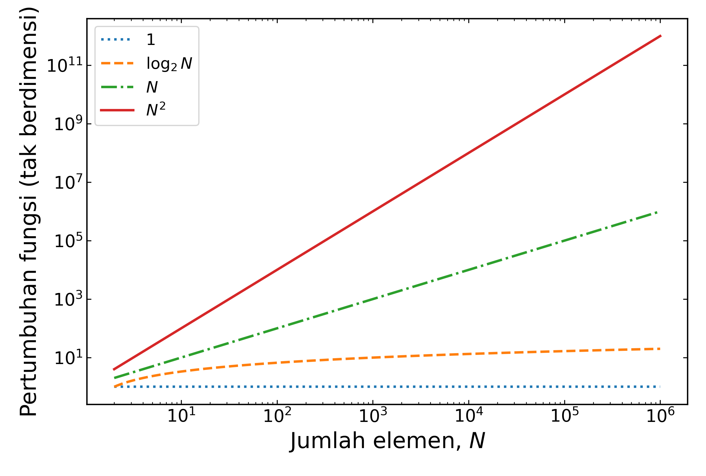
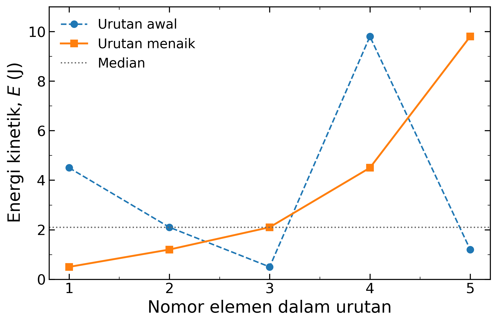

# Kuliah 11: Algoritma Pengurutan

## Mengapa data perlu diurutkan?

Pada materi sebelumnya kita mempelajari pencarian linear dan pencarian biner. Pencarian biner memiliki kompleksitas logaritmik, tetapi memerlukan data yang sudah terurut menurut kunci pencarian.

Dalam eksperimen dan simulasi, urutan data biasanya mengikuti waktu pengukuran atau urutan pembangkitan data. Urutan tersebut belum tentu sesuai dengan kebutuhan analisis, misalnya ketika kita ingin menentukan median energi partikel, menyusun peringkat intensitas spektrum, atau mencari partikel yang berdekatan berdasarkan posisi.

Pengurutan posisi juga digunakan sebagai tahap awal dalam metode *sweep and prune* untuk menyaring pasangan kandidat tumbukan partikel. Pengurutan dapat mengurangi pekerjaan pada banyak konfigurasi, tetapi tidak menjamin bahwa jumlah pasangan kandidat selalu lebih kecil daripada orde kuadratik.

## Perumusan masalah pengurutan

Misalkan terdapat $N$ data numerik dalam larik $A$. Pengurutan menaik (*ascending order*) menghasilkan suatu permutasi $B$ dari data tersebut yang memenuhi

```math
B_0\leq B_1\leq\cdots\leq B_{N-1}.
```

Kata permutasi penting karena semua elemen asli harus tetap ada, termasuk elemen yang nilainya sama. Menghasilkan larik yang terurut saja belum cukup untuk menjamin bahwa algoritma benar jika ada data yang hilang atau berubah nilainya.

Sebagai contoh, perhatikan lima nilai berikut. Pengurutan menaik dan menurun menghasilkan dua susunan berbeda dari himpunan data yang sama.

| Keadaan | Isi larik |
|---|---|
| Awal | 5, 3, 8, 4, 1 |
| Menaik | 1, 3, 4, 5, 8 |
| Menurun | 8, 5, 4, 3, 1 |

Kita akan menggunakan indeks mulai dari nol dan nilai numerik berhingga. Kelima algoritma berikut mengurutkan data menaik dengan mengubah isi larik asli.

### Operasi pertukaran

Pertukaran dua elemen (*swap*) memerlukan penyimpanan sementara agar nilai pertama tidak hilang. Dalam C, kita dapat memanfaatkan *pointer* untuk membuat fungsi yang digunakan kembali.

```c
void swap(double *a, double *b)
{
    double temp = *a;
    *a = *b;
    *b = temp;
}
```

Pemanggilan `swap(&a[i], &a[j])` mengirim alamat kedua elemen. Dalam Python, pertukaran dapat langsung dilakukan melalui penugasan (*assignment*) berikut.

```python
a[i], a[j] = a[j], a[i]
```

## Bubble sort (pengurutan apung)

Algoritma ini membandingkan pasangan elemen bersebelahan dan menukarnya jika urutannya salah. Setelah satu penelusuran dari kiri ke kanan, elemen terbesar pada bagian yang belum terurut mencapai ujung kanan bagian tersebut.

### Penelusuran algoritma

Gunakan larik `[5, 3, 8, 4, 1]` sebagai contoh. Perhatikan bagaimana nilai 8 bergerak ke kanan selama putaran pertama.

| Pasangan | Tindakan | Isi larik |
|---|---|---|
| 5, 3 | Tukar | 3, 5, 8, 4, 1 |
| 5, 8 | Tetap | 3, 5, 8, 4, 1 |
| 8, 4 | Tukar | 3, 5, 4, 8, 1 |
| 8, 1 | Tukar | 3, 5, 4, 1, 8 |

Setelah putaran pertama, nilai 8 tidak perlu diperiksa lagi. Putaran berikutnya cukup memproses empat elemen pertama, kemudian tiga elemen pertama, dan seterusnya.

Invarian pengulangan luar menyatakan bahwa setelah $k$ putaran, $k$ elemen terbesar telah berada pada posisi akhirnya di sebelah kanan. Pada awalnya $k=0$, dan setiap putaran menempatkan satu elemen terbesar berikutnya sehingga sifat ini tetap berlaku.

### Pseudocode

```text
FOR i ← 0 TO N-2
    changed ← false
    FOR j ← 0 TO N-i-2
        IF A[j] > A[j+1]
            SWAP A[j], A[j+1]
            changed ← true
        END IF
    END FOR
    IF NOT changed
        BREAK
    END IF
END FOR
```

Variabel `changed` mencatat apakah terjadi pertukaran dalam satu putaran. Jika tidak ada pertukaran, bagian yang diperiksa sudah terurut dan pengulangan dapat dihentikan.

### Implementasi

**Bahasa C**

```c
void bubble_sort(double a[], int n)
{
    for (int i = 0; i < n - 1; i++) {
        int changed = 0;
        for (int j = 0; j < n - i - 1; j++) {
            if (a[j] > a[j + 1]) {
                swap(&a[j], &a[j + 1]);
                changed = 1;
            }
        }
        if (!changed) break;
    }
}
```

**Python**

```python
def bubble_sort(a):
    n = len(a)
    for i in range(n - 1):
        changed = False
        for j in range(n - i - 1):
            if a[j] > a[j + 1]:
                a[j], a[j + 1] = a[j + 1], a[j]
                changed = True
        if not changed:
            break
```

Program lengkap yang dapat langsung dijalankan tersedia dalam [`Kode/bubble_sort.c`](Kode/bubble_sort.c) dan [`Kode/bubble_sort.py`](Kode/bubble_sort.py). Kedua implementasi mengubah isi larik atau `list` asli.

### Kompleksitas

Dalam kasus terburuk, misalnya data berbeda yang terurut menurun, setiap putaran harus dijalankan. Banyak perbandingan adalah

```math
C(N)=(N-1)+(N-2)+\cdots+1=\frac{N(N-1)}{2}.
```

Dengan demikian, kompleksitas kasus terburuk adalah $\Theta(N^2)$. Untuk data yang sudah terurut, versi dengan `changed` berhenti setelah $N-1$ perbandingan sehingga kasus terbaiknya $\Theta(N)$.

## Selection sort (pengurutan seleksi)

*Selection sort* mencari elemen terkecil pada bagian yang belum terurut, kemudian menukarnya dengan elemen pertama bagian tersebut. Berbeda dari *bubble sort*, pertukaran dilakukan setelah pencarian minimum selesai.

### Penelusuran algoritma

Gunakan larik yang sama agar perbedaan strategi mudah terlihat. Setiap baris tabel menunjukkan keadaan setelah satu putaran selesai.

| Putaran | Minimum bagian tersisa | Isi larik |
|---:|---:|---|
| 1 | 1 | **1**, 3, 8, 4, 5 |
| 2 | 3 | **1, 3**, 8, 4, 5 |
| 3 | 4 | **1, 3, 4**, 8, 5 |
| 4 | 5 | **1, 3, 4, 5**, 8 |

Invariannya adalah bahwa sebelum putaran berindeks $i$, bagian `A[0:i]` (indeks 0 sampai $i-1$) memuat $i$ elemen terkecil yang sudah berada pada posisi akhir. Pemilihan minimum dari bagian tersisa mempertahankan sifat tersebut untuk putaran selanjutnya.

### Pseudocode

```text
FOR i ← 0 TO N-2
    m ← i
    FOR j ← i+1 TO N-1
        IF A[j] < A[m]
            m ← j
        END IF
    END FOR
    IF m ≠ i
        SWAP A[i], A[m]
    END IF
END FOR
```

### Implementasi

**Bahasa C**

```c
void selection_sort(double a[], int n)
{
    for (int i = 0; i < n - 1; i++) {
        int m = i;
        for (int j = i + 1; j < n; j++) {
            if (a[j] < a[m]) m = j;
        }
        if (m != i) swap(&a[i], &a[m]);
    }
}
```

**Python**

```python
def selection_sort(a):
    for i in range(len(a) - 1):
        m = i
        for j in range(i + 1, len(a)):
            if a[j] < a[m]:
                m = j
        if m != i:
            a[i], a[m] = a[m], a[i]
```

Program lengkap yang dapat langsung dijalankan tersedia dalam [`Kode/selection_sort.c`](Kode/selection_sort.c) dan [`Kode/selection_sort.py`](Kode/selection_sort.py). Kedua implementasi mengubah isi larik atau `list` asli.

### Kompleksitas

Pencarian minimum tetap dilakukan meskipun larik sudah terurut. Oleh karena itu, jumlah perbandingan selalu $N(N-1)/2$ dan kompleksitas waktu untuk semua susunan adalah $\Theta(N^2)$.

Jumlah pertukaran paling banyak $N-1$ karena setiap putaran hanya melakukan satu pertukaran. Ini dapat menjadi keuntungan jika penulisan data lebih mahal daripada pembandingan.

## Insertion sort (pengurutan sisip)

*Insertion sort* bekerja seperti menyusun kartu di tangan. Kita mengambil satu elemen dari bagian yang belum terurut, menggeser elemen yang lebih besar ke kanan, lalu menyisipkan elemen tersebut ke posisi yang tepat.

### Penelusuran algoritma

Misalkan tiga elemen awal `[2, 5, 8]` sudah terurut dan elemen berikutnya adalah 3. Simpan nilai 3 sebagai `key` agar nilainya tidak hilang selama pergeseran.

```text
[2, 5, 8, 3, 9]   key = 3
[2, 5, 8, 8, 9]   geser 8
[2, 5, 5, 8, 9]   geser 5
[2, 3, 5, 8, 9]   sisipkan key
```

Invariannya adalah bahwa sebelum putaran $i$, bagian dengan indeks 0 sampai $i-1$ telah terurut dan merupakan permutasi dari elemen awal bagian tersebut. Berbeda dari *selection sort*, elemen pada bagian terurut belum tentu berada pada posisi akhirnya di seluruh larik.

### Pseudocode

```text
FOR i ← 1 TO N-1
    key ← A[i]
    j ← i-1
    WHILE j ≥ 0 AND A[j] > key
        A[j+1] ← A[j]
        j ← j-1
    END WHILE
    A[j+1] ← key
END FOR
```

### Implementasi

**Bahasa C**

```c
void insertion_sort(double a[], int n)
{
    for (int i = 1; i < n; i++) {
        double key = a[i];
        int j = i - 1;
        while (j >= 0 && a[j] > key) {
            a[j + 1] = a[j];
            j--;
        }
        a[j + 1] = key;
    }
}
```

**Python**

```python
def insertion_sort(a):
    for i in range(1, len(a)):
        key = a[i]
        j = i - 1
        while j >= 0 and a[j] > key:
            a[j + 1] = a[j]
            j -= 1
        a[j + 1] = key
```

Program lengkap yang dapat langsung dijalankan tersedia dalam [`Kode/insertion_sort.c`](Kode/insertion_sort.c) dan [`Kode/insertion_sort.py`](Kode/insertion_sort.py). Kedua implementasi mengubah isi larik atau `list` asli.

Syarat `j >= 0` harus diperiksa sebelum mengakses `a[j]`. C dan Python menggunakan evaluasi hubungan logika secara hubung singkat (*short-circuit evaluation*), sehingga akses tersebut tidak dilakukan jika syarat pertama salah.

### Kompleksitas

Jika data sudah terurut, tidak ada elemen yang perlu digeser dan hanya diperlukan $N-1$ perbandingan nilai. Jika data dengan nilai berbeda terurut menurun, setiap elemen baru harus menggeser seluruh elemen sebelumnya ke kanan sehingga kasus terburuknya $\Theta(N^2)$.

Untuk data hampir terurut, *insertion sort* sering memerlukan sedikit pergeseran. Secara lebih tepat, jumlah pergeseran sama dengan jumlah inversi awal, yaitu pasangan indeks $i<j$ dengan $A_i>A_j$.

## Rekursi dan strategi divide and conquer

Tiga algoritma sebelumnya menggunakan pengulangan untuk memperbesar bagian yang terurut. Dua algoritma berikutnya menggunakan strategi *divide and conquer*, yaitu membagi masalah menjadi submasalah yang lebih kecil, menyelesaikannya, lalu memperoleh hasil keseluruhan.

Fungsi rekursif adalah fungsi yang memanggil dirinya sendiri untuk menyelesaikan submasalah. Agar proses berhenti, setiap pemanggilan harus memperkecil ukuran masalah dan memiliki kasus dasar, misalnya bagian larik dengan nol atau satu elemen.

## Merge sort (pengurutan gabung)

*Merge sort* membagi larik menjadi dua bagian, mengurutkan masing-masing bagian secara rekursif, lalu menggabungkan kedua bagian terurut. Tahap penggabungan merupakan inti algoritma karena dua bagian yang terurut dapat digabungkan dengan satu penelusuran.

```text
             [38, 27, 43, 3]
              /           \
         [38, 27]        [43, 3]
          /    \          /   \
        [38]  [27]      [43]  [3]
          \    /          \   /
         [27, 38]        [3, 43]
              \           /
             [3, 27, 38, 43]
```

Pada saat menggabungkan `[27, 38]` dengan `[3, 43]`, kita membandingkan elemen pertama yang belum diambil dari masing-masing bagian. Urutan pemilihannya adalah 3, 27, 38, lalu 43 yang tersisa.

### Pseudocode

Kita gunakan rentang setengah terbuka `[l, r)`, yaitu indeks `l` termasuk dan `r` tidak termasuk. Konvensi ini memudahkan representasi bagian kosong serta sesuai dengan notasi irisan Python.

```text
MERGE_SORT(A, temp, l, r)
    IF r-l ≤ 1
        RETURN
    END IF
    m ← l + FLOOR((r-l)/2)
    MERGE_SORT(A, temp, l, m)
    MERGE_SORT(A, temp, m, r)
    MERGE(A, temp, l, m, r)
```

Fungsi `MERGE` mengambil nilai terkecil dari dua bagian terurut dan menyimpannya ke larik sementara. Setelah salah satu bagian habis, sisa bagian lainnya disalin dan seluruh hasil penggabungan dikembalikan ke larik asli.

### Implementasi

**Bahasa C**

```c
void merge(double a[], double tmp[], int l, int m, int r)
{
    int i = l, j = m, k = l;
    while (i < m && j < r) {
        if (a[i] <= a[j]) tmp[k++] = a[i++];
        else tmp[k++] = a[j++];
    }
    while (i < m) tmp[k++] = a[i++];
    while (j < r) tmp[k++] = a[j++];
    for (k = l; k < r; k++) a[k] = tmp[k];
}

void merge_sort(double a[], double tmp[], int l, int r)
{
    if (r - l <= 1) return;
    int m = l + (r - l) / 2;
    merge_sort(a, tmp, l, m);
    merge_sort(a, tmp, m, r);
    merge(a, tmp, l, m, r);
}
```

**Python**

```python
def merge(a, tmp, l, m, r):
    i, j, k = l, m, l
    while i < m and j < r:
        if a[i] <= a[j]:
            tmp[k] = a[i]
            i += 1
        else:
            tmp[k] = a[j]
            j += 1
        k += 1
    while i < m:
        tmp[k] = a[i]
        i += 1
        k += 1
    while j < r:
        tmp[k] = a[j]
        j += 1
        k += 1
    a[l:r] = tmp[l:r]


def merge_sort(a, tmp, l, r):
    if r - l <= 1:
        return
    m = l + (r - l) // 2
    merge_sort(a, tmp, l, m)
    merge_sort(a, tmp, m, r)
    merge(a, tmp, l, m, r)
```

Program lengkap yang dapat langsung dijalankan tersedia dalam [`Kode/merge_sort.c`](Kode/merge_sort.c) dan [`Kode/merge_sort.py`](Kode/merge_sort.py). Kedua implementasi mengubah isi larik atau `list` asli.

Untuk larik berukuran $N$, panggilan awal dalam C adalah `merge_sort(a, tmp, 0, n)` dengan `tmp` berkapasitas sekurang-kurangnya $N$ elemen. Padanannya dalam Python adalah `merge_sort(a, [0.0] * len(a), 0, len(a))`.

### Kompleksitas

Untuk mempermudah analisis, anggap $N=2^k$. Pembagian menjadi dua menghasilkan $k=\log_2 N$ tingkat penggabungan, dengan total pekerjaan linear pada setiap tingkat.

```math
T(N)=2T(N/2)+\Theta(N)
\quad\Longrightarrow\quad T(N)=\Theta(N\log N).
```

Hasil ini berlaku untuk kasus terbaik maupun terburuk pada implementasi tersebut, termasuk ketika $N$ bukan pangkat dua. Biaya tambahannya adalah larik sementara berukuran $\Theta(N)$ serta tumpukan pemanggilan rekursif berukuran $O(\log N)$.

## Quick sort (pengurutan cepat)

*Quick sort* juga menggunakan rekursi, tetapi pekerjaan utama dilakukan sebelum pemanggilan rekursif. Algoritma memilih nilai acuan (*pivot*) lalu mempartisi larik sehingga elemen lebih kecil daripada pivot berada di kiri dan elemen lain berada di kanan.

### Partisi

Misalkan kita menggunakan elemen terakhir sebagai pivot. Pada contoh berikut, satu proses partisi menempatkan nilai 50 pada posisi yang sudah benar terhadap seluruh elemen lain.

```text
Awal:    [90, 20, 70, 10, 80, 30, 50]
Partisi: [20, 10, 30, 50, 80, 70, 90]
                     ^
                    pivot
```

Bagian kiri dan kanan belum tentu terurut, sehingga keduanya masih harus diproses. Nilai yang sama dengan pivot ditempatkan di bagian kanan oleh aturan perbandingan ketat `<` pada implementasi ini.

### Pseudocode

Berbeda dari implementasi *merge sort* tadi, kita gunakan rentang inklusif `[low, high]` untuk mengikuti konvensi PDF acuan. Pivot dikeluarkan dari kedua pemanggilan rekursif karena posisinya sudah benar.

```text
QUICK_SORT(A, low, high)
    IF low ≥ high
        RETURN
    END IF
    p ← PARTITION(A, low, high)
    QUICK_SORT(A, low, p-1)
    QUICK_SORT(A, p+1, high)
```

Selama partisi, indeks `i` menandai batas bagian yang berisi nilai lebih kecil daripada pivot. Setiap kali nilai lebih kecil ditemukan, nilai tersebut dipindahkan ke posisi `i` dan batas diperbarui.

### Implementasi

**Bahasa C**

```c
int partition(double a[], int low, int high)
{
    double pivot = a[high];
    int i = low;
    for (int j = low; j < high; j++) {
        if (a[j] < pivot) {
            swap(&a[i], &a[j]);
            i++;
        }
    }
    swap(&a[i], &a[high]);
    return i;
}

void quick_sort(double a[], int low, int high)
{
    if (low >= high) return;
    int p = partition(a, low, high);
    quick_sort(a, low, p - 1);
    quick_sort(a, p + 1, high);
}
```

**Python**

```python
def partition(a, low, high):
    pivot = a[high]
    i = low
    for j in range(low, high):
        if a[j] < pivot:
            a[i], a[j] = a[j], a[i]
            i += 1
    a[i], a[high] = a[high], a[i]
    return i


def quick_sort(a, low, high):
    if low >= high:
        return
    p = partition(a, low, high)
    quick_sort(a, low, p - 1)
    quick_sort(a, p + 1, high)
```

Program lengkap yang dapat langsung dijalankan tersedia dalam [`Kode/quick_sort.c`](Kode/quick_sort.c) dan [`Kode/quick_sort.py`](Kode/quick_sort.py). Kedua implementasi mengubah isi larik atau `list` asli.

Panggilan awal dalam C adalah `quick_sort(a, 0, n - 1)`. Dalam Python, bentuknya adalah `quick_sort(a, 0, len(a) - 1)`.

### Kompleksitas

Jika partisi relatif seimbang, jumlah tingkat rekursi berorde $\log N$ dan pekerjaan pada tiap tingkat berorde $N$. Kompleksitas terbaik adalah $\Theta(N\log N)$, demikian pula kompleksitas rata-rata untuk permutasi acak dari data berbeda.

Namun, pemilihan elemen terakhir sebagai pivot dapat menghasilkan partisi yang sangat timpang, misalnya pada data terurut atau data yang seluruh nilainya sama. Dalam kasus tersebut, satu submasalah hanya berkurang satu elemen setiap kali sehingga

```math
T(N)=T(N-1)+\Theta(N)=\Theta(N^2).
```

Tumpukan rekursi juga dapat mencapai $O(N)$ pada kasus terburuk. Implementasi ini ditujukan untuk pembelajaran, bukan untuk menangani larik besar dengan sembarang distribusi data tanpa perlindungan tambahan.

## Membandingkan kelima algoritma

Tabel berikut merangkum kompleksitas waktu untuk implementasi yang digunakan di catatan ini. Notasi $\Theta$ menyatakan orde pertumbuhan yang ketat, sedangkan $O$ menyatakan batas atas asimtotik.

| Algoritma | Terbaik | Rata-rata* | Terburuk | Memori tambahan** | Stabil |
|---|---|---|---|---|---|
| Bubble | $\Theta(N)$ | $\Theta(N^2)$ | $\Theta(N^2)$ | $O(1)$ | Ya |
| Selection | $\Theta(N^2)$ | $\Theta(N^2)$ | $\Theta(N^2)$ | $O(1)$ | Tidak |
| Insertion | $\Theta(N)$ | $\Theta(N^2)$ | $\Theta(N^2)$ | $O(1)$ | Ya |
| Merge | $\Theta(N\log N)$ | $\Theta(N\log N)$ | $\Theta(N\log N)$ | $O(N)$ | Ya |
| Quick | $\Theta(N\log N)$ | $\Theta(N\log N)$ | $\Theta(N^2)$ | $O(\log N)$ rata-rata, $O(N)$ terburuk | Tidak |

\* Kasus rata-rata mengasumsikan permutasi acak dari nilai berbeda. \*\* Memori tambahan mencakup tumpukan rekursi, tetapi tidak mencakup larik masukan.



Grafik membandingkan fungsi pertumbuhan $N$, $N\log_2 N$, dan $N^2$, bukan waktu eksekusi yang diukur. Konstanta, biaya akses memori, distribusi data, dan implementasi dapat mengubah peringkat waktu aktual untuk ukuran data tertentu.

### Stabilitas pengurutan

Pengurutan disebut stabil jika dua rekaman dengan kunci yang sama mempertahankan urutan relatif awalnya. Sebagai contoh, rekaman intensitas `[4_A, 4_B, 2_C]` setelah pengurutan stabil menjadi `[2_C, 4_A, 4_B]`, dengan huruf menyatakan identitas sensor.

*Bubble sort* dan *insertion sort* di atas tidak memindahkan elemen yang sama melewati satu sama lain. *Merge sort* juga stabil karena kondisi `<=` memilih elemen bagian kiri terlebih dahulu jika nilainya sama, sedangkan pertukaran pada *selection sort* dan *quick sort* tidak menjamin stabilitas.

### Pengurutan dan pencarian

Jika hanya ingin mencari nilai minimum atau maksimum sekali, penelusuran linear sudah cukup dan pengurutan biasanya tidak diperlukan. Jika data perlu dicari berulang kali atau disajikan dalam urutan tertentu, biaya pengurutan awal dapat menjadi investasi yang masuk akal.

Untuk $Q$ pencarian pada $N$ data, pencarian linear membutuhkan $O(QN)$ dalam kasus terburuk. Pengurutan dengan *merge sort* diikuti pencarian biner membutuhkan $O(N\log N+Q\log N)$, dengan asumsi data tidak berubah selama rangkaian pencarian.

## Studi kasus: distribusi energi kinetik

PDF acuan menggunakan data energi kinetik lima partikel gas untuk memperkenalkan pengurutan. Kita gunakan data ilustratif yang sama dalam joule, bukan data pengukuran gas nyata pada skala molekuler.

```math
E=[4.5,\;2.1,\;0.5,\;9.8,\;1.2]\;\mathrm{J}.
```

Hasil pengurutan adalah `[0.5, 1.2, 2.1, 4.5, 9.8]` dalam joule. Untuk data terurut $B$, median dapat dihitung berdasarkan paritas jumlah elemen sebagai berikut.

```math
\mathrm{median}(B)=\begin{cases}
B_{\lfloor N/2\rfloor},&N\text{ ganjil},\\
(B_{N/2-1}+B_{N/2})/2,&N\text{ genap}.
\end{cases}
```

Untuk contoh ini, minimum adalah 0,5 J, maksimum 9,8 J, dan median 2,1 J. Rata-rata bernilai 3,62 J dan tidak berubah akibat pengurutan; median tidak harus sama dengan rata-rata.

### Implementasi C

Gunakan fungsi `insertion_sort` yang telah dipelajari dan tambahkan program utama berikut. Program lengkap tersedia pada [`Kode/energi.c`](Kode/energi.c).

```c
#include <stdio.h>

/* Letakkan definisi insertion_sort di sini. */

int main(void)
{
    double e[] = {4.5, 2.1, 0.5, 9.8, 1.2};
    int n = sizeof(e) / sizeof(e[0]);
    insertion_sort(e, n);
    double median = (n % 2 != 0) ? e[n / 2]
        : (e[n / 2 - 1] + e[n / 2]) / 2.0;
    printf("Min = %.2f J\n", e[0]);
    printf("Median = %.2f J\n", median);
    printf("Max = %.2f J\n", e[n - 1]);
    return 0;
}
```

### Implementasi Python

Python menyediakan `sorted` untuk membuat daftar terurut baru dan metode `sort` untuk mengubah daftar asli. Untuk kasus energi, kita dapat mempertahankan urutan data mentah dengan memilih `sorted`.

```python
energy = [4.5, 2.1, 0.5, 9.8, 1.2]
b = sorted(energy)
n = len(b)
median = b[n // 2] if n % 2 else (b[n // 2 - 1] + b[n // 2]) / 2
print(f"Min = {b[0]:.2f} J")
print(f"Median = {median:.2f} J")
print(f"Max = {b[-1]:.2f} J")
```

Fungsi bawaan Python menggunakan pengurutan stabil dan adaptif. Pada C, pustaka `<stdlib.h>` menyediakan `qsort` dengan fungsi pembanding; namanya tidak menjamin bahwa implementasinya menggunakan *quick sort* atau bahwa hasilnya stabil.



Grafik memperlihatkan bahwa pengurutan mengubah posisi data, bukan energi masing-masing partikel. Indeks pada sumbu horizontal grafik terurut menyatakan peringkat, bukan waktu pengukuran atau identitas partikel.

## Mengurutkan rekaman pengukuran

Sering kali setiap nilai memiliki informasi lain yang harus dipertahankan, misalnya panjang gelombang yang berkaitan dengan intensitas spektrum. Jika kita hanya mengurutkan intensitas tanpa memindahkan panjang gelombangnya, hubungan antarkolom akan rusak.

Dalam C, kita dapat menggunakan `struct` dan memindahkan seluruh rekaman. Contoh berikut mengurutkan spektrum berdasarkan intensitas menurun dengan pola *insertion sort*.

```c
typedef struct {
    double wavelength;
    double intensity;
} Peak;

void sort_peaks(Peak a[], int n)
{
    for (int i = 1; i < n; i++) {
        Peak key = a[i];
        int j = i - 1;
        while (j >= 0 && a[j].intensity < key.intensity) {
            a[j + 1] = a[j];
            j--;
        }
        a[j + 1] = key;
    }
}
```

Dalam Python, pasangan panjang gelombang dan intensitas dapat disimpan sebagai tupel. Parameter `key` menentukan anggota yang digunakan sebagai kunci pengurutan, sedangkan `reverse=True` menghasilkan urutan menurun.

```python
peaks = [(450, 0.72), (520, 1.15), (610, 0.72)]
ranked = sorted(peaks, key=lambda row: row[1], reverse=True)
print(ranked)
```

Hasilnya adalah `[(520, 1.15), (450, 0.72), (610, 0.72)]`. Kedua intensitas yang sama tetap mempertahankan urutan awalnya dan masing-masing masih terhubung dengan panjang gelombang yang benar.

## Pengujian algoritma

Pengujian harus memeriksa dua syarat, yaitu keterurutan dan terpeliharanya seluruh elemen. Untuk data numerik kecil, hasil dapat dibandingkan dengan hasil pengurutan manual atau fungsi pustaka yang dipercaya.

| Masukan | Hasil yang diharapkan |
|---|---|
| `[]` | `[]` |
| `[7]` | `[7]` |
| `[1, 2, 3]` | `[1, 2, 3]` |
| `[3, 2, 1]` | `[1, 2, 3]` |
| `[3, -1, 3, 0]` | `[-1, 0, 3, 3]` |
| `[2, 2, 2]` | `[2, 2, 2]` |

Pada data eksperimen, periksa juga nilai tak berhingga atau `NaN` sebelum pengurutan. Nilai `NaN` tidak memenuhi aturan pembandingan biasa sehingga asumsi algoritma numerik dapat gagal.

## Cek pemahaman

Jawablah pertanyaan berikut sebelum mencoba latihan. Gunakan penelusuran manual jika penjelasan verbal saja belum cukup.

- Apa dua syarat hasil pengurutan yang benar?
- Apa perbedaan pertukaran pada *bubble sort* dan *selection sort*?
- Mengapa *insertion sort* cocok untuk data hampir terurut?
- Mengapa *bubble sort* tanpa penghentian dini tidak memiliki kasus terbaik linear?
- Apa perbedaan tahap pembagian pada *merge sort* dan *quick sort*?
- Kapan *quick sort* dapat menjadi kuadratik?
- Apa arti stabilitas ketika data memiliki identitas sensor?
- Mengapa mencari maksimum saja tidak memerlukan pengurutan?

## Latihan

Untuk soal implementasi, gunakan C dan Python sesuai instruksi masing-masing soal. Periksa hasil dengan data kecil sebelum mencoba ukuran data besar.

### 1. Penelusuran manual

Urutkan `[7, 2, 5, 2, -1]` menggunakan *bubble sort*, *selection sort*, dan *insertion sort*. Buat tabel keadaan setelah setiap putaran, hitung jumlah perbandingan nilai dan pertukaran (atau pergeseran untuk *insertion sort*), serta nyatakan invarian masing-masing algoritma.

### 2. Median energi partikel

Gunakan `Data/energi.csv` dan tambahkan tiga energi positif pilihan Anda sehingga jumlah data menjadi genap. Buat program C dan Python yang membaca atau memuat nilai tersebut, mengurutkannya, lalu menghitung median, rata-rata, minimum, dan maksimum; jelaskan mengapa rata-rata tidak berubah akibat pengurutan.

### 3. Peringkat intensitas spektrum

Gunakan `Data/spektrum-11.csv` untuk menyusun peringkat intensitas menurun tanpa merusak pasangan panjang gelombang dan intensitas. Implementasikan pengurutan rekaman dalam C dan Python, tampilkan tiga puncak terkuat, serta periksa urutan relatif dua rekaman dengan intensitas sama.

### 4. Posisi partikel dan jarak terdekat

Diberikan posisi partikel pada garis lurus `[1.2, -0.4, 2.7, 0.9, -0.1]` dalam meter. Urutkan posisi dengan *selection sort* dalam C dan Python, kemudian cari jarak terkecil antara pasangan bersebelahan dan jelaskan mengapa pasangan dengan jarak minimum pasti dapat ditemukan pada susunan terurut.

### 5. Data hampir terurut

Sebuah sensor menghasilkan data tekanan `[100, 101, 103, 102, 104, 106, 105]` dalam kPa. Bandingkan banyak perbandingan dan pergeseran *insertion sort* dengan *bubble sort* berpenghentian dini pada data tersebut dan pada urutan terbalik; tambahkan pencacah pada implementasi Python untuk memverifikasi hasil manual.

### 6. Partisi quick sort

Gunakan data hambatan `[10, 20, 30, 40, 50, 60]` dalam ohm untuk menelusuri *quick sort* dengan pivot terakhir. Hitung jumlah perbandingan pada seluruh partisi, lalu bandingkan dengan data yang sama dalam urutan acak; jelaskan pengaruh pemilihan pivot terhadap kedalaman rekursi.

### 7. Penggabungan dua data eksperimen

Dua alat menghasilkan daftar waktu terurut `[0.0, 0.5, 1.5, 2.0]` dan `[0.2, 0.5, 1.0, 2.1]` dalam sekon. Implementasikan tahap *merge* saja dalam C dan Python dengan mempertahankan kedua nilai 0,5 serta identitas alat, kemudian jelaskan mengapa kompleksitasnya linear terhadap jumlah kedua daftar.

### 8. Eksperimen kompleksitas

Bangkitkan data bilangan bulat acak dengan benih tetap menggunakan Python untuk $N=100,200,400,800,1600$. Ukur waktu pengurutan kelima algoritma dengan `time.perf_counter`, gunakan salinan masukan yang sama untuk setiap metode dan beberapa pengulangan, lalu buat grafik waktu median terhadap $N$ dengan label dan satuan yang jelas.

Pisahkan waktu pembangkitan dan penyalinan data dari pengukuran waktu pengurutan. Bandingkan hasil dengan orde pertumbuhan teoritis tanpa menganggap bahwa grafik waktu harus persis mengikuti fungsi teoritis.

## Rangkuman

Pengurutan menghasilkan permutasi data yang memenuhi urutan tertentu. Kebenaran algoritma dapat diperiksa melalui invarian, keterurutan hasil, dan keterpeliharaan elemen asli.

*Bubble sort*, *selection sort*, dan *insertion sort* memiliki kompleksitas kasus terburuk kuadratik. *Merge sort* menjamin waktu $\Theta(N\log N)$ pada implementasi ini, sedangkan *quick sort* memiliki waktu rata-rata seorde tersebut tetapi dapat mengalami kasus terburuk kuadratik.

Pemilihan algoritma bergantung pada ukuran data, kondisi awal, memori tambahan, dan kebutuhan stabilitas. Dalam komputasi ilmiah, identitas rekaman dan satuan harus tetap terpelihara selama pengurutan.
