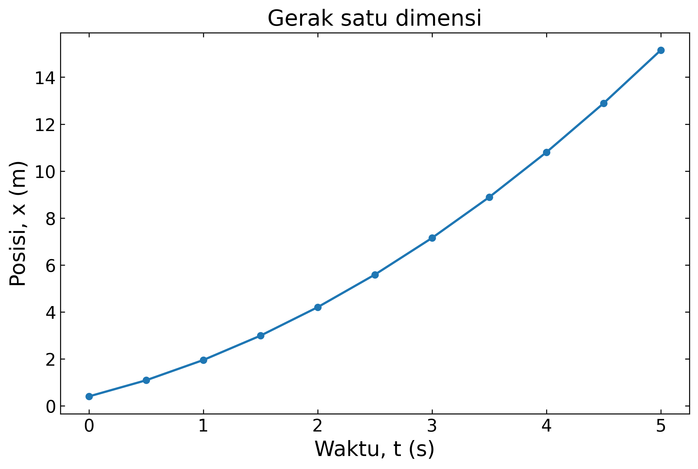
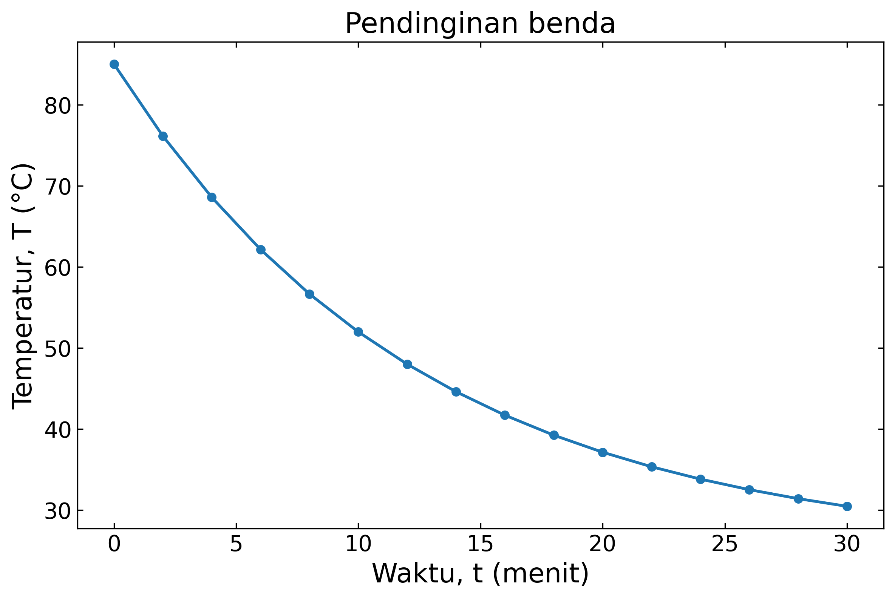
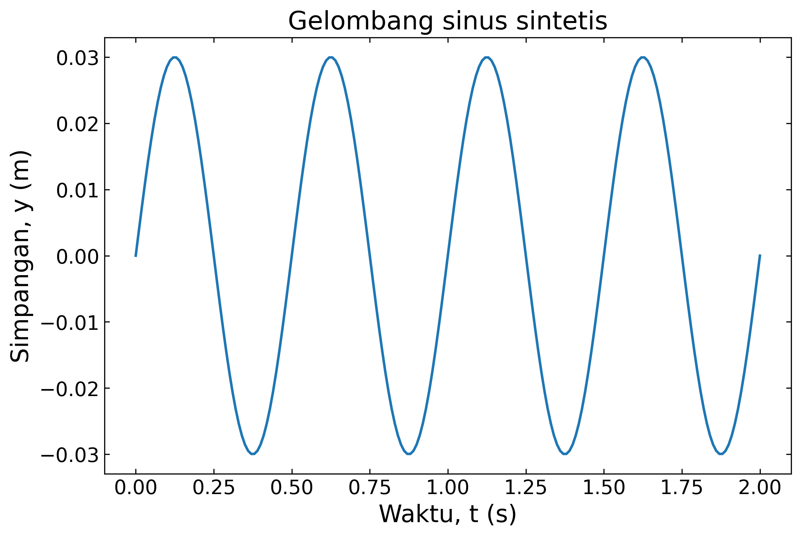

# Kuliah 9: Python untuk Komputasi Ilmiah

## Mengapa beralih dari C ke Python?

Pada kuliah-kuliah sebelumnya kita menggunakan bahasa C untuk memahami struktur program, representasi data, aliran kontrol, fungsi, larik, `struct`, dan berkas. Pendekatan tersebut penting karena C memperlihatkan banyak detail komputasi yang biasanya tersembunyi pada bahasa tingkat lebih tinggi.

Pada kuliah ini kita mulai menggunakan Python sebagai perangkat komputasi ilmiah. Tujuannya bukan mempelajari seluruh bahasa Python, tetapi menggunakan bagian-bagian yang paling relevan untuk pengolahan data, komputasi numerik, dan visualisasi.

Mahasiswa tidak perlu memulai kembali dari nol. Konsep seperti variabel, ekspresi, percabangan, pengulangan, fungsi, larik, dan berkas tetap sama secara algoritmik, tetapi sintaks serta pustaka yang digunakan berbeda.

Alur berpikir yang ingin dipertahankan tetap sama:

```math
\boxed{
\text{persoalan}
\rightarrow
\text{model}
\rightarrow
\text{algoritma}
\rightarrow
\text{program}
\rightarrow
\text{data}
\rightarrow
\text{analisis}
\rightarrow
\text{visualisasi}
}
```

Python akan membantu kita bekerja lebih cepat pada bagian analisis data dan visualisasi. Namun, kemudahan sintaks tidak menghilangkan tugas-tugas kita sebagai pemrogram untuk memeriksa satuan, asumsi, kasus batas, dan kewajaran hasil.

## Python sebagai perangkat komputasi ilmiah

Python merupakan bahasa pemrograman tingkat tinggi dengan ekosistem pustaka yang luas. Dalam konteks kuliah ini, dua pustaka yang paling penting adalah NumPy untuk komputasi numerik dan Matplotlib untuk visualisasi.

Kombinasi Python, NumPy, dan Matplotlib banyak digunakan untuk eksplorasi data, analisis eksperimen, pembuatan grafik, dan prototipe algoritma. Kita akan menggunakan ketiganya sebagai alat kerja, bukan sebagai tujuan akhir tersendiri.

## Menyiapkan lingkungan Python

Program Python dijalankan menggunakan *interpreter*. Kita dapat memeriksa versi Python dari terminal dengan perintah berikut.

```bash
python --version
```

Pada beberapa sistem, perintah yang digunakan adalah

```bash
python3 --version
```

Untuk memasang NumPy dan Matplotlib, kita dapat menggunakan `pip`. Perintah dasarnya adalah

```bash
python -m pip install numpy matplotlib
```

Lingkungan laboratorium atau komputer institusi mungkin sudah menyediakan pustaka tersebut. Jika demikian, kita cukup mengimpor dan menggunakannya.

## Program Python pertama

Program C sederhana biasanya memerlukan fungsi `main`, tanda titik koma, dan deklarasi tipe. Python menghilangkan sebagian besar sintaks tersebut sehingga kode untuk tugas yang sama menjadi lebih ringkas.

Program Python berikut mencetak satu baris teks.

```python
print("Algoritma dan Pemrograman")
```

Tidak ada `#include`, `int main(void)`, atau `return 0`. Hal ini tidak berarti konsep eksekusi program hilang, tetapi detail sintaks yang harus ditulis menjadi lebih sedikit.

## Perbandingan sintaks C dan Python

Misalkan kita ingin menghitung energi kinetik

```math
E_k
=
\frac{1}{2}mv^2.
```

Dalam C, kita dapat menulis

```c
double mass = 2.0;
double velocity = 3.0;

double energy =
    0.5 * mass * velocity * velocity;
```

Dalam Python, bentuk sederhananya adalah

```python
mass = 2.0
velocity = 3.0

energy = 0.5 * mass * velocity**2
```

Python menggunakan `**` sebagai operator pangkat. Berbeda dari C, kita tidak perlu menuliskan tipe `double` pada deklarasi variabel.

## Variabel dan tipe dinamis

Python menggunakan tipe dinamis. Tipe sebuah nama ditentukan oleh nilai yang sedang dirujuk dan tidak harus dideklarasikan secara eksplisit.

```python
n = 10
temperature = 25.5
sensor_name = "T1"
active = True
```

Kita dapat memeriksa tipe dengan fungsi `type`. Contohnya adalah

```python
print(type(n))
print(type(temperature))
```

Kemudahan ini mengurangi sintaks, tetapi programmer tetap harus memahami jenis data yang sedang digunakan. Kesalahan tipe masih dapat terjadi walaupun tidak ada deklarasi eksplisit seperti pada C.

## Bilangan bulat dan bilangan real

Bilangan seperti `10` merupakan integer, sedangkan `10.0` merupakan bilangan *floating-point*. Pembagian menggunakan `/` menghasilkan bilangan real.

```python
a = 5
b = 2

print(a / b)
```

Keluaran adalah

```text
2.5
```

Jika kita memang menginginkan pembagian bulat, Python menyediakan operator `//`. Contohnya adalah `5 // 2`, yang menghasilkan `2`.

## Ekspresi matematika

Operator aritmetika dasar dalam Python mirip dengan C. Kita menggunakan `+`, `-`, `*`, `/`, dan `%`, sedangkan pangkat menggunakan `**`.

```python
x = 3.0

y = 2.0 * x**2 - 4.0 * x + 1.0
```

Tanda kurung tetap penting untuk memperjelas urutan evaluasi. Untuk ekspresi teknik, keterbacaan lebih penting daripada mencoba menulis semuanya dalam satu baris.

## Input dan output sederhana

Fungsi `input` membaca teks dari pengguna. Karena hasil `input` berupa *string*, kita perlu mengonversinya jika ingin memperoleh angka.

```python
mass = float(
    input("Mass (kg): ")
)

velocity = float(
    input("Velocity (m/s): ")
)
```

Kita dapat menghitung energi dalam beberapa baris menggunakan tanda kurung. Bentuk ini tetap mudah dibaca walaupun ekspresinya relatif panjang.

```python
energy = (
    0.5
    * mass
    * velocity**2
)

print(
    f"Kinetic energy = {energy:.3f} J"
)
```

Sintaks `:.3f` berarti tiga digit setelah titik desimal. Gagasan pemformatan ini serupa dengan `%.3f` pada `printf`.

## Percabangan dalam Python

Percabangan menggunakan `if`, `elif`, dan `else`. Perbedaan penting dari C adalah Python menggunakan indentasi untuk menentukan blok.

```python
temperature = 32.0

if temperature < 20.0:
    print("DINGIN")
elif temperature <= 30.0:
    print("NORMAL")
else:
    print("PANAS")
```

Tidak ada kurung kurawal untuk membatasi blok. Indentasi merupakan bagian dari sintaks dan harus konsisten.

## Kondisi logika

Operator logika Python ditulis dengan kata `and`, `or`, dan `not`. Hal ini berbeda dari C yang menggunakan `&&`, `||`, dan `!`.

```python
if (
    temperature >= 20.0
    and temperature <= 30.0
):
    print("NORMAL")
```

Python juga mengizinkan bentuk yang lebih dekat dengan notasi matematika.

```python
if 20.0 <= temperature <= 30.0:
    print("NORMAL")
```

Bentuk tersebut valid di Python. Ini berbeda dari C, sehingga mahasiswa perlu berhati-hati ketika berpindah antarbahasa.

## Pengulangan `for`

Python menggunakan `for` untuk menelusuri elemen suatu objek yang dapat diiterasi. Untuk pencacah integer, kita sering menggunakan `range`.

```python
for i in range(5):
    print(i)
```

Keluaran adalah

```text
0
1
2
3
4
```

`range(5)` menghasilkan urutan dari nol sampai sebelum lima. Pola ini sejalan dengan indeks larik yang dimulai dari nol.

## `range` dengan batas dan langkah

Kita dapat menentukan nilai awal, batas akhir, dan langkah. Bentuknya adalah `range(start, stop, step)`.

```python
for i in range(2, 11, 2):
    print(i)
```

Program mencetak bilangan genap dari 2 sampai 10. Nilai `stop` tidak ikut dihasilkan.

## Pengulangan `while`

`while` digunakan ketika pengulangan lebih alami dinyatakan melalui kondisi. Konsepnya sama seperti pada C.

```python
x = 0.0
dx = 0.001

while x * x < 2.0:
    x = x + dx

print(x)
```

Kondisi berhenti harus tetap dirancang dengan benar. Python tidak mencegah pengulangan tak hingga jika kondisi tidak pernah menjadi salah.

## Fungsi dalam Python

Fungsi didefinisikan menggunakan `def`. Tipe parameter dan nilai kembalian tidak wajib ditulis pada sintaks dasar.

```python
def kinetic_energy(mass, velocity):
    return 0.5 * mass * velocity**2
```

Pemanggilannya dapat ditulis

```python
energy = kinetic_energy(
    2.0,
    3.0
)
```

Konsep modularisasi tetap sama seperti pada C. Fungsi sebaiknya mempunyai tanggung jawab yang jelas dan input-output yang mudah dipahami.

## Variabel lokal

Variabel yang dibuat di dalam fungsi biasanya bersifat lokal terhadap fungsi tersebut. Prinsip ruang lingkup masih relevan walaupun sintaks Python berbeda dari C.

```python
def square(x):
    result = x * x
    return result
```

Nama `result` berada di dalam ruang lingkup fungsi. Penggunaan variabel global yang dapat berubah tetap sebaiknya dibatasi.

## Python `list`

`list` adalah struktur data dasar Python untuk menyimpan sekumpulan objek. Berbeda dari larik C, satu `list` secara teknis dapat berisi objek dengan tipe berbeda.

```python
temperature = [
    28.5,
    29.1,
    30.0,
    29.7,
    28.9
]
```

Untuk komputasi numerik, kita biasanya menjaga agar seluruh elemen memiliki makna dan tipe yang seragam. Kebiasaan tersebut membuat data lebih mudah diproses dan nantinya lebih mudah dipindahkan ke NumPy.

## Mengakses elemen `list`

Indeks `list` dimulai dari nol seperti larik C. Elemen pertama diakses dengan `data[0]`.

```python
data = [10.0, 20.0, 30.0]

print(data[0])
print(data[2])
```

Python juga mendukung indeks negatif. `data[-1]` berarti elemen terakhir, tetapi penggunaan fitur ini sebaiknya tetap disesuaikan dengan keterbacaan algoritma.

## Menambah elemen ke `list`

Metode `append` menambahkan satu elemen pada akhir `list`. Pola ini berguna ketika jumlah data belum diketahui sebelum program berjalan.

```python
data = []

data.append(2.5)
data.append(3.1)
data.append(4.0)
```

Setelah operasi tersebut, `data` berisi tiga nilai. Berbeda dari larik statis C, ukurannya dapat bertambah secara dinamis.

## Menelusuri `list`

Python memungkinkan penelusuran langsung terhadap nilai tanpa selalu menggunakan indeks. Bentuk ini sering lebih mudah dibaca.

```python
for value in data:
    print(value)
```

Jika indeks juga diperlukan, kita dapat menggunakan `enumerate`. Fungsi ini menghasilkan pasangan indeks dan nilai.

```python
for i, value in enumerate(data):
    print(i, value)
```

## Operasi statistik dengan `list`

Beberapa operasi dasar tersedia sebagai fungsi bawaan. Contohnya adalah `sum`, `min`, `max`, dan `len`.

```python
data = [
    2.4,
    3.1,
    2.8,
    4.0,
    3.5
]

mean = sum(data) / len(data)

print(mean)
print(min(data))
print(max(data))
```

Pendekatan ini cukup untuk kumpulan data kecil. Untuk komputasi numerik yang lebih serius, NumPy menyediakan struktur dan operasi yang lebih sesuai.

## Membaca berkas teks secara langsung

Python menyediakan fungsi `open`. Pola dasar pembukaan berkas masih serupa dengan C, tetapi Python mempunyai konstruksi `with` yang membantu memastikan berkas ditutup otomatis.

```python
with open(
    "Data/voltage.dat",
    "r",
    encoding="utf-8"
) as f:
    for line in f:
        print(line)
```

Setelah blok `with` selesai, berkas ditutup secara otomatis. Pola ini mengurangi risiko lupa menutup berkas secara eksplisit.

## Membaca data numerik secara manual

Jika berkas memiliki dua kolom yang dipisahkan spasi, kita dapat membaca dan memisahkan setiap baris. Contoh berikut melewati baris komentar yang diawali `#`.

```python
time = []
voltage = []

with open(
    "Data/voltage.dat",
    "r",
    encoding="utf-8"
) as f:
    for line in f:
        if line.startswith("#"):
            continue

        parts = line.split()

        t = float(parts[0])
        v = float(parts[1])

        time.append(t)
        voltage.append(v)
```

Pendekatan ini menunjukkan hubungan langsung antara teks dan data numerik. Namun, NumPy dapat melakukan tugas serupa dengan kode yang lebih ringkas.

## Pengantar NumPy

NumPy adalah pustaka utama untuk komputasi numerik berbasis larik di Python. Struktur utamanya disebut `ndarray`.

Kita biasanya mengimpor NumPy dengan nama singkat `np`. Konvensi ini sangat umum sehingga sebaiknya diikuti agar kode mudah dikenali.

```python
import numpy as np
```

Larik NumPy dapat dibuat dari `list`. Contohnya adalah

```python
data = np.array(
    [1.0, 2.0, 3.0, 4.0]
)
```

Berbeda dari `list` umum, larik NumPy dirancang untuk operasi numerik yang efisien. Elemen-elemennya biasanya memiliki tipe data yang seragam.

## Operasi elemen demi elemen

Salah satu keuntungan utama NumPy adalah operasi numerik dapat diterapkan pada seluruh larik. Kita tidak selalu perlu menulis loop eksplisit.

```python
x = np.array(
    [1.0, 2.0, 3.0]
)

y = x**2
```

Nilai `y` menjadi `[1., 4., 9.]`. Operasi semacam ini disebut **vektorisasi** karena satu ekspresi bekerja pada seluruh larik.

## Membandingkan dengan loop biasa

Tanpa NumPy, kuadrat data dapat dihitung menggunakan loop. Bentuknya adalah

```python
data = [1.0, 2.0, 3.0]

result = []

for value in data:
    result.append(value**2)
```

Dengan NumPy, bentuknya menjadi lebih ringkas.

```python
data = np.array(
    [1.0, 2.0, 3.0]
)

result = data**2
```

Bentuk kedua biasanya lebih sesuai untuk komputasi ilmiah. Namun, kita tetap harus memahami operasi yang sebenarnya sedang dilakukan pada data.

## Membuat larik numerik dengan NumPy

NumPy menyediakan beberapa fungsi pembentuk larik. Salah satunya adalah `arange`, yang cocok ketika ukuran langkah ingin ditentukan.

```python
t = np.arange(
    0.0,
    5.0,
    0.5
)
```

Untuk membuat sejumlah titik yang tersebar merata antara dua batas, kita dapat menggunakan `linspace`.

```python
t = np.linspace(
    0.0,
    2.0,
    201
)
```

Perbedaan keduanya penting. `arange` berorientasi pada ukuran langkah, sedangkan `linspace` berorientasi pada jumlah titik.

## Model fisika menggunakan NumPy

Misalkan gerak dengan percepatan konstan diberikan oleh

```math
x(t)
=
x_0+v_0t+\frac{1}{2}at^2.
```

Jika `t` merupakan larik NumPy, kita dapat menuliskan model hampir sama seperti persamaan matematis.

```python
x0 = 0.4
v0 = 1.2
a = 0.7

t = np.linspace(
    0.0,
    5.0,
    11
)

x = (
    x0
    + v0 * t
    + 0.5 * a * t**2
)
```

Hasil `x` merupakan larik dengan ukuran sama seperti `t`. Setiap elemen posisi dihitung untuk waktu yang bersesuaian.

## Statistik dasar NumPy

NumPy menyediakan fungsi statistik sederhana pada larik. Contohnya adalah `mean`, `min`, `max`, dan `sum`.

```python
mean_value = np.mean(data)
minimum = np.min(data)
maximum = np.max(data)
total = np.sum(data)
```

Kita juga dapat menggunakan metode langsung pada objek larik. Contohnya adalah `data.mean()` dan `data.max()`.

Untuk RMS, kita dapat menulis

```python
rms = np.sqrt(
    np.mean(data**2)
)
```

Bentuk tersebut sangat dekat dengan definisi matematis RMS. NumPy membuat banyak operasi berbasis larik menjadi lebih langsung.

## Penyaringan data dengan kondisi Boolean

NumPy dapat membentuk larik Boolean dari suatu kondisi. Teknik ini sering disebut **Boolean masking**.

```python
temperature = np.array(
    [24.0, 28.5, 31.0, 35.2]
)

mask = temperature > 30.0
```

Nilai `mask` berisi `True` dan `False`. Kita dapat memilih hanya data yang memenuhi kondisi dengan `temperature[mask]`.

Pendekatan ini sangat berguna untuk analisis data eksperimen. Kita dapat memilih rentang, menghitung jumlah kejadian, atau memisahkan data valid dan tidak valid.

## Menghitung jumlah kondisi

Fungsi `np.count_nonzero` dapat digunakan untuk menghitung banyak elemen yang memenuhi kondisi. Contohnya adalah

```python
count_high = np.count_nonzero(
    temperature > 30.0
)
```

Cara ini lebih eksplisit daripada menjumlahkan larik Boolean. Nama fungsi langsung menunjukkan bahwa kita sedang menghitung elemen yang bukan nol atau bernilai benar.

## Membaca data numerik dengan `np.loadtxt`

Untuk berkas numerik sederhana tanpa *header* kompleks, NumPy menyediakan `loadtxt`. Berkas `Data/voltage.dat` pada paket kuliah ini dapat dibaca sebagai berikut.

```python
data = np.loadtxt(
    "Data/voltage.dat"
)

time = data[:, 0]
voltage = data[:, 1]
```

Notasi `data[:, 0]` berarti semua baris pada kolom pertama. Sementara itu, `data[:, 1]` mengambil seluruh nilai pada kolom kedua.

## Membaca CSV dengan `np.genfromtxt`

Untuk CSV dengan nama kolom, `genfromtxt` cukup memudahkan digunakan pada tahap awal. Contoh berikut membaca `motion.csv`.

```python
data = np.genfromtxt(
    "Data/motion.csv",
    delimiter=",",
    names=True
)
```

Kita kemudian dapat mengambil kolom berdasarkan nama.

```python
time = data["time_s"]
position = data["position_m"]
```

Pendekatan ini mengurangi kebutuhan untuk mengingat nomor kolom. Nama kolom juga membantu menjaga makna dan satuan data.

## Memeriksa ukuran data

Atribut `size` memberikan banyak elemen pada larik satu dimensi. Untuk larik multidimensi, atribut `shape` memberikan ukuran setiap dimensi.

```python
print(time.size)
print(data.shape)
```

Pemeriksaan ini berguna sebelum melakukan analisis. Program sebaiknya memastikan jumlah data cukup untuk operasi yang ingin dilakukan.

## Menghitung selisih dengan `np.diff`

NumPy menyediakan `np.diff` untuk menghitung selisih antara elemen berurutan. Fungsi ini sangat berguna untuk data waktu, posisi, atau temperatur.

```python
dt = np.diff(time)
dx = np.diff(position)
```

Untuk data gerak, kecepatan interval dapat dihitung dengan

```python
velocity = dx / dt
```

Kita tetap harus memastikan `dt` tidak nol atau negatif. Vektorisasi tidak menghilangkan kebutuhan untuk memeriksa validitas data.

## Validasi waktu dengan NumPy

Urutan waktu yang benar harus memenuhi

```math
\Delta t_i>0.
```

Kita dapat memeriksanya menggunakan `np.any`.

```python
dt = np.diff(time)

if np.any(dt <= 0.0):
    print("Invalid time order")
```

Fungsi `np.any` menghasilkan `True` jika sekurang-kurangnya satu elemen memenuhi kondisi. Fungsi `np.all` digunakan jika kita ingin memastikan semua elemen memenuhi kondisi tertentu.


## Studi kasus 1: gerak satu dimensi

Paket kuliah ini menyertakan `Data/motion.csv`. Data tersebut dibuat dari model gerak dipercepat agar hasilnya mudah diperiksa secara fisik.

Kita mulai dengan membaca data. Dua kolom yang digunakan adalah waktu dan posisi.

```python
import numpy as np

data = np.genfromtxt(
    "Data/motion.csv",
    delimiter=",",
    names=True
)

t = data["time_s"]
x = data["position_m"]
```

Selanjutnya, kita dapat menghitung selang waktu dan kecepatan interval. Pemeriksaan urutan waktu dilakukan sebelum pembagian.

```python
dt = np.diff(t)

if np.any(dt <= 0.0):
    raise ValueError(
        "Time must increase."
    )

dx = np.diff(x)
v = dx / dt
```

Rata-rata, minimum, dan maksimum dapat dihitung langsung dengan NumPy. Contohnya adalah

```python
print(
    f"Mean v = {v.mean():.6f} m/s"
)

print(
    f"Min v  = {v.min():.6f} m/s"
)

print(
    f"Max v  = {v.max():.6f} m/s"
)
```

Program tersebut jauh lebih ringkas dibandingkan implementasi C yang setara. Namun, struktur algoritmiknya tetap sama, yaitu membaca data, memeriksa, menghitung selisih, lalu meringkas hasil.

## Pengantar Matplotlib

Matplotlib adalah pustaka utama untuk membuat grafik ilmiah di Python. Kita biasanya mengimpor modul `pyplot` dengan nama `plt`.

```python
import matplotlib.pyplot as plt
```

Grafik ilmiah sebaiknya mempunyai ukuran yang cukup, label sumbu beserta satuan, ukuran huruf yang mudah dibaca, dan tanda skala yang jelas. Judul dapat digunakan jika memang membantu konteks.

## Objek `figure` dan `axes`

Untuk kontrol yang lebih baik, gunakan antarmuka berbasis `figure` dan `axes`. Bentuk dasar yang digunakan pada catatan ini adalah

```python
fig, ax = plt.subplots(
    figsize=(8.0, 5.4),
    dpi=180
)
```

Objek `fig` mewakili seluruh gambar, sedangkan `ax` mewakili area grafik. Pendekatan ini lebih terstruktur daripada bergantung seluruhnya pada keadaan global `pyplot`.

## Grafik posisi terhadap waktu

Kita dapat menggambar data `motion.csv` sebagai berikut. Ukuran huruf sengaja dibuat relatif besar agar grafik tetap terbaca ketika dimasukkan ke laporan.

```python
fig, ax = plt.subplots(
    figsize=(8.0, 5.4),
    dpi=180
)

ax.plot(
    t,
    x,
    marker="o",
    linewidth=1.8,
    markersize=5
)

ax.set_xlabel(
    "Waktu, t (s)",
    fontsize=17
)

ax.set_ylabel(
    "Posisi, x (m)",
    fontsize=17
)

ax.set_title(
    "Gerak satu dimensi",
    fontsize=18
)

ax.tick_params(
    axis="both",
    labelsize=14,
    direction="in",
    top=True,
    right=True
)

fig.tight_layout()

fig.savefig(
    "Gambar/gerak-posisi.png",
    dpi=300,
    bbox_inches="tight"
)

plt.show()
```

Tanda skala diarahkan ke dalam dan juga ditampilkan pada sisi atas serta kanan. Pengaturan tersebut bukan aturan mutlak, tetapi cukup lazim pada grafik ilmiah.

Gambar hasil program sudah disertakan dalam paket pertemuan ini. Versi PNG cocok untuk dokumen umum, sedangkan SVG tersedia untuk kebutuhan grafik vektor.



## Menyimpan gambar

Fungsi `savefig` digunakan untuk menyimpan grafik. Format PNG sesuai untuk penggunaan umum, sedangkan SVG berguna jika kita menginginkan grafik vektor.

Contoh penyimpanan PNG:

```python
fig.savefig(
    "Gambar/gerak-posisi.png",
    dpi=300,
    bbox_inches="tight"
)
```

Untuk SVG, kita cukup mengganti ekstensi berkas. Resolusi tidak perlu ditentukan untuk format vektor.

```python
fig.savefig(
    "Gambar/gerak-posisi.svg",
    bbox_inches="tight"
)
```

Pada paket kuliah ini, contoh grafik utama disertakan dalam format PNG dan SVG. Hal ini memudahkan penggunaan pada dokumen digital maupun kebutuhan publikasi.

## Studi kasus 2: pendinginan benda

Berkas `Data/cooling.csv` memuat temperatur benda terhadap waktu. Datanya dibangkitkan dari model pendinginan eksponensial sederhana.

Modelnya adalah

```math
T(t)
=
T_{\mathrm{ruang}}
+
\left(
T_0-T_{\mathrm{ruang}}
\right)
e^{-kt}.
```

Kita tidak akan melakukan *fitting* parameter pada pertemuan ini. Tujuannya adalah membaca data, menghitung statistik, dan memvisualisasikan tren.

### Membaca data

```python
data = np.genfromtxt(
    "Data/cooling.csv",
    delimiter=",",
    names=True
)

t = data["time_min"]
T = data["temperature_C"]
```

Statistik dasarnya dapat dihitung langsung. Hasil awal dan akhir penting untuk memeriksa arah proses pendinginan.

```python
print(
    f"Jumlah data      : {T.size}"
)

print(
    f"Temperatur awal  : {T[0]:.3f} C"
)

print(
    f"Temperatur akhir : {T[-1]:.3f} C"
)

print(
    f"Temperatur min   : {T.min():.3f} C"
)

print(
    f"Temperatur max   : {T.max():.3f} C"
)

print(
    f"Temperatur rata2 : {T.mean():.3f} C"
)
```

Hasil harus menunjukkan temperatur yang turun menuju temperatur ruang. Pemeriksaan tren tersebut merupakan bagian dari pemeriksaan kewajaran fisik.

### Laju perubahan temperatur

Kita dapat menghitung perubahan temperatur antarinterval menggunakan `np.diff`. Nilai negatif menunjukkan temperatur menurun.

```python
dt = np.diff(t)
dT = np.diff(T)

rate = dT / dt
```

Interval dengan laju pendinginan paling besar secara absolut dapat dicari menggunakan `np.argmin` karena nilai lajunya negatif. Bentuk sederhananya adalah

```python
i = np.argmin(rate)

print(
    f"Fastest cooling interval: "
    f"{t[i]:.1f} to {t[i+1]:.1f} min"
)
```

Fungsi `np.argmin` mengembalikan indeks nilai minimum. Jika konteksnya berbeda, `np.argmax` dapat digunakan untuk mencari indeks nilai maksimum.

### Grafik pendinginan

```python
fig, ax = plt.subplots(
    figsize=(8.0, 5.4),
    dpi=180
)

ax.plot(
    t,
    T,
    marker="o",
    linewidth=1.8,
    markersize=5
)

ax.set_xlabel(
    "Waktu, t (menit)",
    fontsize=17
)

ax.set_ylabel(
    "Temperatur, T (°C)",
    fontsize=17
)

ax.set_title(
    "Pendinginan benda",
    fontsize=18
)

ax.tick_params(
    axis="both",
    labelsize=14,
    direction="in",
    top=True,
    right=True
)

fig.tight_layout()

fig.savefig(
    "Gambar/pendinginan.png",
    dpi=300,
    bbox_inches="tight"
)

plt.show()
```

Grafik tersebut seharusnya memperlihatkan penurunan yang semakin lambat terhadap waktu. Bentuk ini konsisten dengan model eksponensial sederhana.



## Studi kasus 3: gelombang sinus

Paket ini juga menyertakan `Data/wave.csv`. Data tersebut merepresentasikan gelombang sinus sederhana dengan amplitudo 0.03 m dan frekuensi 2 Hz.

Modelnya adalah

```math
y(t)
=
A\sin(2\pi ft).
```

Untuk gelombang sinus ideal yang memiliki rata-rata nol, nilai RMS teoritisnya adalah

```math
y_{\mathrm{RMS}}
=
\frac{A}{\sqrt{2}}.
```

### Analisis dengan NumPy

```python
data = np.genfromtxt(
    "Data/wave.csv",
    delimiter=",",
    names=True
)

t = data["time_s"]
y = data["displacement_m"]

amplitude = np.max(
    np.abs(y)
)

rms = np.sqrt(
    np.mean(y**2)
)
```

Kita dapat membandingkan RMS numerik dengan nilai teoritis. Perbedaan kecil dapat muncul karena jumlah sampel dan posisi titik sampel terhadap fase gelombang.

```python
print(
    f"Amplitude = {amplitude:.6f} m"
)

print(
    f"RMS       = {rms:.6f} m"
)

print(
    f"A/sqrt(2) = "
    f"{amplitude / np.sqrt(2):.6f} m"
)
```

### Grafik gelombang

```python
fig, ax = plt.subplots(
    figsize=(8.0, 5.4),
    dpi=180
)

ax.plot(
    t,
    y,
    linewidth=1.8
)

ax.set_xlabel(
    "Waktu, t (s)",
    fontsize=17
)

ax.set_ylabel(
    "Simpangan, y (m)",
    fontsize=17
)

ax.set_title(
    "Gelombang sinus sintetis",
    fontsize=18
)

ax.tick_params(
    axis="both",
    labelsize=14,
    direction="in",
    top=True,
    right=True
)

fig.tight_layout()

fig.savefig(
    "Gambar/gelombang.png",
    dpi=300,
    bbox_inches="tight"
)

plt.show()
```

Grafik harus memperlihatkan osilasi periodik dengan amplitudo tetap. Bentuk visual ini membantu menghubungkan data numerik dengan interpretasi gelombang.



## Grafik sebagai alat analisis

Grafik bukan sekadar hiasan pada laporan. Visualisasi dapat membantu menemukan tren, data pencilan, perubahan mendadak, dan kesalahan satuan.

Sebagai contoh, satu titik posisi yang jauh dari pola umum mungkin menunjukkan masalah pengukuran. Grafik membuat anomali seperti ini sering lebih cepat terlihat dibandingkan tabel angka panjang.

## Label sumbu dan satuan

Setiap sumbu harus memiliki nama besaran dan satuan jika besaran tersebut berdimensi. Contoh yang baik adalah `"Waktu, t (s)"` dan `"Tegangan, V (V)"`.

Label seperti `"x"` atau `"data"` terlalu umum untuk grafik ilmiah. Pembaca seharusnya dapat memahami makna sumbu tanpa harus menebak dari kode sumber.

## Ukuran huruf

Grafik yang hanya terlihat jelas pada layar komputer belum tentu terbaca setelah dimasukkan ke laporan. Oleh karena itu, ukuran huruf label dan tanda skala perlu dibuat cukup besar.

Pada contoh catatan ini, label sumbu menggunakan ukuran sekitar 17 pt dan label *tick* sekitar 14 pt. Nilai tersebut dapat disesuaikan dengan ukuran akhir gambar, tetapi prinsipnya adalah keterbacaan pada media tujuan.

## Tanda skala

Tanda skala sebaiknya cukup rapat untuk membantu pembacaan nilai, tetapi tidak terlalu padat sehingga grafik menjadi penuh. Matplotlib biasanya memberikan pilihan otomatis yang cukup baik sebagai titik awal.

Kita dapat mengatur arah tanda skala dan menampilkannya pada sisi tambahan. Contohnya adalah

```python
ax.tick_params(
    axis="both",
    direction="in",
    top=True,
    right=True
)
```

Pendekatan tersebut umum digunakan pada grafik ilmiah. Namun, tidak semua publikasi atau laporan membutuhkan format yang sama.

## Legenda

Legenda diperlukan jika lebih dari satu kurva ditampilkan pada satu grafik. Jika hanya ada satu kurva dan maknanya sudah jelas dari label sumbu serta judul, legenda sering tidak diperlukan.

Jika diperlukan, berikan `label` pada kurva lalu panggil `ax.legend`. Contohnya adalah

```python
ax.plot(
    t,
    x,
    label="Data eksperimen"
)

ax.legend(
    fontsize=14
)
```

Legenda harus membantu pembaca, bukan menambah elemen yang tidak diperlukan. Penempatan dan ukurannya juga perlu diperiksa agar tidak menutupi data penting.

## Menggabungkan data dan model

Salah satu penggunaan Matplotlib yang penting adalah membandingkan data eksperimen dengan model. Kita dapat menggambar keduanya pada sumbu yang sama.

```python
ax.plot(
    t_data,
    x_data,
    marker="o",
    linestyle="none",
    label="Data"
)

ax.plot(
    t_model,
    x_model,
    linewidth=1.8,
    label="Model"
)

ax.legend(
    fontsize=14
)
```

Perbandingan visual dapat membantu menilai apakah model mengikuti tren data. Namun, kesimpulan kuantitatif tetap memerlukan analisis numerik yang sesuai.

## Menulis data hasil dengan NumPy

NumPy juga dapat digunakan untuk menyimpan larik numerik. Fungsi `np.savetxt` cukup berguna untuk data tabular sederhana.

```python
result = np.column_stack(
    (
        t[:-1],
        t[1:],
        velocity
    )
)

np.savetxt(
    "velocity-python.csv",
    result,
    delimiter=",",
    header=(
        "time_start_s,"
        "time_end_s,"
        "velocity_m_per_s"
    ),
    comments=""
)
```

Fungsi `column_stack` menggabungkan beberapa larik satu dimensi menjadi tabel dua dimensi. Parameter `comments=""` mencegah NumPy menambahkan karakter `#` sebelum *header*.

## C dan Python dalam satu alur kerja

C dan Python tidak harus dipandang sebagai pesaing. Keduanya dapat digunakan pada bagian yang berbeda dari satu alur kerja komputasi.

Salah satu pola yang akan kita gunakan adalah

```text
data mentah
   ↓
program C
   ↓
hasil.csv
   ↓
Python + NumPy
   ↓
analisis lanjutan
   ↓
Matplotlib
```

C dapat digunakan untuk proses yang dekat dengan sistem, perangkat, atau implementasi algoritma dasar. Python kemudian dapat digunakan untuk analisis data dan visualisasi.

## Perbandingan peran C dan Python

Tabel berikut merangkum perbedaan praktis yang relevan untuk mata kuliah ini. Perbandingan ini bukan penilaian bahwa satu bahasa selalu lebih baik daripada yang lain.

| Aspek | C | Python |
|---|---|---|
| Tipe variabel | eksplisit | dinamis |
| Eksekusi | dikompilasi | umumnya melalui *interpreter* |
| Larik dasar | ukuran dan tipe eksplisit | `list` dinamis |
| Komputasi numerik | implementasi/pustaka | NumPy |
| Pengelolaan memori | lebih eksplisit | lebih otomatis |
| Visualisasi | bukan bagian utama standar | Matplotlib |
| I/O teks | `FILE *`, `fprintf`, `fscanf` | `open`, `with`, NumPy |
| Kedekatan ke perangkat keras | lebih tinggi | lebih abstrak |
| Kecepatan prototipe | relatif lebih lambat | biasanya lebih cepat |

Pemahaman C membantu kita memahami apa yang terjadi di balik abstraksi Python. Sebaliknya, Python memungkinkan kita memusatkan perhatian lebih cepat pada data, model, dan interpretasi.


## Kesalahan umum ketika berpindah dari C ke Python

### Menggunakan titik koma dan kurung kurawal

Python tidak membutuhkan titik koma pada akhir pernyataan biasa dan tidak menggunakan kurung kurawal untuk membatasi blok. Indentasi merupakan bagian dari struktur program sehingga ketidakkonsistenan indentasi dapat menyebabkan galat atau perilaku yang tidak sesuai harapan.

### Lupa tanda titik dua

Pernyataan `if`, `for`, `while`, dan `def` diakhiri dengan tanda titik dua. Kesalahan ini sangat umum bagi pemula yang baru berpindah dari C.

```python
if x > 0:
    print(x)
```

### Salah memahami `range`

`range(5)` berhenti sebelum nilai lima. Pola ini sepadan dengan `for (int i = 0; i < 5; i++)` pada C.

Pemahaman batas ini penting untuk mencegah *off-by-one error*. Kesalahan batas tetap dapat terjadi walaupun sintaks Python terlihat lebih ringkas.

### Menganggap `list` sama dengan larik NumPy

`list` dan `ndarray` memiliki perilaku yang berbeda. Operasi numerik elemen demi elemen sebaiknya menggunakan NumPy jika data memang bersifat numerik.

Perhatikan contoh berikut.

```python
x = [1, 2, 3]

print(x * 2)
```

Hasilnya bukan `[2, 4, 6]`, tetapi pengulangan isi `list`. Jika kita menginginkan perkalian numerik setiap elemen, gunakan larik NumPy.

```python
x = np.array([1, 2, 3])

print(x * 2)
```

### Mengabaikan validasi data

Kode Python yang singkat tetap dapat menghasilkan hasil fisik yang salah. Pemeriksaan urutan waktu, satuan, rentang, dan jumlah data masih diperlukan.

Kemudahan sintaks seharusnya tidak membuat proses verifikasi menjadi lebih longgar. Justru karena perhitungan dapat ditulis dengan sangat ringkas, kita harus semakin jelas mengenai makna setiap operasi.

### Mengabaikan bentuk larik

NumPy memungkinkan operasi pada larik dengan berbagai dimensi. Jika bentuk larik tidak sesuai, operasi dapat gagal atau menghasilkan hasil yang tidak dimaksudkan.

Gunakan `shape`, `size`, dan pemeriksaan sederhana sebelum melakukan operasi yang penting. Kebiasaan ini terutama relevan ketika data berasal dari berkas yang struktur baris dan kolomnya mungkin berubah.

## Kebiasaan komputasi ilmiah yang baik

Pisahkan data mentah dari hasil analisis. Berkas asli sebaiknya tetap dipertahankan agar proses dapat diulang dan hasil dapat ditelusuri kembali ke sumber data.

Gunakan nama variabel yang menunjukkan makna fisik. Nama seperti `time`, `position`, `temperature`, dan `voltage` lebih informatif daripada `a`, `b`, dan `c`.

Gunakan satuan secara konsisten. Jika data disimpan dalam SI, pertahankan konvensi tersebut atau dokumentasikan setiap konversi dengan jelas.

Buat grafik dengan label sumbu, satuan, dan ukuran huruf yang dapat dibaca. Visualisasi ilmiah harus menyampaikan informasi, bukan sekadar menunjukkan bahwa program berhasil membuat gambar.

Bandingkan hasil numerik dengan nilai referensi jika tersedia. Pemeriksaan model sederhana, limit, atau orde besaran tetap menjadi bagian penting dari analisis.

Simpan kode analisis bersama data dan hasil yang berkaitan. Struktur direktori yang rapi membantu reproduksibilitas dan memudahkan orang lain memahami alur kerja komputasi.

## Cek pemahaman

Cobalah menjawab pertanyaan berikut tanpa melihat kembali catatan. Pertanyaan ini menekankan hubungan antara konsep C yang telah dipelajari dan penggunaannya dalam Python.

- Mengapa Python pada kuliah ini tidak diperlakukan sebagai bahasa yang benar-benar baru?
- Apa perbedaan utama deklarasi variabel di C dan Python?
- Apa perbedaan operator pangkat di C dan Python?
- Mengapa hasil `input` biasanya perlu dikonversi?
- Apa fungsi indentasi dalam Python?
- Apa perbedaan `if-else if` di C dan `if-elif` di Python?
- Apa hubungan `range(5)` dengan loop C yang menggunakan `i < 5`?
- Apa perbedaan `list` dan larik NumPy?
- Apa yang dimaksud dengan vektorisasi?
- Mengapa `data**2` pada NumPy berbeda dari `list * 2`?
- Apa fungsi `np.diff`?
- Apa perbedaan `np.any` dan `np.all`?
- Kapan `np.loadtxt` sesuai digunakan?
- Apa keuntungan `np.genfromtxt(..., names=True)`?
- Apa fungsi Boolean masking?
- Mengapa grafik ilmiah harus memiliki satuan pada sumbu?
- Apa fungsi `fig.tight_layout()`?
- Apa perbedaan menyimpan grafik sebagai PNG dan SVG?
- Mengapa grafik tidak menggantikan pemeriksaan numerik?
- Bagaimana C dan Python dapat digunakan dalam satu alur kerja?
- Mengapa validasi fisik tetap diperlukan walaupun Python membuat analisis menjadi ringkas?

## Latihan

### 1. Transisi C ke Python

Ambil salah satu program C sederhana dari Pertemuan 3 atau 4, misalnya energi kinetik atau klasifikasi temperatur. Tulis ulang program tersebut dalam Python dan jelaskan bagian mana yang berubah secara sintaks serta bagian mana yang tetap sama secara algoritmik.

Program Python harus menerima input pengguna dan menampilkan hasil dengan format yang sesuai. Sertakan sekurang-kurangnya satu pemeriksaan input atau kondisi fisik.

### 2. Gerak satu dimensi dengan NumPy

Gunakan `Data/motion.csv` dan baca data menggunakan `np.genfromtxt`. Hitung kecepatan interval dengan `np.diff`, kemudian hitung kecepatan minimum, maksimum, rata-rata aritmetika, dan kecepatan rata-rata global.

Bandingkan rata-rata aritmetika kecepatan interval dengan kecepatan rata-rata global. Jelaskan kondisi yang menyebabkan keduanya dapat berbeda.

### 3. Analisis pendinginan

Gunakan `Data/cooling.csv` untuk menghitung temperatur awal, akhir, minimum, maksimum, dan rata-rata. Hitung pula perubahan temperatur antarinterval dan tentukan interval dengan penurunan temperatur terbesar.

Buat grafik temperatur terhadap waktu dengan ukuran huruf dan label sumbu yang layak untuk laporan ilmiah. Simpan hasilnya dalam format PNG dengan resolusi 300 dpi.

### 4. Gelombang sinus dan RMS

Gunakan `Data/wave.csv` untuk menghitung amplitudo maksimum absolut dan RMS. Bandingkan RMS numerik dengan $A/\sqrt{2}$.

Buat grafik gelombang terhadap waktu dan tentukan secara numerik jumlah perubahan tanda pada data. Jelaskan hubungan perubahan tanda tersebut dengan penyeberangan titik setimbang.

### 5. Peluruhan tegangan

Baca `Data/voltage.dat` menggunakan `np.loadtxt`. Hitung tegangan awal, tegangan akhir, dan persentase penurunan dari awal ke akhir.

Buat grafik tegangan terhadap waktu. Periksa secara visual apakah tren data konsisten dengan peluruhan eksponensial sederhana.

### 6. Boolean masking untuk data sensor

Buat larik NumPy berisi sekurang-kurangnya 20 data temperatur sintetis. Gunakan Boolean masking untuk mengambil data yang berada di luar rentang aman 20 sampai 30 °C.

Hitung jumlah dan persentase data di luar rentang. Buat grafik temperatur terhadap indeks sampel dan jelaskan bagaimana Anda akan menandai ambang jika grafik tersebut dikembangkan lebih lanjut.

### 7. Membandingkan model dan data

Gunakan model gerak

```math
x(t)
=
x_0+v_0t+\frac12at^2
```

dengan parameter yang Anda pilih. Bangkitkan data model menggunakan `np.linspace`, kemudian tambahkan gangguan kecil yang ditentukan sendiri untuk meniru data eksperimen.

Gambarkan data dan model pada satu grafik dengan legenda yang jelas. Hitung galat RMS antara data dan model lalu jelaskan makna angka tersebut secara sederhana.

### 8. Analisis daya listrik

Buat berkas CSV dengan kolom `time_s,voltage_V,current_A`. Baca berkas menggunakan NumPy, hitung daya $P=VI$, lalu tentukan daya maksimum, rata-rata, dan energi pendekatan menggunakan penjumlahan trapesium.

Buat grafik daya terhadap waktu dan simpan hasil numerik ke CSV baru. Pastikan seluruh sumbu memiliki satuan yang jelas.

### 9. Eksperimen optika sederhana

Buat data sintetis posisi dan intensitas cahaya dengan satu puncak utama. Gunakan NumPy untuk mencari posisi puncak dan intensitas relatif terhadap maksimum.

Buat grafik intensitas relatif terhadap posisi. Tentukan pula posisi pertama di sebelah kanan puncak ketika intensitas turun di bawah 50% maksimum.

### 10. Proyek mini Python ilmiah

Pilih satu masalah sederhana dari mekanika, elektromagnetisme, termal, optika, atau gelombang. Bangun alur kerja `data -> NumPy -> analisis -> visualisasi -> berkas hasil`.

Program harus membaca atau menghasilkan data numerik, melakukan sekurang-kurangnya tiga operasi analisis, membuat satu grafik ilmiah yang layak, dan menyimpan hasil numerik. Sertakan pemeriksaan kewajaran hasil berdasarkan satuan, tanda, rentang, atau nilai referensi.

## Rangkuman

- Python pada kuliah ini digunakan sebagai perangkat komputasi ilmiah, bukan sebagai pengantar lengkap seluruh bahasa. Konsep algoritmik yang sudah dipelajari di C tetap menjadi dasar.

- Variabel Python tidak memerlukan deklarasi tipe eksplisit pada penggunaan dasar. Walaupun demikian, programmer tetap harus memahami jenis dan makna data yang sedang diproses.

- Percabangan menggunakan `if`, `elif`, dan `else`, sedangkan blok ditentukan oleh indentasi. Pengulangan menggunakan `for` dan `while` dengan prinsip algoritmik yang sama seperti di C.

- Fungsi didefinisikan menggunakan `def`. Modularisasi tetap penting agar program analisis mudah dibaca, diuji, dan digunakan kembali.

- `list` merupakan struktur data dasar Python yang dinamis. Untuk komputasi numerik, NumPy `ndarray` biasanya lebih sesuai karena mendukung operasi elemen demi elemen dan vektorisasi.

- NumPy menyediakan fungsi penting seperti `array`, `arange`, `linspace`, `mean`, `min`, `max`, `sum`, `diff`, `any`, dan `all`. Fungsi-fungsi tersebut membantu mengolah data numerik secara ringkas.

- `np.loadtxt` sesuai untuk data numerik sederhana, sedangkan `np.genfromtxt` lebih fleksibel untuk CSV dengan *header*. Nama kolom dapat digunakan untuk menjaga makna data.

- Boolean masking memungkinkan pemilihan data berdasarkan kondisi tanpa loop eksplisit. Pola ini sangat berguna untuk validasi dan penyaringan data eksperimen.

- Matplotlib digunakan untuk visualisasi data dan hasil program. Grafik ilmiah harus memiliki label sumbu, satuan, ukuran huruf yang memadai, dan tanda skala yang jelas.

- `savefig` dapat menyimpan grafik dalam format raster seperti PNG maupun format vektor seperti SVG. Resolusi 300 dpi sesuai untuk banyak kebutuhan laporan berbasis PNG.

- Grafik merupakan alat analisis, bukan sekadar dekorasi. Visualisasi harus tetap disertai pemeriksaan numerik dan penalaran fisik.

- C dan Python dapat digunakan dalam satu pipeline. C dapat menangani bagian implementasi atau pemrosesan tertentu, sedangkan Python dapat digunakan untuk analisis data dan visualisasi.

- Pada kuliah berikutnya kita akan kembali ke algoritma secara lebih eksplisit melalui pencarian data. Konsep larik, fungsi, kompleksitas, dan pengukuran waktu komputasi akan digunakan untuk membandingkan beberapa strategi pencarian.
